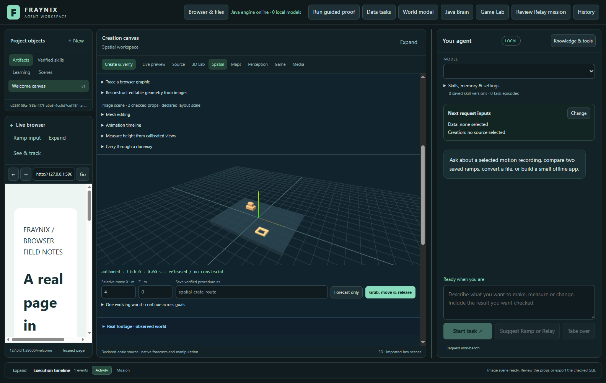
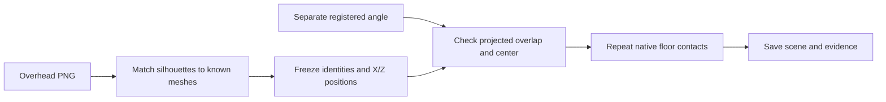
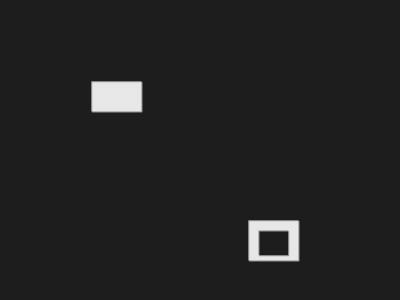
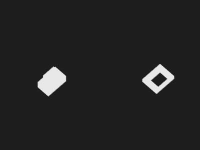
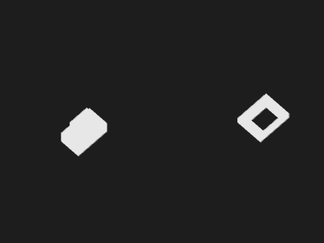
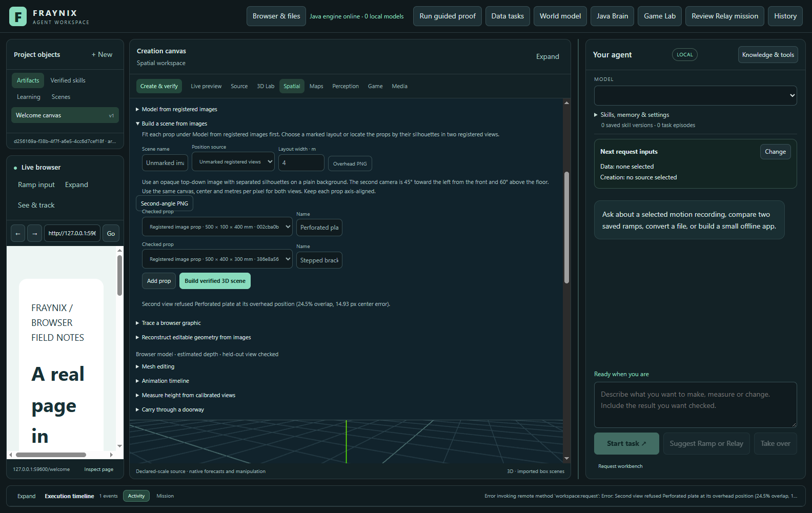
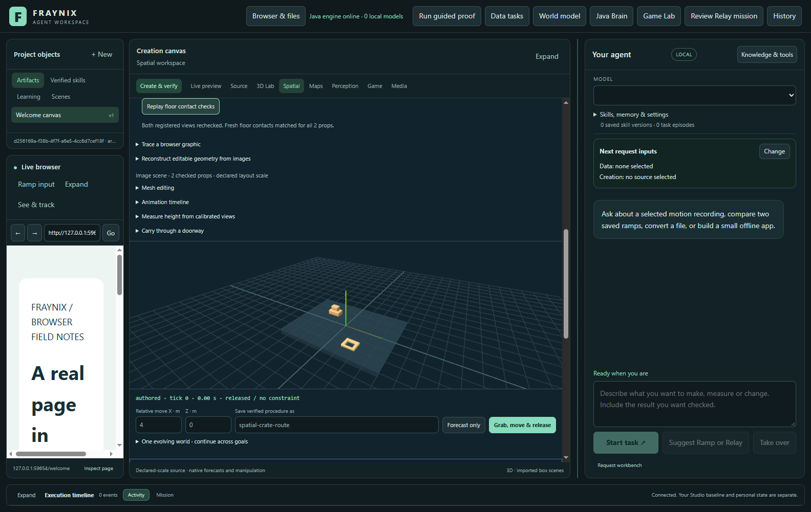

# Edition 248 — Locate unmarked props and verify their positions from a second view

2026-11-25 · [Edition 247](README-247.md) · [Offline walkthrough](docs/readmes/248/index.html) · [Full history](docs/readmes/INDEX.md)

Fraynix locates previously reconstructed 3D props by shape in an unmarked overhead image. It freezes each prop's identity and floor position, then projects the meshes into a separate oblique image. The scene is saved after every position passes the second-angle check and the existing native floor tests.

## Try it

1. Use **Spatial → Model from registered images** to fit and check each prop from [the bracket and plate source views](README-247.md#try-it-offline).
2. Open **Spatial → Build a scene from images**. Set **Position source** to **Unmarked registered views** and select the two checked models. For the sample, enter **4 m** and attach the [overhead PNG](docs/readmes/248/overhead.png) and [second-angle PNG](docs/readmes/248/second-angle.png).
3. Choose **Build verified 3D scene**. The result shows the accepted overlap in the second image. After restart, reopen the scene and use **Replay floor contact checks** to recheck the images and rerun physics.
4. Choose **Export GLB** under **Scene exchange and image blueprints** to open the result in Blender. Both visual meshes remain separate from their collider boxes.

| Unmarked overhead | Independent second angle | Shifted control |
| --- | --- | --- |
|  |  |  |

## Measured results

Blender authored the independent scene at known coordinates. The desktop test selected the props in reverse image order. The algorithm used shape and scale to associate them.

| Prop | Estimated X, Z | Floor position error | Overhead overlap | Second-view overlap | Second-view center error |
| --- | ---: | ---: | ---: | ---: | ---: |
| Perforated plate | (+0.74, +0.91) m | 0.0 mm | 89.7% | 92.4% | 0.04 px |
| Stepped bracket | (-0.84, -0.54) m | 14.1 mm | 95.0% | 92.4% | 1.26 px |

Moving the plate by 16 cm on X and −4 cm on Z in the second image lowered its match to **24.5%** and shifted the projected center by **14.93 px**. Fraynix refused the scene. It also refused a reused overhead image and an ambiguous repeated mesh. After restart, a replaced second-angle file blocked replay and GLB export. Restoring the original bytes recovered the same scene and contact results.

Both props contacted the floor at tick 46 during the 240-tick drop tests. Blender independently reopened the verified GLB with both models and their separate boxes. The sample used rendered input, a known scale, and fixed orthographic camera geometry. To reproduce the setup, use a plain contrasting background, separated axis-aligned props, and identical image dimensions and metres per pixel. The overhead image center is the floor origin, with +X to the right and +Z down. Place the second camera 45° toward the left from the front and 60° above the floor, aimed at the floor center.

[Reproduction](docs/publication248/plan.md) · [Measured evidence](docs/readmes/248/image-assembly-evidence.json) · [Scene JSON](docs/readmes/248/image-workshop.json) · [GLB](docs/readmes/248/image-workshop.glb) · [Blender readback](docs/readmes/248/blender-readback.json) · [File tree](docs/readmes/248/FILE_TREE.md) · [Obsidian map](docs/obsidian/256-unmarked-image-registration.canvas)
