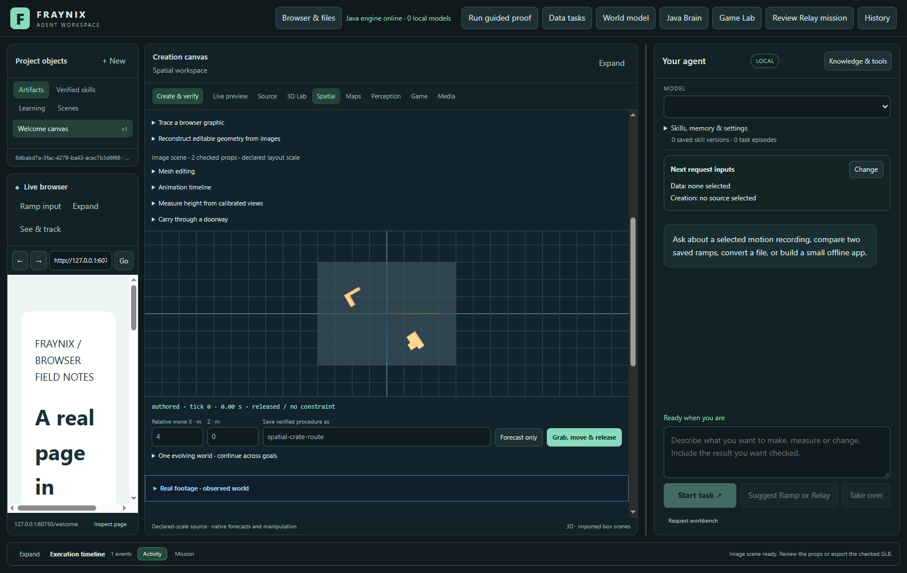
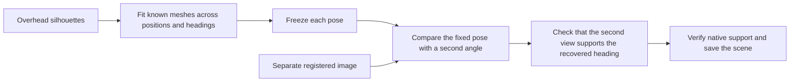
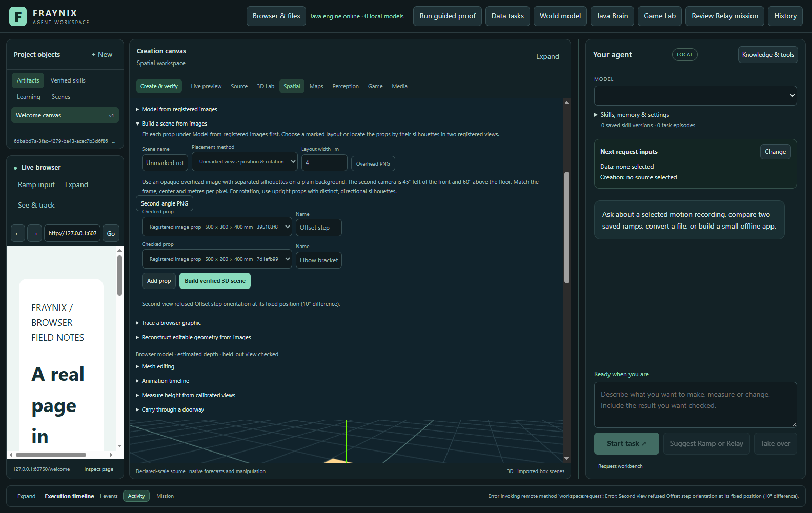
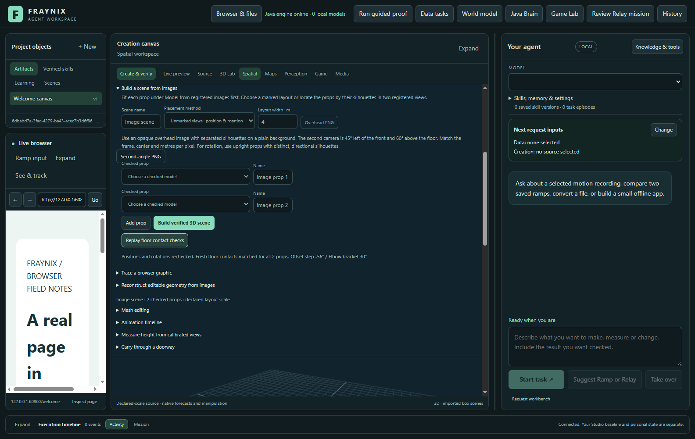

# Edition 249 — Recover and verify prop rotation from unmarked images

2026-11-25 · [Edition 248](README-248.md) · [Offline walkthrough](docs/readmes/249/index.html) · [Full history](docs/readmes/INDEX.md)

Fraynix can recover the floor position and heading of upright props from an unmarked overhead image. It freezes each pose, then checks it against a separate registered view. The checked scene uses the recovered angles for the editable visual meshes and their independent physics colliders.

## Try it

1. Fit and check the props under **Spatial → Model from registered images**. The sample uses the [elbow images](workspace-desktop/test/fixtures/image-yaw/elbow) and [offset step images](workspace-desktop/test/fixtures/image-yaw/step) with a front width of **0.50 m**, the top view included, and the elevated witness set to **60° above**.
2. Open **Spatial → Build a scene from images** and choose **Unmarked views · position & rotation**. Select the two checked models. Enter **4 m**, load the [overhead PNG](docs/readmes/249/overhead.png) and the [second-angle PNG](docs/readmes/249/second-angle.png), then choose **Build verified 3D scene**.
3. Review the recovered headings in the results. After restart, reopen the scene and choose **Replay floor contact checks** to recheck both images and rerun native physics.
4. Under **Scene exchange and image blueprints**, choose **Export GLB** to open the adjusted meshes and boxes in Blender.

## Measured result

Blender authored two asymmetric props at off-grid positions and headings. The desktop test selected them in reverse image order. The second-angle search checked heading at the fixed overhead position, so it could expose a turned prop without moving the estimate.

| Prop | Blender reference yaw | Overhead estimate | Second-view yaw | Floor position error | Second-view overlap |
| --- | ---: | ---: | ---: | ---: | ---: |
| Offset step | -55° | -56° | -56° | 5.0 mm | 97.2% |
| Elbow bracket | +31° | +30° | +30° | 5.0 mm | 95.1% |

The test refused a **10° rotation-only change** with the prop center fixed, and a separate **14 cm translation-only change**. It also refused a symmetric footprint with ambiguous headings. After restart, replacing the saved second image blocked replay and export. Restoring the original image reproduced the scene and exact GLB bytes.

Both props contacted the floor at tick 46. The greatest recorded change in orientation after the native drop was **0.028°**. Blender **4.5.17 LTS** independently reopened the GLB with both rotated colliders and separate visual meshes. Fraynix reimported the GLB and checked mesh topology and transforms within its geometry tolerance.

## Input conditions

The test uses rendered orthographic images, known scale, separated silhouettes and a plain contrasting background. Both views use the same dimensions, center and metres per pixel. The second camera sits 45° left of the front and 60° above the floor. The selected model supplies the prop's shape and upright orientation. This edition estimates yaw around the vertical axis. A tilted or partly hidden prop needs more evidence. The earlier color-marker and position-only modes remain available.

[Reproduction](docs/publication249/plan.md) · [Measured evidence](docs/readmes/249/image-assembly-evidence.json) · [Rotation-only input](docs/readmes/249/rotated-second-angle.png) · [Translation-only input](docs/readmes/249/shifted-second-angle.png) · [Scene JSON](docs/readmes/249/image-workshop.json) · [GLB](docs/readmes/249/image-workshop.glb) · [Blender readback](docs/readmes/249/blender-readback.json) · [File tree](docs/readmes/249/FILE_TREE.md) · [Obsidian map](docs/obsidian/257-image-pose-registration.canvas)
