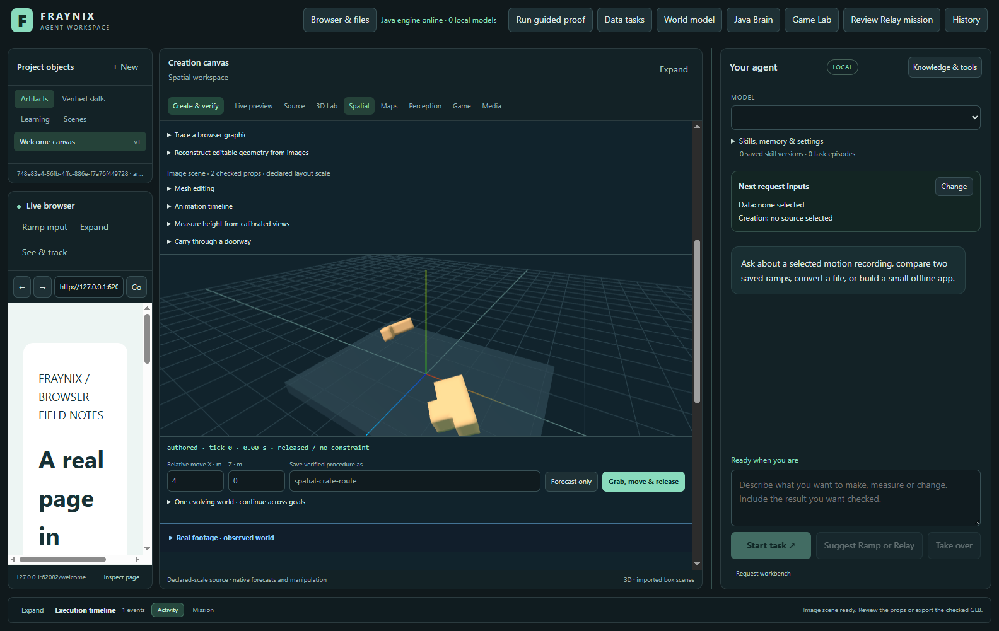
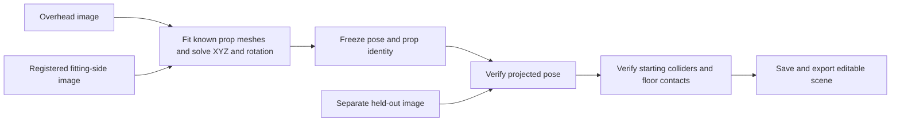
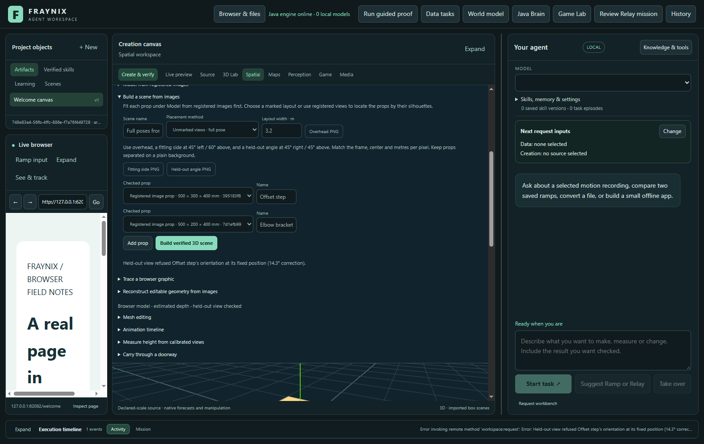
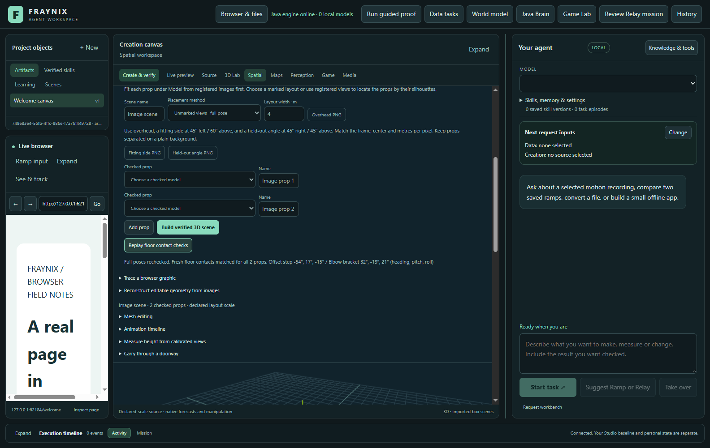

# Edition 250 — Recover full prop poses from unmarked images

2026-11-25 · [Edition 249](README-249.md) · [Offline walkthrough](docs/readmes/250/index.html) · [Full history](docs/readmes/INDEX.md)

Spatial can place known props from unmarked images even when they lean, roll or start above the floor. Java recovers 3D position, heading, pitch and roll from the overhead and fitting-side images. A third image checks the resulting pose before the workspace saves an editable scene with separate visual meshes and colliders.

## Try the sample

1. In **Spatial → Model from registered images**, fit and check each prop. Use the [elbow images](workspace-desktop/test/fixtures/image-yaw/elbow) and [offset step images](workspace-desktop/test/fixtures/image-yaw/step). Set front width to **0.50 m**, include the top view and set the elevated model-check view to **60°**.
2. Open **Spatial → Build a scene from images**. Choose **Unmarked views · full pose**, select both checked models, and enter **3.2 m** for the scene width.
3. Load the [overhead view](docs/readmes/250/overhead.png), [fitting-side view](docs/readmes/250/fitting-side.png) and [held-out view](docs/readmes/250/held-out.png). Choose **Build verified 3D scene**. The status line shows the heading, pitch and roll of each prop.
4. Reopen the scene after restart and choose **Replay floor contact checks**. Use **Scene exchange and image blueprints → Export GLB** to open the editable geometry and collider boxes in Blender.

## What the test measured

Blender placed two asymmetric props at independent off-grid positions and three-axis orientations. The test supplied the models to the app in reverse order. It compared the whole quaternion with Blender's reference, so the rotation error reflects the full orientation.

| Prop | Recovered heading / pitch / roll | Blender reference | 3D position error | Full rotation error | Held-out overlap | Floor contact tick |
| --- | --- | --- | ---: | ---: | ---: | ---: |
| Offset step | -54° / +17° / -15° | -53° / +17° / -13° | 5.4 mm | 1.96° | 98.1% | 56 |
| Elbow bracket | +32° / -19° / +21° | +33° / -17° / +21° | 1.9 mm | 2.24° | 93.7% | 60 |

The held-out angle refused a **16° pitch change** at the same position and heading. It also refused a **9 cm height change** with the same rotation and a copy of the fitting-side image. The 16° input led the witness search to report a 14.3° correction at the fixed position.

After a desktop and Java restart, the scene restored the full-pose mode, repeated native contacts and reproduced the same GLB bytes. Replay and export refused modified fitting and held-out images. The app also refused a changed input from the original checked model. Restoring the source bytes restored replay and export.

The native trials released both colliders from their saved poses, recorded contact, and settled them on the floor. The tilted props visibly rotate on release. The exported scene retains the observed starting poses. Blender 4.5.17 LTS reimported both visual meshes and distinct collider boxes. Its largest orientation difference from the exported collider transform was **0.000017°**. That number measures the export round trip. The table measures recovery from images.

## Supported inputs

Use calibrated, equal-size orthographic PNGs of the same stationary arrangement. The fitting camera is **45° left of front and 60° above the floor**. The held-out camera is **45° right and 45° above**. All images share a center and scale, with at least **40 pixels per metre**. Props need separate, contrasting silhouettes and previously checked models. The search covers a full heading turn and pitch and roll from **−30° to +30°**. The height comes from side-view displacement with known scale.

The test uses Blender renders. Perspective photos, unknown camera placement, touching silhouettes and physical camera accuracy remain outside this validation. Color-marker, position-only and upright-heading modes passed their desktop regression tests.

[Reproduction](docs/publication250/plan.md) · [Measured evidence](docs/readmes/250/pose-verification.json) · [Tilt-only input](docs/readmes/250/wrong-tilt.png) · [Height-only input](docs/readmes/250/wrong-height.png) · [Scene JSON](docs/readmes/250/image-workshop.json) · [GLB](docs/readmes/250/image-workshop.glb) · [Blender readback](docs/readmes/250/blender-readback.json) · [File tree](docs/readmes/250/FILE_TREE.md) · [Obsidian map](docs/obsidian/258-image-tilt-registration.canvas)
