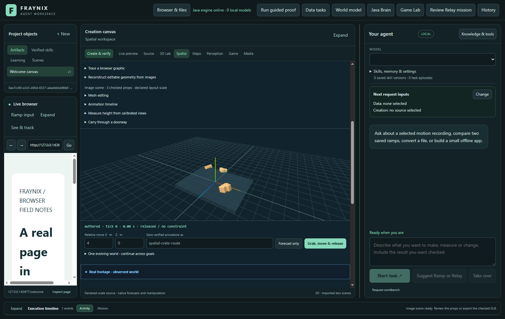
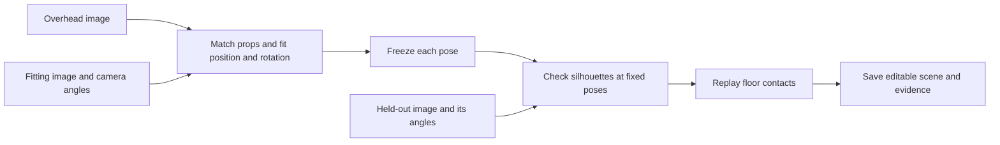
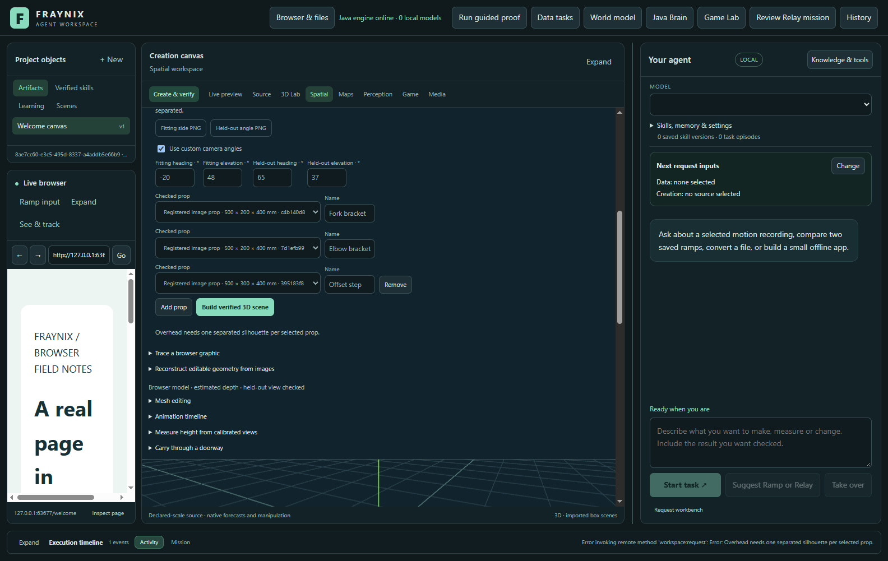
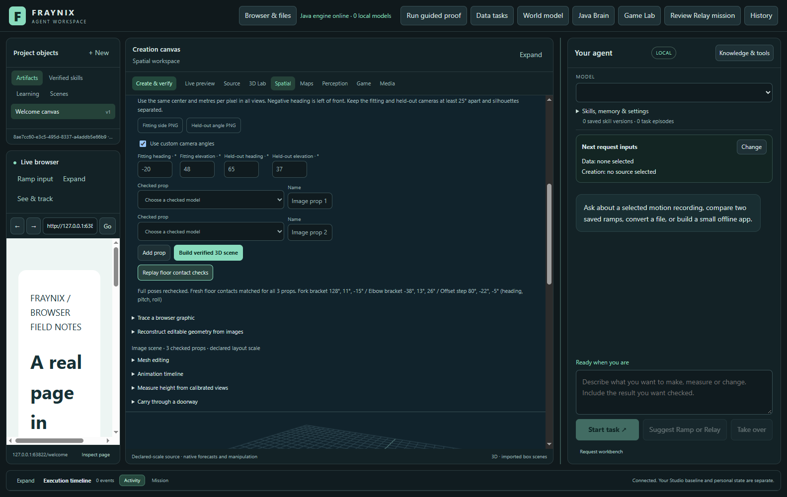

# Edition 251 — Verify three prop poses with custom camera angles

2026-11-25 · [Edition 250](README-250.md) · [Offline walkthrough](docs/readmes/251/index.html) · [Full history](docs/readmes/INDEX.md)

Spatial can now use custom camera headings and elevations to recover the 3D position and rotation of known props. The new test uses three Blender-authored shapes, new placements and camera angles, and an independently rendered image that checks the fixed poses. Each saved prop has an editable mesh and a separate physics collider.

## Try the sample

1. In **Spatial → Model from registered images**, fit the [fork](workspace-desktop/test/fixtures/image-pose-survey/fork), [elbow](workspace-desktop/test/fixtures/image-yaw/elbow) and [step](workspace-desktop/test/fixtures/image-yaw/step) props. Set each front width to **0.50 m**, include the top image and set the model-check camera elevation to **60°**.
2. In **Spatial → Build a scene from images**, select **Unmarked views · full pose**, add a third prop, select all three checked shapes and set layout width to **3.6 m**.
3. Enable **Use custom camera angles**. Set the fitting camera to heading **−20°**, elevation **48°** and the held-out camera to heading **+65°**, elevation **37°**. Load the [overhead image](docs/readmes/251/overhead.png), [fitting-side image](docs/readmes/251/fitting-side.png) and [held-out image](docs/readmes/251/held-out.png), then choose **Build verified 3D scene**.
4. Reopen the saved scene after restart and choose **Replay floor contact checks**. Use **Export GLB** under **Scene exchange and image blueprints** to open the saved transforms, meshes, and colliders in Blender.

## What the test measured

The desktop matched all three shapes in a different order from the Blender reference. The full-rotation error compares the entire recovered quaternion with the authored orientation.

| Prop | Recovered heading / pitch / roll | 3D position error | Full rotation error | Held-out overlap | Floor contact tick |
| --- | --- | ---: | ---: | ---: | ---: |
| Fork bracket | +128° / +11° / -15° | 5.2 mm | 2.06° | 94.9% | 58 |
| Elbow bracket | -38° / +13° / +26° | 5.3 mm | 3.37° | 89.1% | 68 |
| Offset step | +80° / -22° / -5° | 3.5 mm | 2.13° | 97.2% | 63 |

Four inputs were refused before a scene was saved. Two merged overhead silhouettes could not be assigned to individual props. A symmetric block admitted two indistinguishable orientations. Nearly coincident cameras failed the minimum 25° separation. A held-out image rendered from the wrong camera failed the fixed-pose check, with 30.7% overlap for the fork.

After restart, the desktop restored all four camera values, reran floor contacts, and exported the same GLB bytes. Replacing the retained held-out image blocked export and replay. Restoring its exact bytes restored both. Blender 4.5.17 LTS independently reopened all three colliders and the visual meshes. The edition 250 preset fixture still produces its original scene JSON and GLB bytes.

## Input conditions

All images need the same center, orthographic scale and dimensions. Use opaque PNGs with separated, contrasting silhouettes and checked prop models. Heading is measured around the vertical axis, with negative values left of front. Custom camera elevations range from **25° to 70°**. Prop pitch and roll remain bounded to **±30°**. The evidence here comes from rendered images. The test demonstrates refusal when an occlusion merges the silhouettes, and recovery from everyday perspective photos remains unvalidated.

[Reproduction](docs/publication251/plan.md) · [Measured evidence](docs/readmes/251/pose-survey.json) · [Scene JSON](docs/readmes/251/image-workshop.json) · [GLB](docs/readmes/251/image-workshop.glb) · [Blender readback](docs/readmes/251/blender-readback.json) · [File tree](docs/readmes/251/FILE_TREE.md) · [Obsidian map](docs/obsidian/259-custom-camera-pose.canvas)
