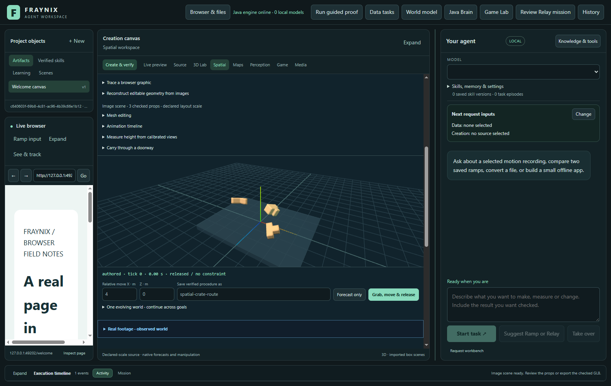
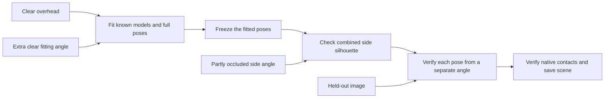
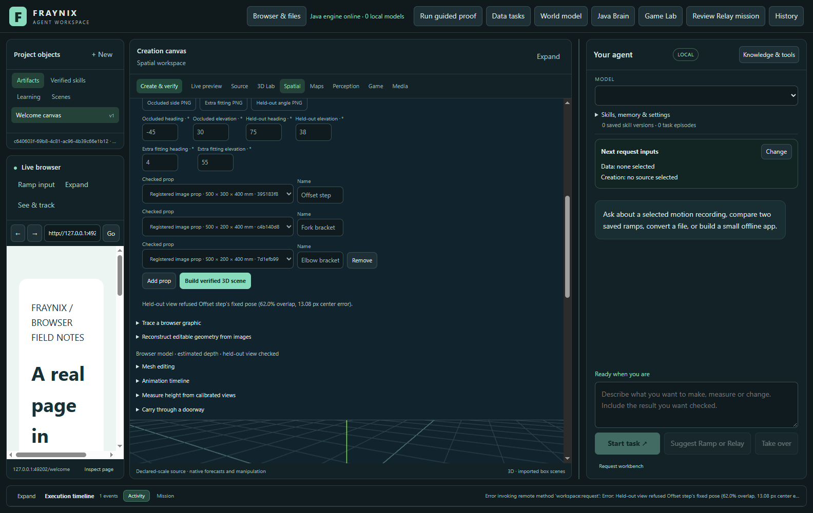
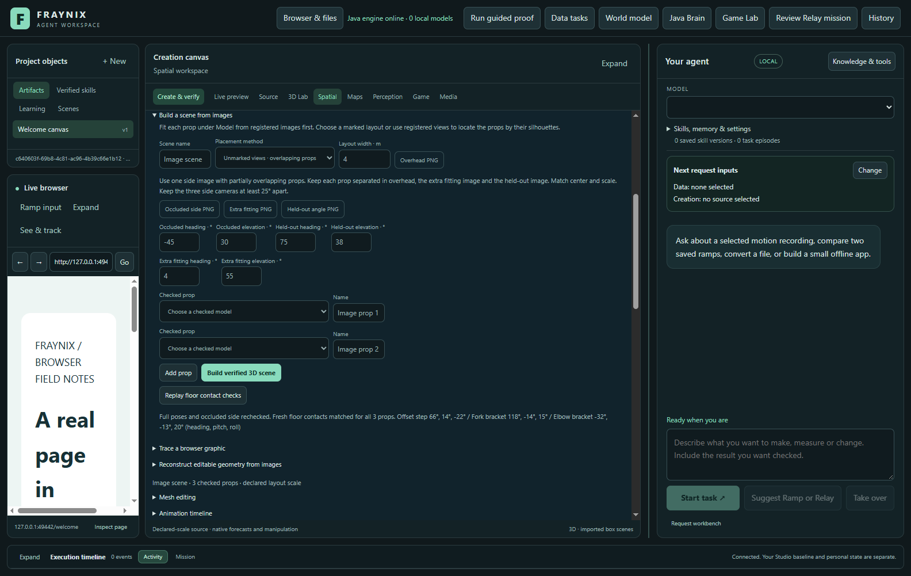

# Edition 252 — Recover partly occluded props with an extra view

2026-11-25 · [Edition 251](README-251.md) · [Offline walkthrough](docs/readmes/252/index.html) · [Full history](docs/readmes/INDEX.md)

Spatial can now recover known props when one partially hides another in the original side view. Java fits each prop from the clear overhead and extra side images. It reprojects the fixed poses into the partly occluded image and checks the visible silhouette. A separate held-out view then verifies each prop individually before the app saves the editable meshes and colliders.

## Try the sample

1. In **Spatial → Model from registered images**, check the [elbow](workspace-desktop/test/fixtures/image-yaw/elbow), [step](workspace-desktop/test/fixtures/image-yaw/step) and [fork](workspace-desktop/test/fixtures/image-pose-survey/fork). Use **0.50 m** front width, include the top image, and set the model-check elevation to **60°**.
2. In **Spatial → Build a scene from images**, choose **Unmarked views · overlapping props**, select the three checked models, and set the layout width to **4 m**.
3. Load the [overhead image](docs/readmes/252/overhead.png), [partly occluded side](docs/readmes/252/occluded-side.png), [extra fitting angle](docs/readmes/252/extra-fitting.png) and [held-out angle](docs/readmes/252/held-out.png). Enter the following headings and elevations.

| Side camera | Heading | Elevation |
| --- | ---: | ---: |
| Partly occluded | −45° | 30° |
| Extra fitting | +4° | 55° |
| Held-out | +75° | 38° |

4. Choose **Build verified 3D scene**. Reopen it after restart and choose **Replay floor contact checks**. Export the editable scene from **Scene exchange and image blueprints → Export GLB**.

## What the test measured

Blender rendered each prop alone at the occluded camera to establish how much of the rear step was obscured by the elbow in the combined render. **42.2% of the rear step’s silhouette was hidden**. Java projected all three recovered poses into that side image and matched the combined mask with **96.0% intersection over union**. The earlier three-view mode refused that same input because the fitting side showed two connected components for three props.

| Prop | 3D position error | Full rotation error | Extra-view overlap | Held-out overlap | Floor contact tick |
| --- | ---: | ---: | ---: | ---: | ---: |
| Offset step | 3.2 mm | 1.58° | 97.6% | 96.6% | 65 |
| Fork bracket | 3.5 mm | 5.10° | 92.9% | 94.5% | 63 |
| Elbow bracket | 0.5 mm | 1.25° | 96.8% | 96.0% | 107 |

The app refused an incomplete extra-image setup, a side image that omitted the rear prop, a held-out image that moved the rear prop by **14 cm**, and an extra image reused as the held-out view. The 14 cm change was refused even though the first three inputs were unchanged.

After restart, the app restored the method and six camera values, recomputed the pose and side checks, repeated the native floor contacts, and reproduced the exact GLB. Replacing the occluded, extra, or held-out image blocked replay and export. Blender 4.5.17 LTS independently reimported all three editable visual meshes and full collider transforms. Edition 251’s custom-camera fixture reproduced its published scene JSON and GLB bytes.

## Supported inputs

Use a stationary, registered orthographic scene with known scale, common center and equal image size. Prop silhouettes must be separate in the overhead, extra fitting, and held-out images. A partial overlap is supported in the remaining side image. The three side cameras need at least **25°** between their viewing directions. The study uses calibrated Blender renders. A prop hidden in every fitting view, perspective photos, or an unknown camera layout still needs additional evidence and a different reconstruction path.

[Reproduction](docs/publication252/plan.md) · [Measured evidence](docs/readmes/252/occlusion-verification.json) · [Missing rear prop test](docs/readmes/252/missing-rear.png) · [Displaced held-out test](docs/readmes/252/wrong-held-out.png) · [Scene JSON](docs/readmes/252/image-workshop.json) · [GLB](docs/readmes/252/image-workshop.glb) · [Blender readback](docs/readmes/252/blender-readback.json) · [File tree](docs/readmes/252/FILE_TREE.md) · [Obsidian map](docs/obsidian/260-partial-occlusion-recovery.canvas)
