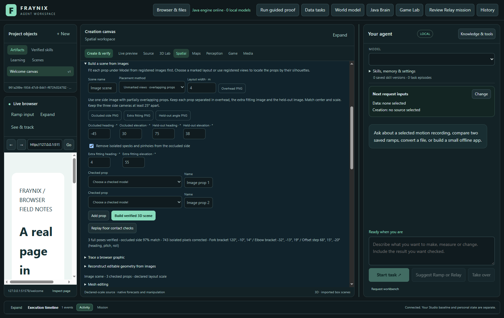
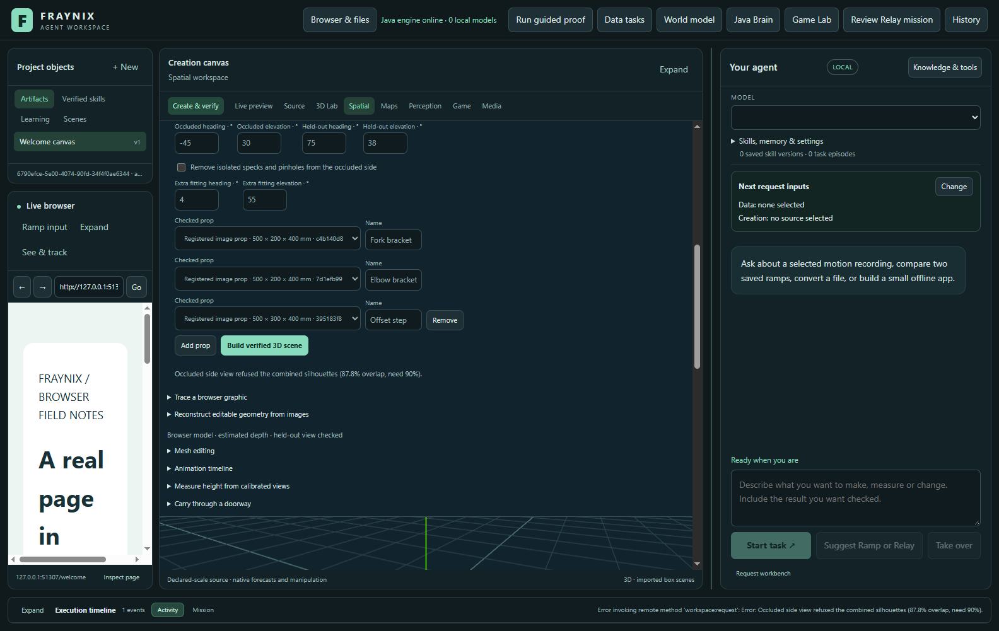

# Edition 253 — Recover overlapping props with noisy side masks

2026-11-25 · [Edition 252](README-252.md) · [Offline walkthrough](docs/readmes/253/index.html) · [Full history](docs/readmes/INDEX.md)

Spatial can correct isolated bright specks and dark pinholes in the partly occluded side image. The overhead and extra fitting images establish the initial pose. Visible parts of the corrected side image can refine the orientation. The original held-out image independently verifies each fixed pose before the app saves editable meshes and separate colliders.

## Try the sample

1. In **Spatial → Model from registered images**, check the [elbow](workspace-desktop/test/fixtures/image-yaw/elbow), [step](workspace-desktop/test/fixtures/image-yaw/step) and [fork](workspace-desktop/test/fixtures/image-pose-survey/fork). Use **0.50 m** front width, include the top PNG, and set the model-check elevation to **60°**.
2. Open **Spatial → Build a scene from images**, choose **Unmarked views · overlapping props**, select the three checked models, and enter **4 m** for layout width.
3. For the first case, load the [overhead](workspace-desktop/test/fixtures/image-occlusion-noise/step-behind-elbow/overhead.png), [noisy side](docs/readmes/253/occluded-noisy.png), [extra fitting](docs/readmes/253/extra-fitting.png) and [held-out](docs/readmes/253/held-out.png) PNGs. Enter the camera headings and elevations below.
4. Enable **Remove isolated specks and pinholes from the occluded side** and choose **Build verified 3D scene**. Reopen the scene and choose **Replay floor contact checks** to verify after restart.

| Camera | Heading | Elevation |
| --- | ---: | ---: |
| Occluded side | −45° | 30° |
| Extra fitting | +4° | 55° |
| Held-out | +75° | 38° |

## Measured results

Four Blender scenes covered three distinct overlapping pairs. The elbow and step swapped front and rear positions. Blender rendered each mesh separately to measure the rear silhouette hidden by the front mesh. A deterministic process then injected isolated foreground specks and background pinholes into the side mask.

| Depth order | Rear silhouette hidden | Isolated pixels corrected | Side overlap before → after cleanup | Rear position error | Rear rotation error | Rear contact tick |
| --- | ---: | ---: | ---: | ---: | ---: | ---: |
| step behind elbow | 43.1% | 743 | 89.9% → 97.4% | 1.2 mm | 1.00° | 65 |
| elbow behind step | 43.0% | 788 | 90.6% → 98.3% | 4.5 mm | 1.00° | 67 |
| step behind fork | 53.9% | 733 | 89.2% → 96.9% | 4.6 mm | 1.41° | 63 |
| fork behind elbow | 41.6% | 762 | 90.1% → 97.9% | 4.7 mm | 1.41° | 64 |

The before-and-after mask columns compare both masks against the same recovered projection. Across all twelve prop poses, the largest errors were **8.3 mm** in 3D position and **1.41°** in rotation. The earlier preset refused the noisy first input. Excess noise and a missing rear prop were refused with cleanup enabled.

The held-out view rejected a **14 cm** rear-prop displacement in each of the four scenes. Reusing a fitting image as the witness was refused. A bright isolated speck in the held-out image also caused refusal, since side cleanup never alters that image.

After restart, every scene reproduced its pose evidence, native contacts and exact GLB bytes. Changing the retained noisy image to its clean counterpart blocked replay and export until the original was restored. Blender 4.5.17 LTS independently reopened all four scenes with all three visual meshes and colliders. The edition 252 fixture reproduced its published JSON and GLB bytes.

## Supported inputs

This test uses calibrated orthographic Blender images. The overhead, extra fitting and held-out views need separated silhouettes. The opt-in cleanup affects isolated single pixels only. Coherent changes such as a missing prop still face the same overlap and individual pose checks.

[Reproduction](docs/publication253/plan.md) · [Full measured evidence](docs/readmes/253/noisy-occlusion-evidence.json) · [Source scenes and controls](workspace-desktop/test/fixtures/image-occlusion-noise) · [Sample GLB](docs/readmes/253/step-behind-elbow/image-workshop.glb) · [Blender verification](docs/readmes/253/step-behind-elbow/blender-readback.json) · [File tree](docs/readmes/253/FILE_TREE.md) · [Obsidian map](docs/obsidian/261-noisy-occlusion-validation.canvas)
