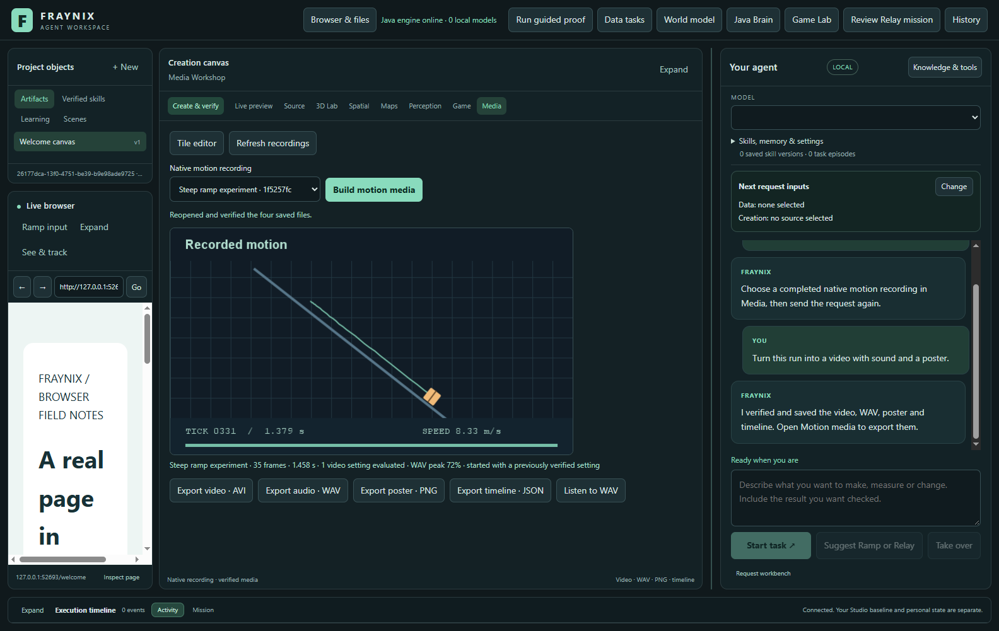

# Edition 254 — Create verified motion media without a language model

2026-11-25 · [Edition 253](README-253.md) · [Offline walkthrough](docs/readmes/254/index.html) · [Full history](docs/readmes/INDEX.md)

A saved native physics run now produces four usable files from one timeline. Java draws the observed motion, translates measured speed into a synthesized sound, qualifies the video settings, and verifies the files before saving. The desktop works offline with zero models enabled.

## Try it

1. Record and finish a native ramp run in **3D Lab**. Open **Media → Motion media** and select the completed recording.
2. Choose **Build motion media**, or ask chat **“Turn this run into a video with sound and a poster.”**. With several recordings and no selection, the app asks you to choose one.
3. Inspect the PNG and listen to the WAV in the workspace. Export the AVI, WAV, PNG or timeline JSON. Exports keep the source citation and verified file hash in their receipts.
4. Reopen **Motion media** after restarting the desktop. The app rechecks the recording and the four retained outputs before offering them again.

| Output | Contents |
| --- | --- |
| [AVI](docs/readmes/254/steep/motion.avi) | 640 × 360 Motion JPEG video at 24 fps, with synchronized 24 kHz mono PCM |
| [WAV](docs/readmes/254/steep/motion.wav) | The same PCM audio as a standalone track |
| [PNG](docs/readmes/254/steep/motion.png) | A still at the highest measured speed on the rendered timeline |
| [JSON](docs/readmes/254/steep/motion.json) | Source identity, timed SI measurements, encoder trials and sound evidence |

## What improved

The first run evaluated two JPEG settings. The lower setting missed the 36 dB decoded-frame floor on the sampled frames. The stronger setting passed. After a full restart, Java tried that previously verified setting first on a fresh steeper run and checked it against three fresh video frames. The second run passed in one trial. This measures the number of trial encodes. It leaves total workflow timing and compression optimality open.

| Native recording | Video frames | Playback duration | Encoder trials | Worst passing check | Audio samples over full scale before → after gain |
| --- | ---: | ---: | ---: | ---: | ---: |
| Shallow | 19 | 0.792 s | 2 | 38.10 dB | 1,444 → 0 |
| Steep | 35 | 1.458 s | 1 | 38.01 dB | 13,742 → 0 |

The sound renderer recomputed gain from each recording and brought both tracks to 72% peak. FFmpeg decoded both videos and confirmed that their PCM was byte-identical to the separately exported WAV. Blender 4.5.17 LTS imported both as editable video and audio strips with matching frame lengths. Restart reproduced the four file hashes for both recipes. Changing one byte in a retained WAV blocked export. Restoring the exact file restored export.

## Engine direction

This first workflow uses motion observed in the native physics engine. The [implementation plan](docs/publication254/plan.md) traces how the same timeline, renderer and verifier boundary can expand to image sequences, authored audio, editable multi-track clips and scenes.

[Measured evidence](docs/readmes/254/media-evidence.json) · [Independent FFmpeg checks](docs/readmes/254/independent-decode.json) · [Blender timeline checks](docs/readmes/254/blender-timeline.json) · [Both media packages](docs/readmes/254/FILE_TREE.md)
