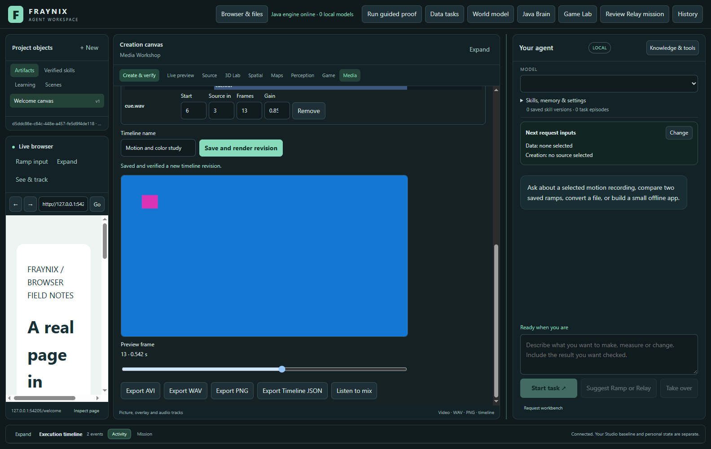
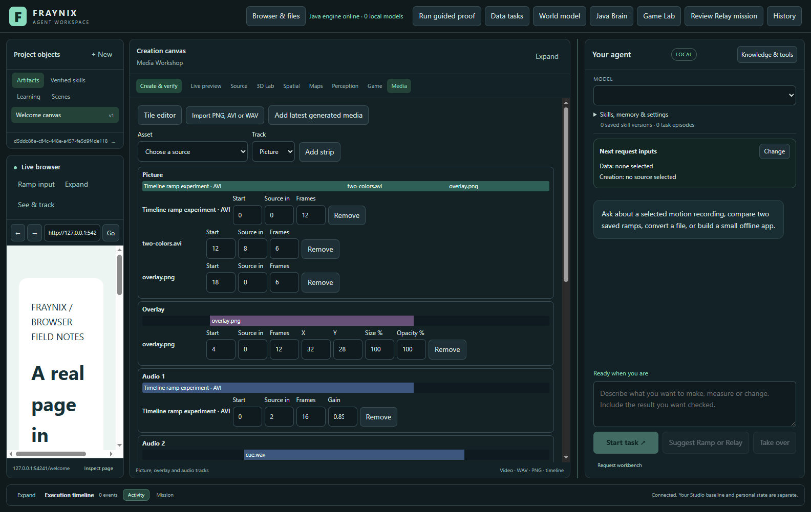

# Edition 255 — Edit and verify a multi-track media timeline

2026-11-25 · [Edition 254](README-254.md) · [Offline walkthrough](docs/readmes/255/index.html) · [Full history](docs/readmes/INDEX.md)

**Media → Timeline** can edit imported video, PNG images, and audio alongside material generated by the Java engine. The editor has one picture lane, one transparent PNG overlay lane, and two audio lanes. You can trim a clip, place it at an exact frame, move or resize the overlay, and mix the sound. Rendering creates a checked revision with video, audio, poster, and editable timeline JSON.

## Use it

1. Open **Media → Timeline** and import PNG, MJPEG AVI, or mono PCM WAV. Use **Edit on timeline** from a verified Motion media package to add its video, sound, and poster with their original evidence.
2. Select an asset and track, then choose **Add strip**. **Start** is the destination frame, **Source in** is the trim point, and **Frames** is the strip length. The editor uses a 24 fps clock. Use **Gain** on audio and **X**, **Y**, **Size %**, or **Opacity %** on overlays.
3. Choose **Save and render revision**. Scrub the rendered video by frame, listen to the mixed WAV, and export AVI, WAV, PNG, or timeline JSON.
4. Reopen after restart to keep editing. Choose **Open previous revision** to inspect or export the preceding edit with its original bytes.

## What the test proved

The test combined a real Java physics clip, an independently generated AVI with two colors, a transparent PNG, and an independently generated WAV. The picture changed from generated motion to the imported clip at frame **12**, and to the still at frame **18**. The overlay appeared at frame **4** and was absent starting at frame **16**. After restart, the test changed which part of the imported clip played, moved the overlay, and delayed the second audio track by three frames.

| Revision | Color at frame 12 | Decoded overlay sample X | Second audio start sample | Over-limit samples before mix gain | Export peak |
| --- | --- | ---: | ---: | ---: | ---: |
| Original | Blue | 55 px | 6,000 | 229 | 32,000 of 32,767 |
| Revised | Crimson | 151 px | 9,000 | 123 | 32,000 of 32,767 |

An independent FFmpeg test decoded all 24 frames and reconstructed all 24,000 PCM samples for each edit from its sources and trim positions. The decoded mix matched the independently reconstructed PCM byte for byte. Blender 4.5.17 LTS opened both files as 24-frame synchronized video and sound strips. The two revisions retained their exact four file hashes after restart. Editing one byte in the stored source clip blocked reopening and export, and restoring the exact source bytes restored both.

## Supported media

The editor renders at **640 × 360 and 24 fps**, with up to **6 seconds per revision**. It reads PNG, 24 fps Motion JPEG AVI, and 24 kHz mono 16-bit PCM WAV. An AVI with supported PCM can also be placed on an audio lane. The exported timeline JSON identifies the locally retained source assets by hash. The test ran offline with zero models enabled.

[Implementation and repro steps](docs/publication255/plan.md) · [Measured evidence](docs/readmes/255/timeline-evidence.json) · [Independent decode](docs/readmes/255/independent-timeline.json) · [Blender strip check](docs/readmes/255/blender-edit.json) · [Sample files](docs/readmes/255/FILE_TREE.md)
