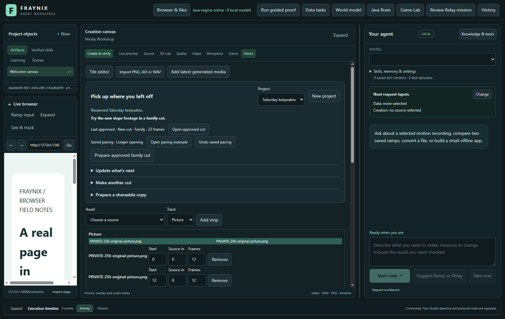
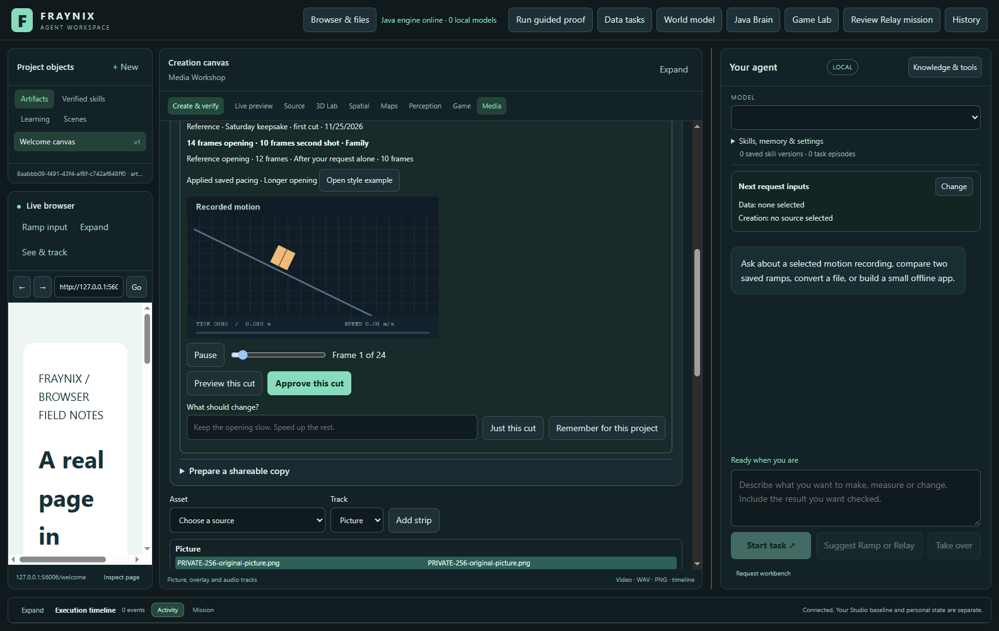
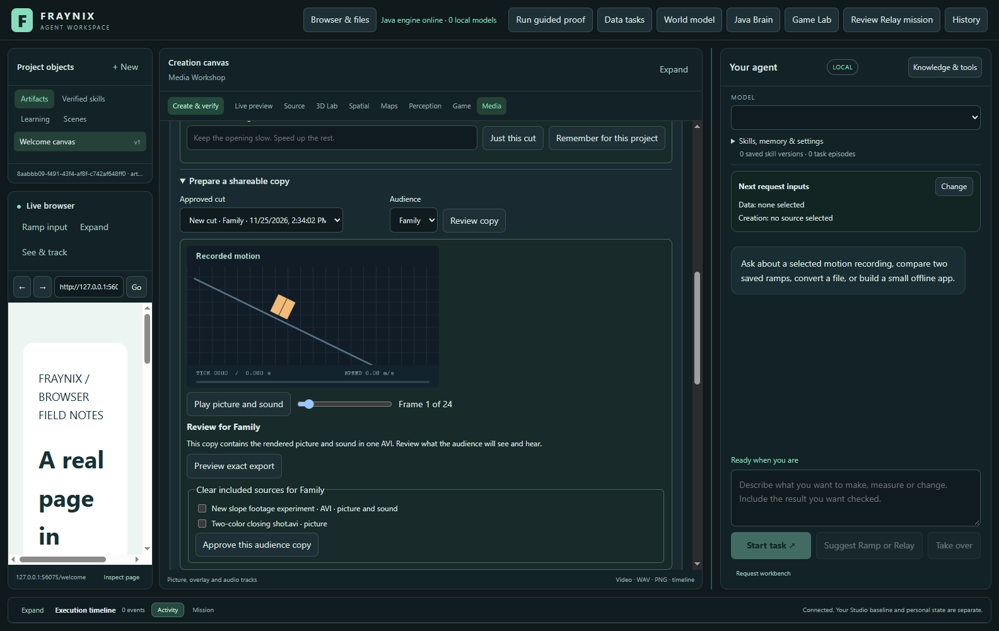

# Edition 256 — Resume a project, teach pacing and prepare an audience copy

2026-11-25 · [Edition 255](README-255.md) · [Offline walkthrough](docs/readmes/256/index.html) · [Full history](docs/readmes/INDEX.md)

Open **Media → Timeline**. **Pick up where you left off** shows your next intention, last approved cut, and any audience copy ready to open. A project keeps its style choices and pending review after a restart.

## Try it

1. Create a project, save a regular timeline edit, and select **Approve current timeline cut**.
2. In **Make another cut**, choose two fresh picture sources and optionally a sound source. Try “Make another one like the last one, a little quicker, for the family.” If several approved references fit, choose by thumbnail.
3. Review the proposed timing and play or scrub the actual cut. Try “Keep the opening slow. Speed up the rest.” **Just this cut** changes the draft. **Remember for this project** saves the opening choice when you approve the cut. The second-shot correction belongs to that cut. You can open the saved example or undo the latest choice.
4. Prepare a shareable copy, play the picture and sound, and clear each source for the selected audience. Approve and export the standalone AVI locally. A changed audience starts a new approval. The editor can still reopen the private master.

## Measured behavior

| Run on the same fresh footage | Second shot begins at zero-based frame |
| --- | ---: |
| Saved pacing disabled | 10 |
| Longer opening enabled | 14 |
| Shorter opening for this cut | 6 |
| Fresh draft after the one-off edit and restart | 14 |
| Fresh draft after saving the shorter opening and restarting | 6 |
| After undo | 14 |

The fresh footage came from a different Java physics run and an independently authored second shot. FFmpeg decoded the visible cut at frames 10 and 14. It verified every PCM sample of the audience copy against the selected fresh audio and found no video or audio container tags. The local family folder contained exactly one AVI. The test's deliberately private picture and audio were absent from the decoded result. A changed source byte blocked export, and restoring the source restored the exact approved result.

The assistant handles bounded pacing requests in Media Timeline offline. The draft uses two picture sources and optional audio. It remembers opening pace inside the current project. The handoff supports Family and Public review and produces a local AVI at 640 × 360 and 24 fps.

[Sample cuts](docs/readmes/256/FILE_TREE.md) · [Implementation and test steps](docs/publication256/plan.md) · [Measured evidence](docs/readmes/256/creative-evidence.json) · [Independent decode](docs/readmes/256/independent-creative.json)
