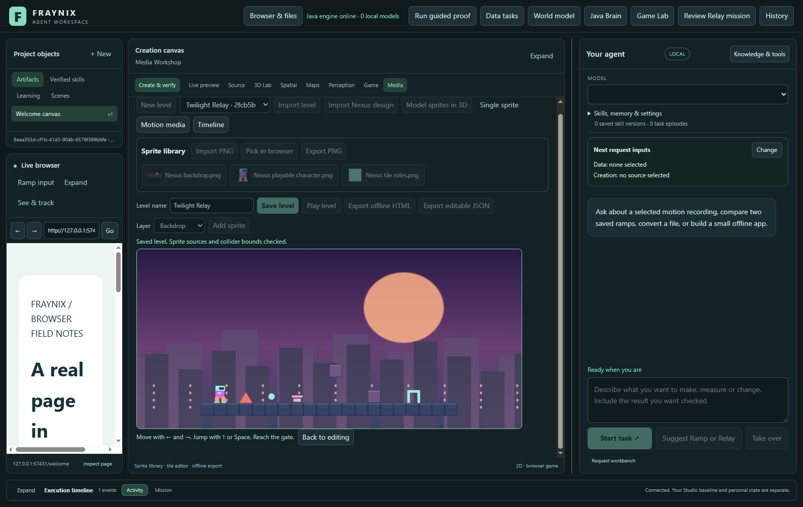
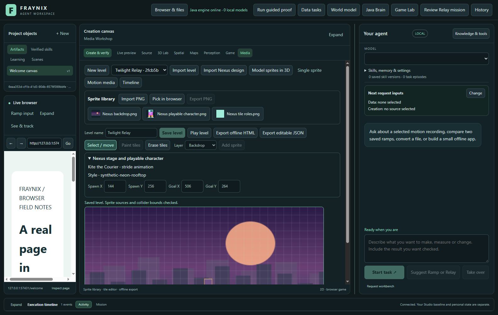
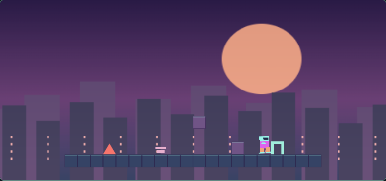

# Edition 257 — Turn a Nexus design into a playable level

2026-11-25 · [Edition 256](README-256.md) · [Offline walkthrough](docs/readmes/257/index.html) · [Full history](docs/readmes/INDEX.md)

**Media → Import Nexus design** brings a Scene to Game export into Fraynix as a playable 2D level. The palette and embedded backdrop shape the world. The playable cutout carries its movement speed, jump power and animation mode. The authored grid controls terrain collisions, hazards, pickups, springs, spawn and goal.

## Use it

1. In Nexus Engine, open **Scene to Game**, extract a 2D level grid and choose **Export WebAssembly**.
2. In Fraynix, open **Media → Import Nexus design** and pick the downloaded runner HTML. Scene graph JSON also works when it includes a 2D grid.
3. Select **Play level**. Use Left and Right to move and Space to jump. Go back to editing to change tiles, collider dimensions, spawn or goal.
4. **Export offline HTML** produces a standalone game. **Export editable JSON** saves the level and assets for another Fraynix project.

## What the tests showed

Twilight Relay used an original example character and background, 20 ground tiles, two solid bricks, one hazard, one pickup and one spring. The editor moved the goal from X 504 to X 506 and retained the original source hash. A palette change kept the same tile roles and collider geometry.

| Test run | Hazard resets | Pickups | Spring boosts | Goal reached |
| --- | ---: | ---: | ---: | :---: |
| Desktop | 1 | 1 | 1 | Yes |
| Desktop after restart | 1 | 1 | 1 | Yes |
| Standalone HTML with networking blocked | 1 | 1 | 1 | Yes |

A copy of the sample generated by the original Nexus exporter imported with the same layout. The editable bundle reproduced the exact HTML in a clean Fraynix project. The standalone game carries its own renderer and art.

This importer supports 2D grids up to 30 × 13, one playable cutout and an optional embedded PNG backdrop. A remote backdrop uses the scene palette as a fallback. The cutout plays procedural movement animation in the platform runtime. Open-world terrain, additional cast behaviors and 3D rigs need their own adapters.

[Sample source and playable download](docs/readmes/257/FILE_TREE.md) · [Implementation and test steps](docs/publication257/plan.md) · [Measured evidence](docs/readmes/257/nexus-evidence.json)
