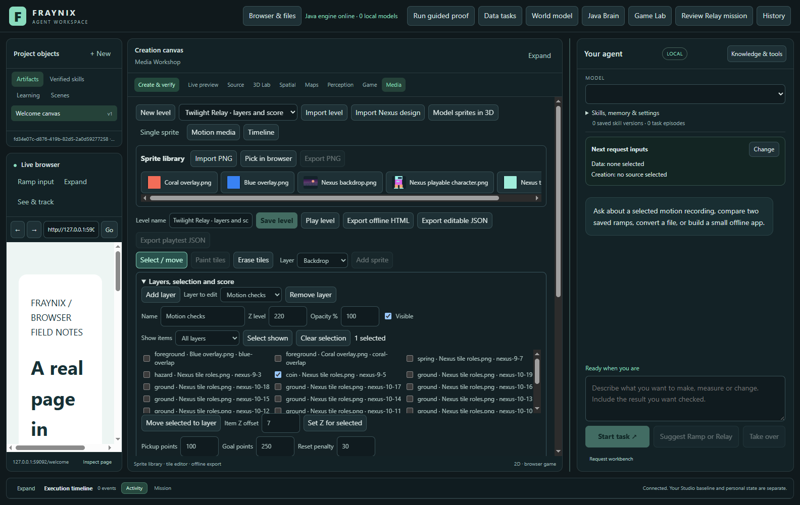
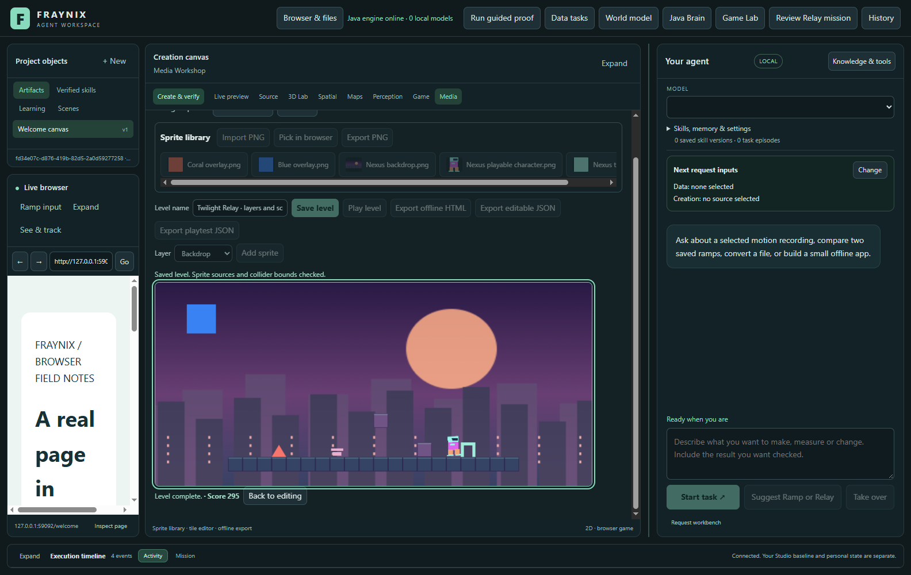
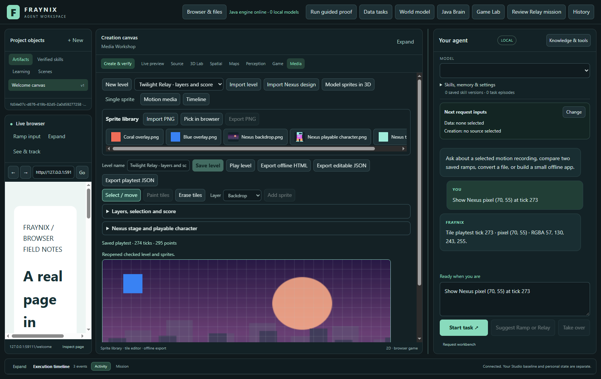

# Edition 258 — Layer, score and inspect playable scenes at every tick

2026-11-25 · [Edition 257](README-257.md) · [Offline walkthrough](docs/readmes/258/index.html) · [Full history](docs/readmes/INDEX.md)

Open **Media → Layers, selection and score** on an existing level. Create visual layers with names, opacity, visibility and Z order. Select items from the list or Shift-click them on the stage. Assign the selection to a layer or set its item Z offset in one edit. Editing visual order preserves the tile's collision and gameplay role.

## Set the score

Set default pickup points, goal points and a reset penalty. Select a pickup to override its points. A pickup can be collected again after a reset and only earns points once per run. The score appears in the editor playtest and the standalone game.

## Read the scene and playtest

- **`tile.level`** reads saved layer settings, geometry, colliders, scoring rules and asset IDs.
- **`tile.ticks`** reads the live or retained playtest in pages. Each row carries exact input, position, velocity, contacts, pickup state, animation state, events and score at 120 Hz.
- **`tile.image`** saves a full PNG of a recorded tick or a retained sprite.
- **`tile.pixels`** returns a pixel or a rectangle of up to 16 × 16 exact RGBA values. Coordinates start at the top left.

Ask in chat, “Show Nexus pixel (70, 55) at tick 273,” “Show tile level layers,” or “Show the Nexus playtest score.” Model-free chat runs the registered read tools. **Export playtest JSON** saves all rows from the recorded desktop run. Runs are saved on completion, after stopping, or at the 60-second limit. Images are rendered on demand from retained rows and require the matching renderer. The standalone HTML carries the layers and scoring.

## Measured result

The desktop recorded 274 consecutive rows. The pickup earned 75 points, the hazard reset took 30, the second pickup earned 0, and the goal added 250. Java checked the event points against the saved rules and rejected a deliberately changed total. The agent reproduced the exact 720 × 336 PNG after restart and read the overlap pixel as RGBA **57, 130, 243, 255**. The standalone game reached the goal with 325 points on a clean run with networking blocked.

[Playable sample and evidence](docs/readmes/258/FILE_TREE.md) · [Implementation and acceptance tests](docs/publication258/plan.md) · [Complete trace](docs/readmes/258/playtest.json)
