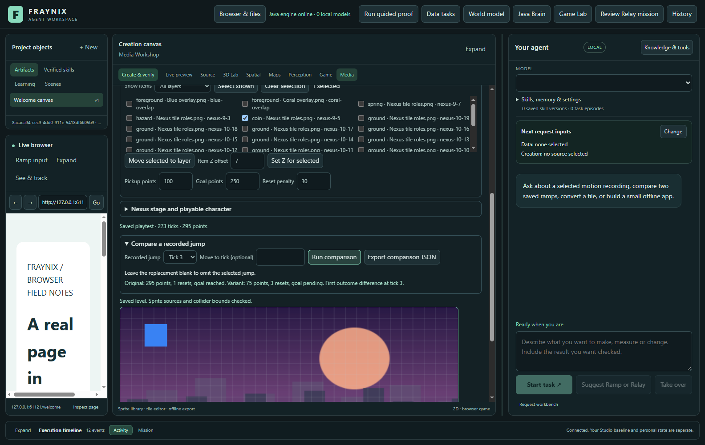
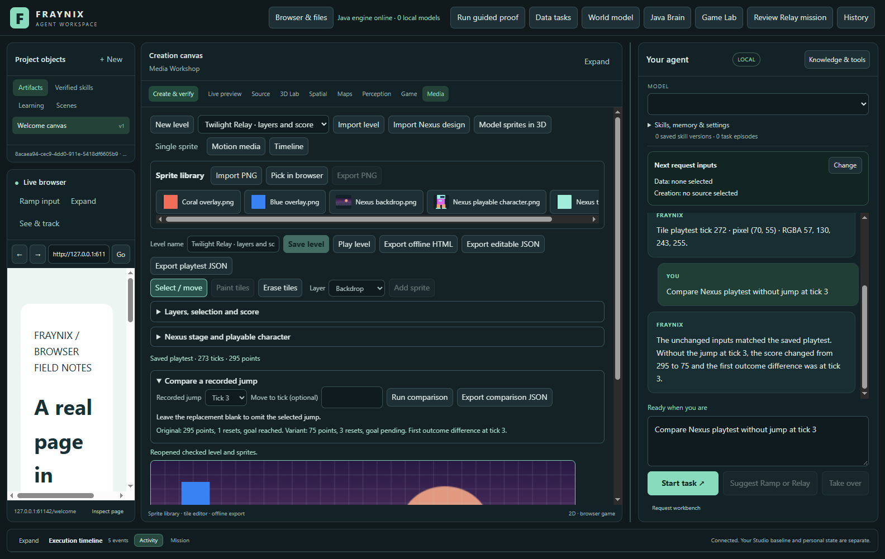

# Edition 259 — Replay saved controls and compare one change

2026-11-25 · [Edition 258](README-258.md) · [Offline walkthrough](docs/readmes/259/index.html) · [Full history](docs/readmes/INDEX.md)

**Media → Compare a recorded jump** reruns the controls from a saved Tile Workshop playtest. Select a recorded jump. Leave the replacement blank to omit it, or move it to a free tick within 30 steps. Fraynix checks that the unchanged input sequence reconstructs every recorded row first, then runs the variant over the same input window.

| Twilight Relay | Score | Resets | Goal reached |
| --- | ---: | ---: | :---: |
| Recorded inputs | 295 | 1 | Yes |
| Omit jump at tick 3 | 75 | 3 | No |
| Move jump to tick 4 | 295 | 1 | Yes |

The original replay matched all **273** rows. The omitted jump first changed the result at tick **3**. The one-tick delay also changed motion and still reached the same score. Both variants retained the level and original direction input. Repeating the omission returned the same comparison ID, and the receipt reopened after restart.

The source and variant each have their own trace. Open an exact PNG or read RGBA from either with the edition 258 tools. In chat, ask “Compare Nexus playtest without jump at tick 3,” using a tick from the current saved run. The desktop can export the comparison as JSON.

Edition 258 traces still support tick and pixel reads. Capture a new playtest to compare controls. Edition 259 separately records the direction that was requested on each tick, including a reset tick where the observed direction drops to zero.

[Sample traces, frames and comparisons](docs/readmes/259/FILE_TREE.md) · [Implementation and tests](docs/publication259/plan.md)
