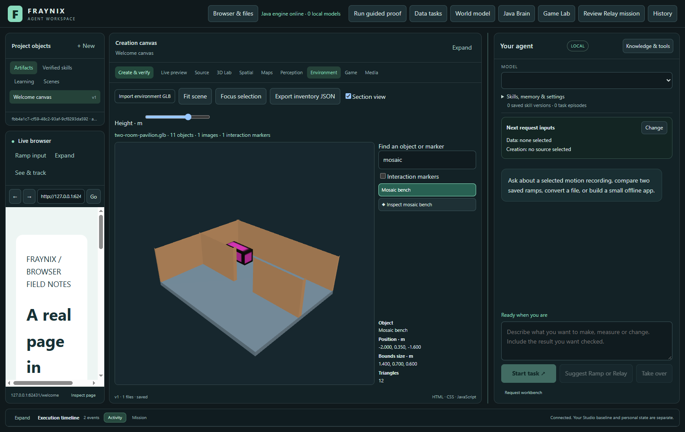
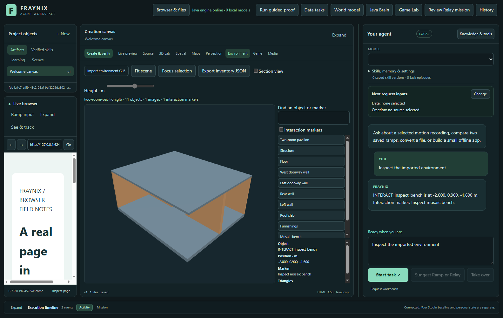

# Edition 260 — Open and inspect textured 3D environments

2026-11-25 · [Edition 259](README-259.md) · [Offline walkthrough](docs/readmes/260/index.html) · [Full history](docs/readmes/INDEX.md)

1. Open Fraynix and select **Environment → Import environment GLB**. Choose a self-contained Blender GLB or use the [sample two-room pavilion](docs/readmes/260/two-room-pavilion.glb).
2. Drag to orbit, scroll to zoom, and use **Section view** to see inside. Click a visible mesh or select a name from the inventory. **Interaction markers** narrows the list to marked interactions.
3. Ask “Inspect the imported environment” in offline chat. Use **Export inventory JSON** to save the full list with source identity, parent indices, marker labels, world coordinates and geometry bounds where available.

The apartment import opened 394 named nodes, including 386 mesh nodes and eight interaction markers. It displayed 14,596 triangles and five embedded images. The selected marker reopened offline after restart, and the exported inventory contained all 394 entries. The retained coordinates use the model’s glTF metres. Room labels, transforms, materials and marker names come from the source GLB. [Apartment source project](https://github.com/eyeoverthink/vaughn-apt)

On the two-room test scene, a visual ray through the doorway travelled 3 m without a hit. A parallel ray hit the adjacent partition at 1.9 m. The selected marker reopened after restart, and a change to the original retained bytes caused catalogue and ray queries to refuse the source. [Measured report](docs/readmes/260/environment-evidence.json) · [Exported inventory](docs/readmes/260/pavilion-inventory.json)

This edition handles self-contained GLBs up to 16 MiB with supported triangle geometry and embedded PNG or JPEG textures. Its agent probe measures hits on rendered geometry. The apartment’s separate scan and first-person puzzle logic have their own representations.

[Sample and screenshot files](docs/readmes/260/FILE_TREE.md) · [Implementation and tests](docs/publication260/plan.md)
