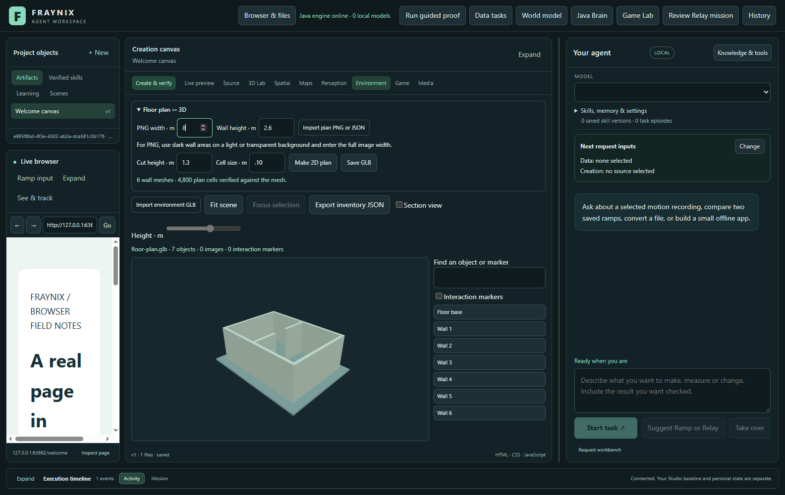
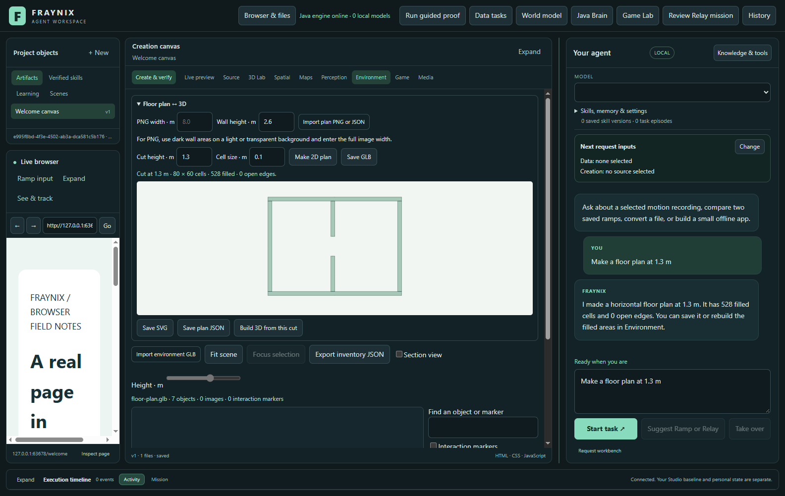

# Edition 261 — Turn floor plans into 3D and back

2026-11-25 · [Edition 260](README-260.md) · [Offline walkthrough](docs/readmes/261/index.html) · [Full history](docs/readmes/INDEX.md)

Open **Environment → Floor plan ↔ 3D** to convert in either direction. Everything in this workflow runs locally.

## Raise a floor plan

1. Use a 2D PNG with solid dark wall areas and a light or transparent background, up to 1,024 pixels per side. Use the [two-room sample](docs/readmes/261/two-room-mask.png) for a first run.
2. Enter the full image width in metres, including margins. The sample is 8 m wide. Set the wall height and import the PNG. An exported Fraynix plan JSON already contains scale.
3. Fraynix raises the walls on a rectangular base and measures the new mesh against the imported plan. Use **Save GLB** to open the meshes in Blender.

## Cut a 3D environment

1. Import an environment GLB and set the cut height and cell size. Select **Make 2D plan**, or ask “Make a floor plan at 1.2 m.”
2. **Save SVG** keeps the diagram and its open edges. **Save plan JSON** keeps the metric grid and its filled areas. **Build 3D from this cut** raises those areas using the selected wall height.

The two-room round trip matched all **4,800** grid cells, preserved the doorway and reproduced the SVG after restart. Blender independently checked all **4,800** cell positions against the expected wall and floor heights. [Desktop evidence](docs/readmes/261/floor-plan-evidence.json) · [Blender readback](docs/readmes/261/blender-readback.json)

The actual apartment model also made the round trip. A cut at **1.2 m** on a **5 cm** grid reproduced all **2,893** filled cells after extrusion. This represents the geometry at that level, including intersected furniture. Original materials, floors above the cut, and behavior have separate 3D representations. For an annotated drawing, prepare a wall-only PNG first. [Apartment source project](https://github.com/eyeoverthink/vaughn-apt)

[Sample files](docs/readmes/261/FILE_TREE.md) · [Implementation and tests](docs/publication261/plan.md)
