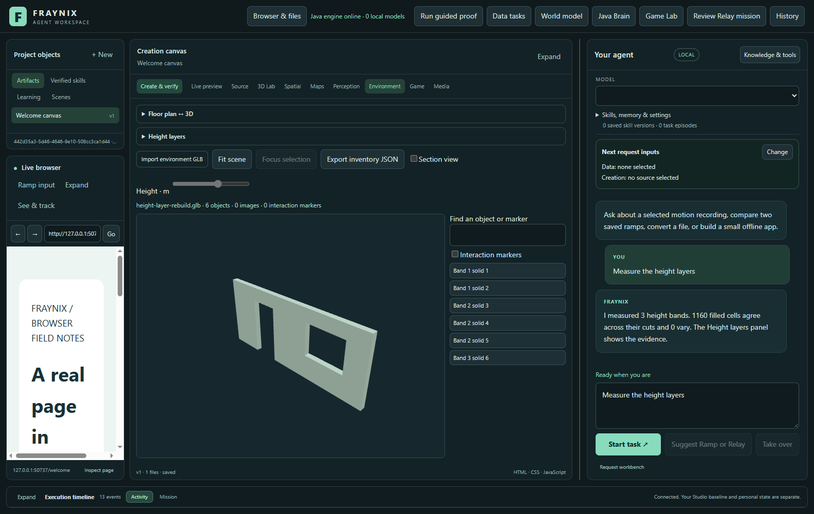
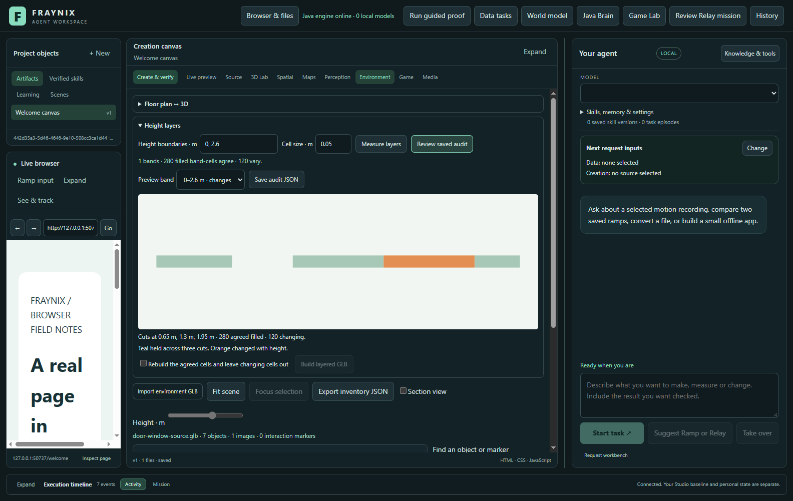

# Edition 262 — Recover openings from measured height layers

2026-11-25 · [Edition 261](README-261.md) · [Offline walkthrough](docs/readmes/262/index.html) · [Full history](docs/readmes/INDEX.md)

1. Import an environment GLB and open **Environment → Height layers**. Start with the [door and window sample](docs/readmes/262/door-window-source.glb).
2. Enter ascending height boundaries in model metres and choose the cell size. For the sample, use **0, 0.9, 2.1, 2.6** and **0.05 m**. Select **Measure layers**, or ask offline chat “Measure the height layers.”
3. Teal areas contained geometry at all three cuts in the band. Orange areas changed. To refine the result, change the boundaries and measure again. To build from an audit with changes, explicitly confirm that Fraynix should leave those cells out.
4. Choose **Build layered GLB**, then **Floor plan ↔ 3D → Save GLB** for Blender. Use **Save audit JSON** for the evidence. After restart, **Review saved audit** and **Open original model** follow the retained link.

The sample preserved the open doorway and window, the window sill and both headers. Fraynix rebuilt **1,160 filled band positions** and matched all nine measured sections. Fraynix and Blender both verified the same six additional rays at heights unused by the rebuild. A single wide band showed **120 changing positions** and required explicit approval for a partial rebuild. [Desktop verification](docs/readmes/262/height-layer-evidence.json) · [Independent Blender verification](docs/readmes/262/blender-height-readback.json)

The apartment test used a **10 cm grid** and three bands. **2,987 filled positions** agreed across their band’s cuts. **1,490** changed and were left out of the reviewed rebuild. The result is a sampled geometry study. Thin features can fall between cuts, and open surfaces are counted separately. The apartment outputs were kept local. [Apartment source project](https://github.com/eyeoverthink/vaughn-apt)

If a display cannot start the 3D viewport, the object catalogue, geometry probes, floor plans and exports remain usable. [Public test files](docs/readmes/262/FILE_TREE.md) · [Research and implementation](docs/publication262/plan.md)
