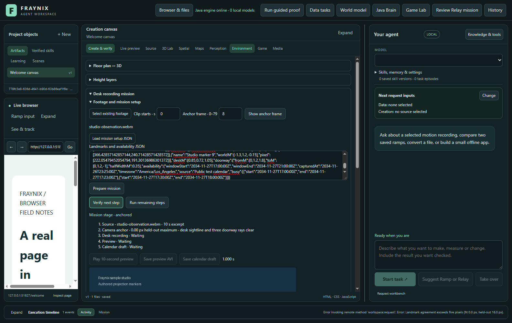
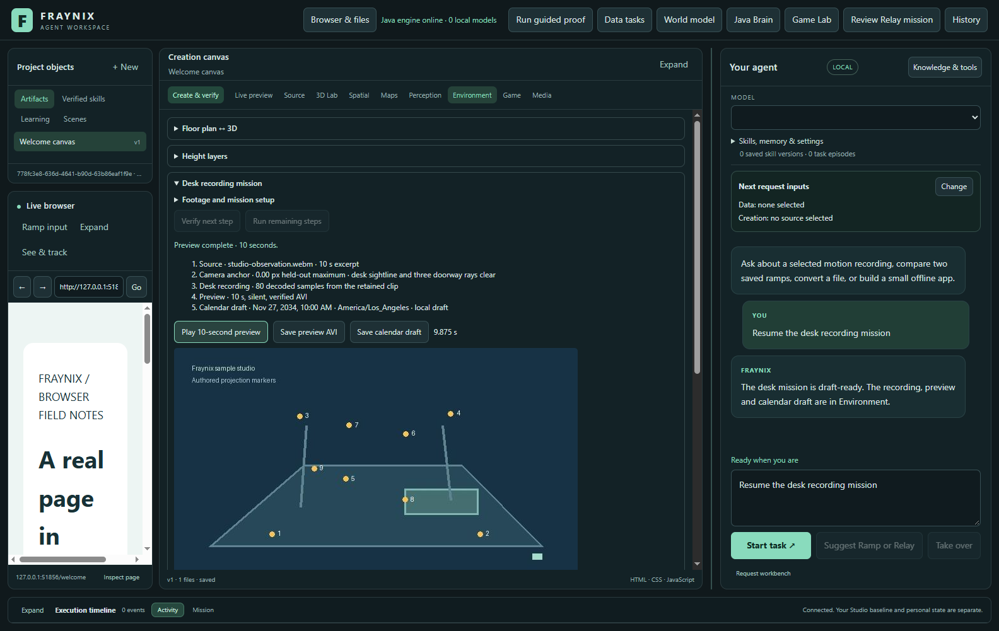

# Edition 263 — Resume a desk recording, preview and calendar draft

2026-11-25 · [Edition 262](README-262.md) · [Offline walkthrough](docs/readmes/263/index.html) · [Full history](docs/readmes/INDEX.md)

Open **Environment → Desk recording mission**. Import the room GLB, select an existing clip, and pick the frame to anchor. Load the mission setup with model coordinates, matching image pixels, a desk target, a doorway segment and calendar availability. Choose **Prepare mission**. Use **Verify next step** to review each checkpoint, **Run remaining steps**, or ask chat “Resume the desk recording mission.”

For a reproducible first run, use the [studio GLB](docs/readmes/263/recording-studio.glb), [studio clip](docs/readmes/263/studio-observation.webm) and [studio setup](docs/readmes/263/studio-setup.json). Set the anchor frame to **8** at clip start **0**. The dates in this example come from its test calendar.

Java fits the camera using seven or more labelled points and checks at least two different landmarks against a five-pixel limit. A successful anchor records the exact JPEG frame digest and checks the desk sightline and three doorway rays at the declared height. These measurements describe the selected recorded view and the retained model.

The test studio resumed after anchoring and produced **80 source samples**, a **ten-second silent preview**, and a local calendar draft. A 16-pixel shift of a held-out point was refused. Changing retained footage blocked export. [Mission evidence](docs/readmes/263/desk-mission-evidence.json) · [Independent media readback](docs/readmes/263/ffprobe-readback.json)

The apartment walkthrough produced a verified, playable excerpt and a local calendar draft that reopened after restart. The proposed camera-to-model registration missed the held-out landmarks by up to **32.8 px** against the **5 px** limit. Its local mission retains that refusal. The preview and draft were exported through the explicit footage-only path. Apartment video, coordinates and calendar details stayed local.

[Public sample files](docs/readmes/263/FILE_TREE.md) · [Implementation and reproduction](docs/publication263/plan.md)
