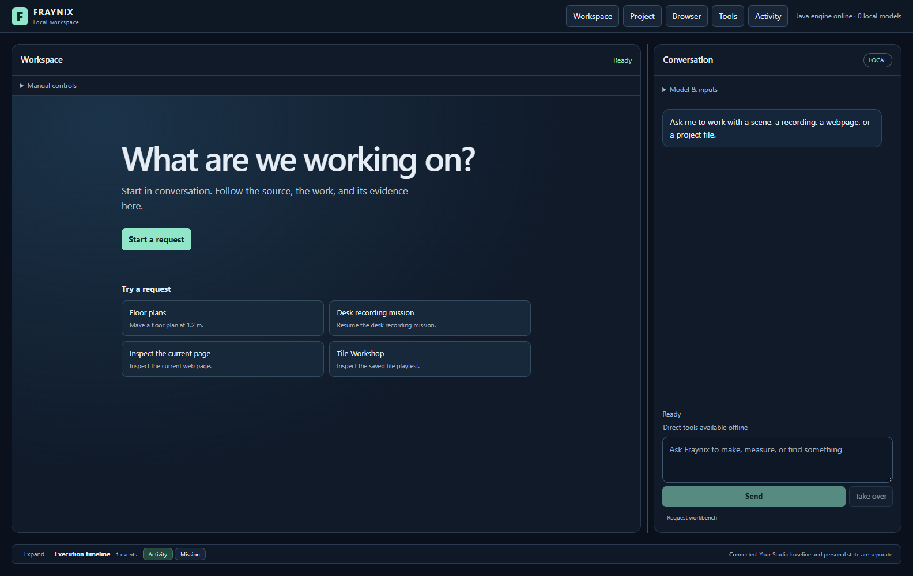
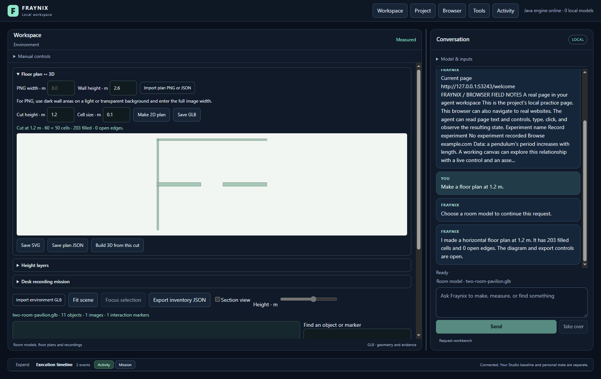
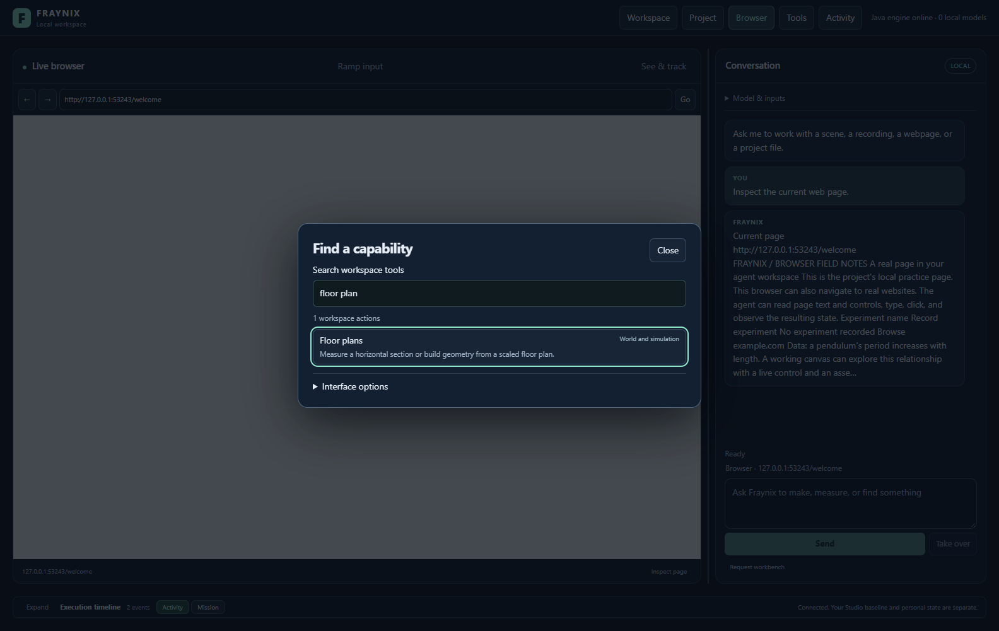
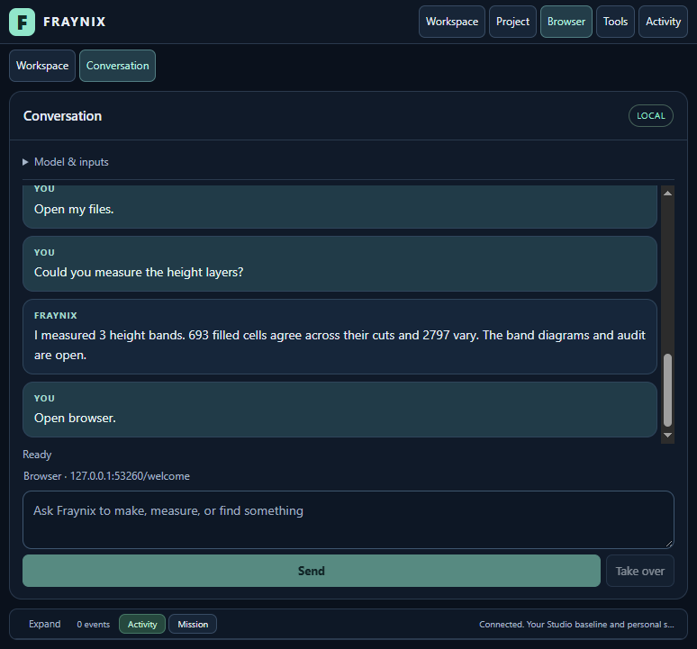

# Edition 264 — One workspace for chat, tools and results

2026-11-25 · [Edition 263](README-263.md) · [Offline walkthrough](docs/readmes/264/index.html) · [Full history](docs/readmes/INDEX.md)

Open Fraynix and type into the conversation. Chat remains beside the active workspace. The relevant pane opens when a supported request needs a file, shows a result or calls for review. Use **Project** and **Browser** for hands-on work. **Activity** shows saved work and progress.

Try **“Make a floor plan at 1.2 m.”** If a room model is missing, select the [sample pavilion](docs/readmes/264/two-room-pavilion.glb) or your own GLB. Then choose **Continue request**. The original prompt stays in the conversation. With a model loaded, try **“Could you measure the height layers?”** from Project or Browser.

**“Inspect the current web page”** reads text from the page already open in the built-in browser. **“Open Game Lab”** opens the embedded game runtime. **“Make a motion video”** can ask for a saved recording if more than one is available. Existing task approvals and verification continue to apply.

Open **Tools** or press **Ctrl+K** on Windows/Linux or **Cmd+K** on macOS. The launcher offers 29 workspace actions and, when you search, matches against the Java tool registry. Opening a workspace action and inspecting a registered tool are distinct choices in the launcher. Use **Interface options → Show all manual controls** for the full controls, and **Unified workspace** to return.

At smaller sizes, **Stage** and **Conversation** share the same window while the composer stays accessible.

The Windows desktop acceptance test ran without a local model. It exercised a browser read, an interrupted floor-plan request, a ramp request awaiting setup, a restart, native view bounds, and protection for unsaved edits. The motion workflow separately exercised recording selection and recipe reuse after restart. [Desktop evidence](docs/readmes/264/workspace-shell-evidence.json) · [Implementation and reproduction](docs/publication264/plan.md)
