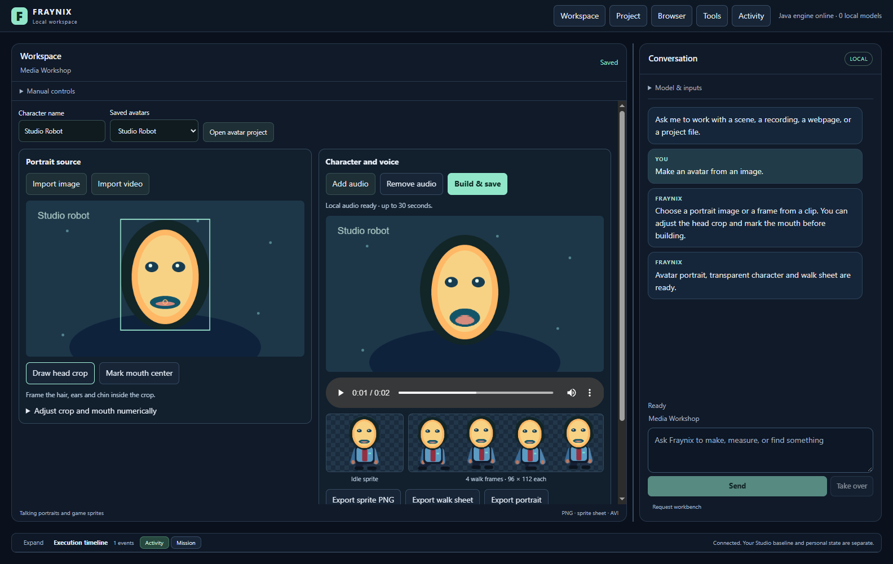

# Edition 265 — Make a talking avatar and game character from an image

2026-11-26 · [Edition 264](README-264.md) · [Offline walkthrough](docs/readmes/265/index.html) · [Full history](docs/readmes/INDEX.md)

Ask **“Make an avatar from an image”** or open **Avatar Studio** from Tools. Import a PNG, JPEG or WebP. You can also import a supported local video, find a clear frame and select **Use this frame**. Drag the crop around the head, including hair, ears and chin, then click the centre of the mouth.

For a talking portrait, select **Add audio** or **Use clip audio**. The portrait opens its mouth in five degrees according to the volume of the supplied recording. The workflow preserves the source framing and uses a template body for the game character. This is an audio-reactive 2D portrait. Full facial motion, phoneme timing and voice synthesis are outside this version.

Select **Build & save** or **Continue request**. Export the portrait, a transparent **96 × 112** PNG, a **384 × 112** PNG walk sheet, or a **640 × 360** talking AVI at **24 fps** with supplied audio. **Use in Tile Workshop** adds the idle PNG to the reusable sprite library. **Export editable avatar** writes a project containing the source image and any attached audio. Import the project to revise it later.

Try the [sample portrait](docs/readmes/265/sample-portrait.png) and [timing-only audio](docs/readmes/265/sample-voice-timing.wav), or open the [editable robot example](docs/readmes/265/editable-avatar.avatar.json). The published demo uses an original drawn test character. Personal sources and exports are kept in local project storage.

The Windows integration created the robot without a model, kept silent frames at rest, verified a transparent sprite in Tile Workshop, and recovered byte-identical video after restart and import into a clean project. Altered local and portable recipes were refused. [Integration evidence](docs/readmes/265/avatar-test-evidence.json) · [Implementation and reproduction](docs/publication265/plan.md)
