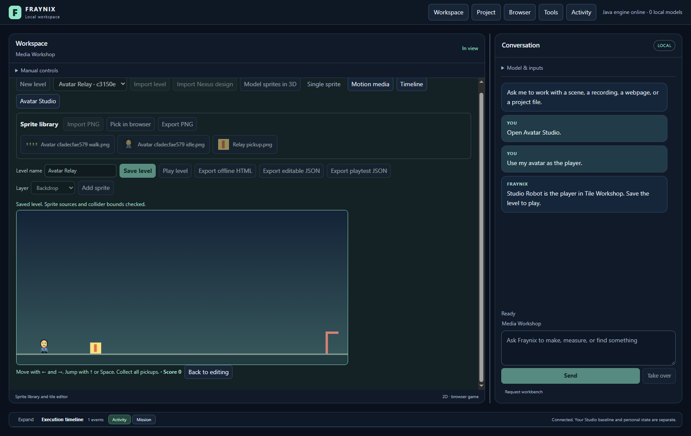

# Edition 266 — Play a saved avatar in a portable tile level

2026-11-27 · [Edition 265](README-265.md) · [Offline walkthrough](docs/readmes/266/index.html) · [Full history](docs/readmes/INDEX.md)

Open a level in Tile Workshop. In Avatar Studio, open a saved avatar and select **Use as player**, or ask **“Use my avatar as the player.”** The selected avatar appears in the level editor. Select **Save level** and **Play level**. Use **Use original player** to reset the player appearance and save that revision.

The idle sprite and all four walk frames are embedded in the editable level and standalone HTML. Ground movement drives the animation, with the sprite facing in the direction of travel. The level keeps its player collider, speed, jump and scoring rules. The sample uses the Studio Robot from [Avatar Studio](README-265.md).

Download the [standalone sample level](docs/readmes/266/avatar-relay.html) and open it in a browser. Hold **Right Arrow** to collect the pickup and reach the exit. Use **Import level** in Tile Workshop to edit the [level JSON](docs/readmes/266/avatar-relay.json).

The Windows test scored **600** in the app, after restart, and in the standalone file with network requests blocked. The same recorded controls reproduced the same physics with and without the avatar. Earlier recorded images can still be reproduced with the corresponding renderer. [Evidence](docs/readmes/266/avatar-player-evidence.json) · [Implementation and reproduction](docs/publication266/plan.md)
