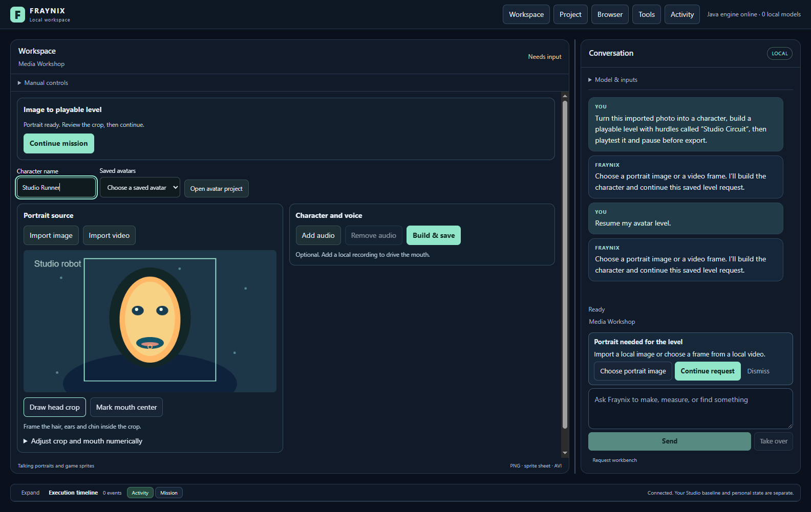
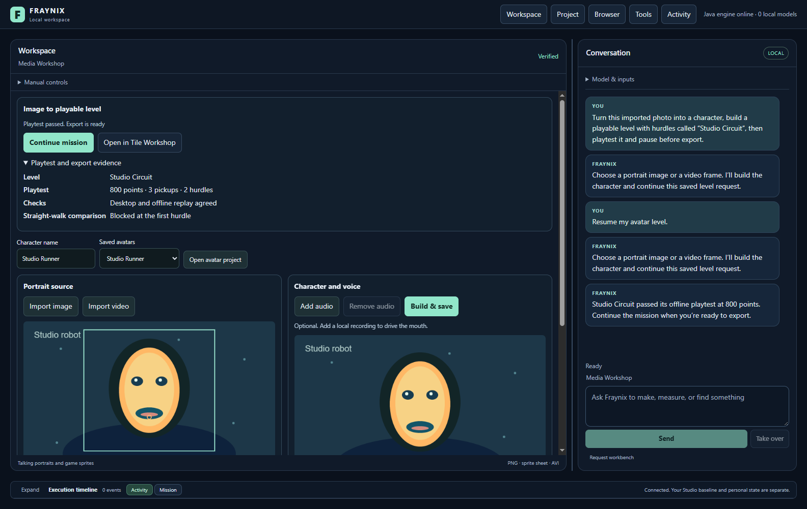
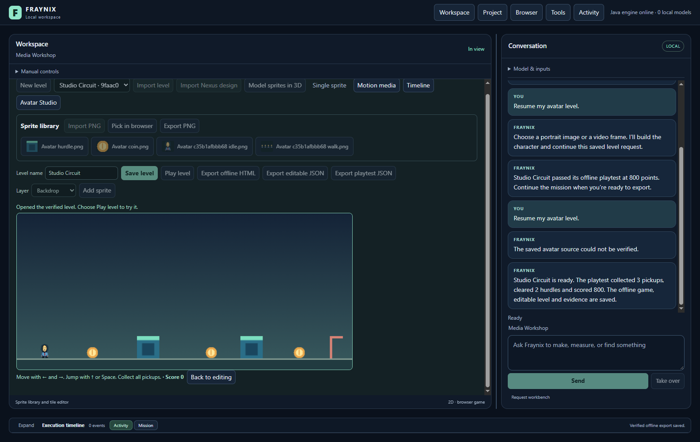

# Edition 267 — Build and verify an offline game level from chat

2026-11-27 · [Edition 266](README-266.md) · [Offline walkthrough](docs/readmes/267/index.html) · [Full history](docs/readmes/INDEX.md)

Ask Fraynix in chat:

> Turn this imported image into a character, build a playable level with hurdles called “Studio Circuit,” then test and export it offline.

If the portrait is missing, choose an image, review the crop and select **Continue request**. A frame from a local video also works. Add **with no jumps** for a walking relay, or **pause before export** to stop after the tests. Use **“Resume my avatar level”** after restarting.

Fraynix builds the character, places pickups and tests the route in the desktop simulation. It opens the exact proposed HTML in a separate Chromium window with network access blocked and compares the starting frame and every recorded tick. The Java engine checks the finish, pickups, score and hurdle clearances before publishing anything.

The challenge course collected **three pickups**, cleared **two hurdles** and scored **800**. The flat relay used a different image and finished with no jumps. The test reopened the editable challenge level in a clean project and played the exact exported HTML with keyboard input. A changed portrait stopped export until the original bytes were restored.

Open **Image to playable level** in Tools to see the saved mission. Use **Open in Tile Workshop** for editing and **Show offline files** for the standalone HTML, editable JSON, verified input trace and receipt.

[Play Studio Circuit](docs/readmes/267/studio-circuit-playable.html) · [Play Quick Relay](docs/readmes/267/quick-relay-playable.html) · [Download editable level](docs/readmes/267/studio-circuit-editable-level.json) · [Test evidence](docs/readmes/267/mission-evidence.json) · [Implementation and reproduction](docs/publication267/plan.md)
