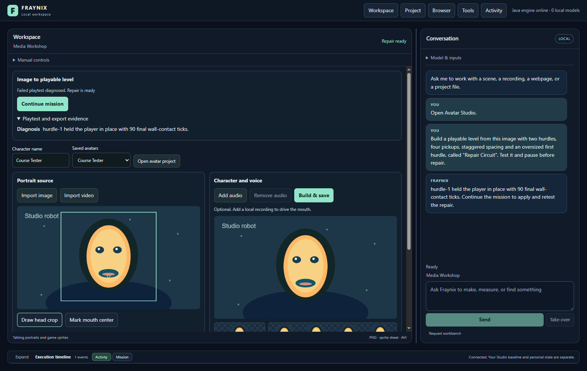
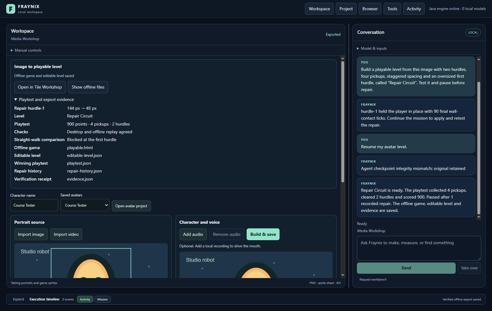
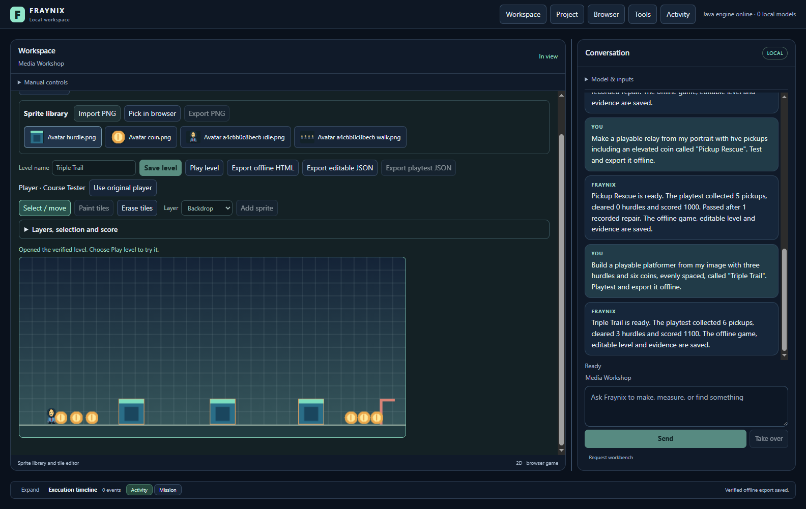

# Edition 268 — Design varied levels and repair failed playtests

2026-11-27 · [Edition 267](README-267.md) · [Offline walkthrough](docs/readmes/268/index.html) · [Full history](docs/readmes/INDEX.md)

Import an image or choose a saved avatar. Then ask in chat:

> Build a playable level from this image with two hurdles, four pickups, staggered spacing and an oversized first hurdle. Test it, repair any failure and export it offline.

The designer supports **zero to three hurdles**, **one to six pickups**, and **even or staggered spacing**. You can also ask for an **elevated pickup**. Say **“pause before repair”** to inspect the failure, or **“keep the layout fixed”** to preserve the requested geometry. **“Resume my avatar level”** continues the current mission after restarting.

Fraynix retains the failed run and diagnoses repeated wall contact or an uncollected required pickup. A repair changes only the diagnosed object. The new level gets a fresh playtest and the exact export is independently opened and replayed offline. A fixed layout or a failure without a supported repair stays under review.

| Course | Measured result |
| --- | --- |
| Repair Circuit | **90** consecutive retained wall-contact ticks at the first hurdle. The repaired hurdle changed from **144 px** to **48 px**. The offline keyboard playthrough cleared both hurdles, took four pickups and scored **900**. |
| Pickup Rescue | The exit stayed locked because **coin-3** was missed. Moving it to a measured grounded position gave **five pickups** and **1,000** points. |
| Triple Trail | The fresh course cleared **three hurdles** and collected **six pickups** for **1,100** points. |
| Locked layout | The failed diagnosis survived restart and export stayed blocked. |

The restart test also refused a changed failure trace, then recovered after the original bytes were restored. **Show offline files** opens the checked HTML, editable JSON, winning playtest and repair history when available.

[Play Repair Circuit](docs/readmes/268/repair-circuit-playable.html) · [Play Pickup Rescue](docs/readmes/268/pickup-rescue-playable.html) · [Play Triple Trail](docs/readmes/268/triple-trail-playable.html) · [Evidence](docs/readmes/268/course-repair-evidence.json) · [Implementation and reproduction](docs/publication268/plan.md)
