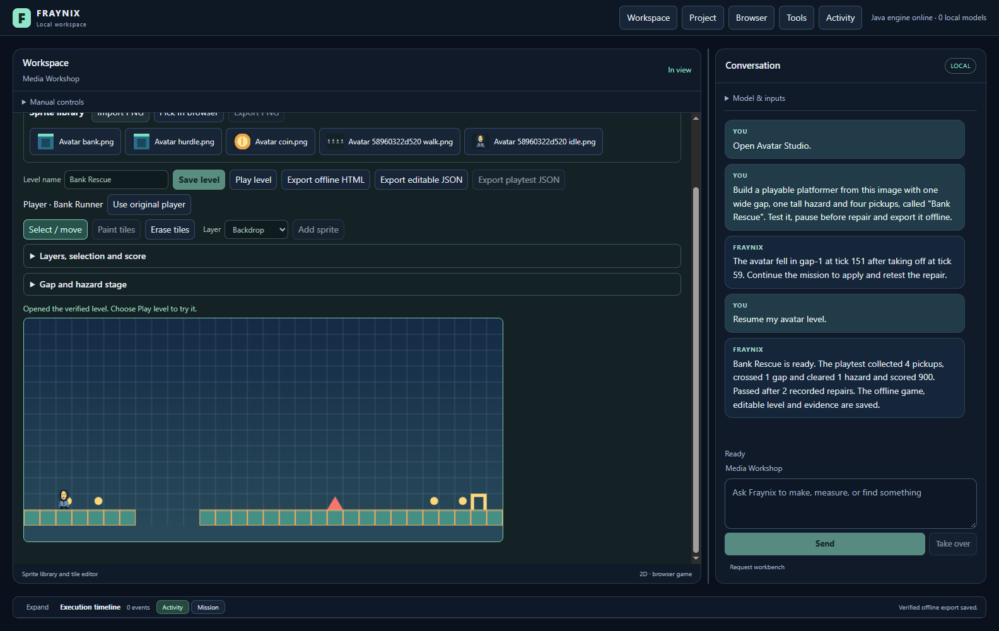
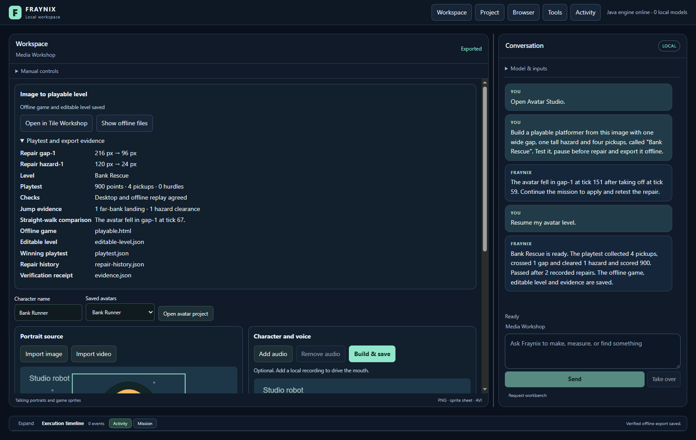

# Edition 269 — Add gaps and hazards and repair failed jumps

2026-11-27 · [Edition 268](README-268.md) · [Offline walkthrough](docs/readmes/269/index.html) · [Full history](docs/readmes/INDEX.md)

Import an image or choose a saved avatar. Then ask in chat:

> Build a playable level from this image with one wide gap, one tall hazard, and four pickups. Test it, repair failed jumps, and export it offline.

A traversal course accepts up to two gaps, two spike hazards and three obstacles in total, including any hurdles. **“Pause before repair”** holds the first diagnosis for review. **“Resume my avatar level”** picks up after a restart. **“Keep the layout fixed”** preserves the requested geometry and blocks export if the playtest fails.

Bank Rescue took off at tick **59**, fell below the bank at **151**, and reset at **170**. Fraynix narrowed the gap from **216 px to 96 px**, leaving a real opening. A fresh run then hit the tall hazard. Reducing it from **120 px to 24 px** kept the hazard in the course and let the next run jump it. The repaired game scored **900** and passed an offline keyboard playthrough.

The independent desktop and offline runs agreed on every tick. The winning trace recorded a far-bank landing and a separate hazard clearance. Twin Banks crossed **two gaps** and cleared **one hazard** for **1,100** points without a geometry repair. A locked wide gap stayed blocked from export after restart.

[Play Bank Rescue](docs/readmes/269/bank-rescue-playable.html) · [Play Twin Banks](docs/readmes/269/twin-banks-playable.html) · [Failed runs and geometry changes](docs/readmes/269/bank-rescue-repair-history.json) · [Verification evidence](docs/readmes/269/jump-repair-evidence.json) · [Implementation and reproduction](docs/publication269/plan.md)
