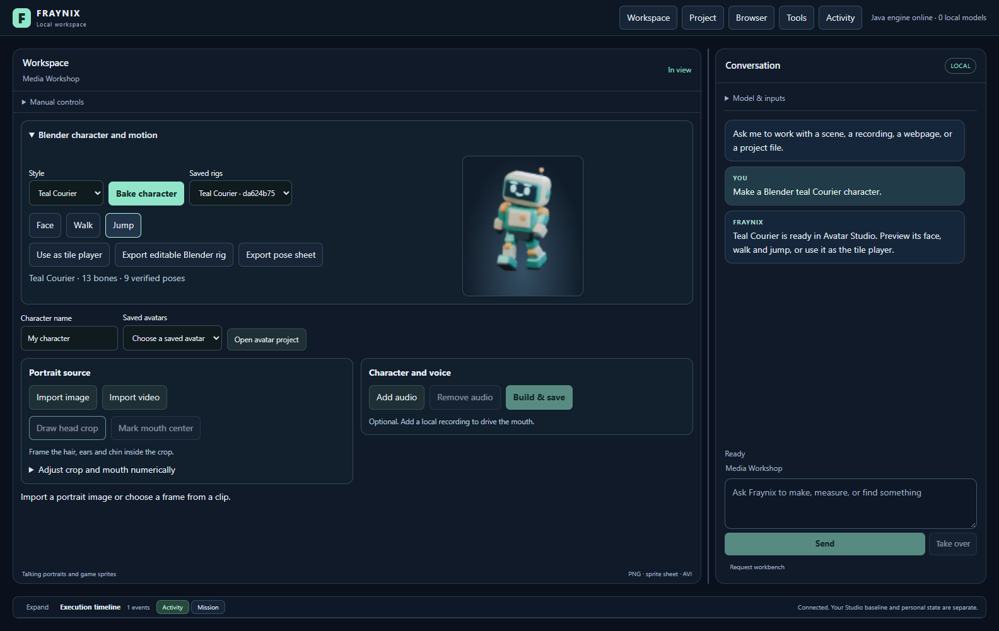
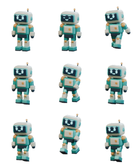
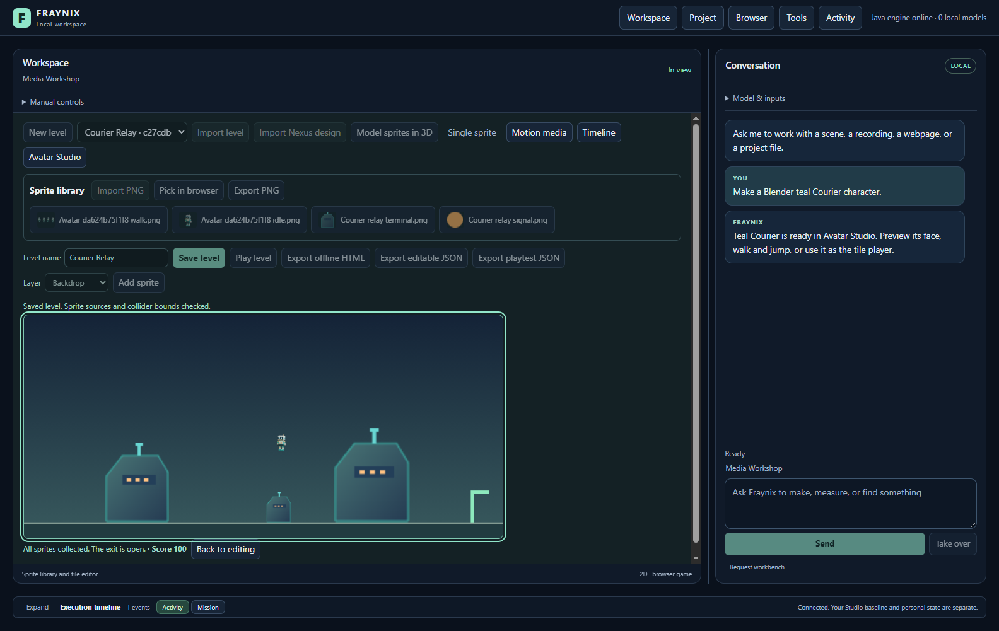

# Edition 270 — Make expressive Blender characters and play them offline

2026-11-27 · [Edition 269](README-269.md) · [Offline walkthrough](docs/readmes/270/index.html) · [Full history](docs/readmes/INDEX.md)

In chat, enter **“Make a Blender teal Courier character.”** You can also open **Avatar Studio → Blender character and motion** and select Teal or Amber. Bake the character, then preview the face, walk or jump. Export an editable Blender project or a transparent nine-pose sprite sheet. Choose **Use as tile player** to put it in your current Tile Workshop level, then save, play and export that level.

Baking uses your local Blender installation. Fraynix searches the standard installation on Windows and macOS and the command path on Linux. Set `FRAYNIX_BLENDER` to point to a different executable. A saved rig and the standalone level can reopen without running Blender.

The original Courier has a **13-bone armature**, opposing arm and leg swing, two keyed eyelids, an anticipatory brow pose, and takeoff, airborne and landing poses. Blender reopened the saved project and measured the left thigh changing from **+24.92° to −31.08°** across opposite strides. The eyes' Blink keys went from **0 to 1**. The rig carries a separate upright collision proxy.

The Windows desktop and independent, network-blocked HTML both collected the signal, crossed the hurdle and scored **600** using all four walk frames. The desktop trace recorded wall contact at tick **161**, takeoff at **162** and a grounded frame beyond the hurdle at **254**. The level exported to the same hash after restart. Changing one saved frame refused to open the rig.

[Play Courier Relay](docs/readmes/270/courier-relay.html) · [Open the rig in Blender](docs/readmes/270/courier.blend) · [Download the transparent sprite sheet](docs/readmes/270/courier-poses.png) · [Read the playtest trace](docs/readmes/270/courier-playtest.json) · [Review findings and next steps](docs/publication270/plan.md)
