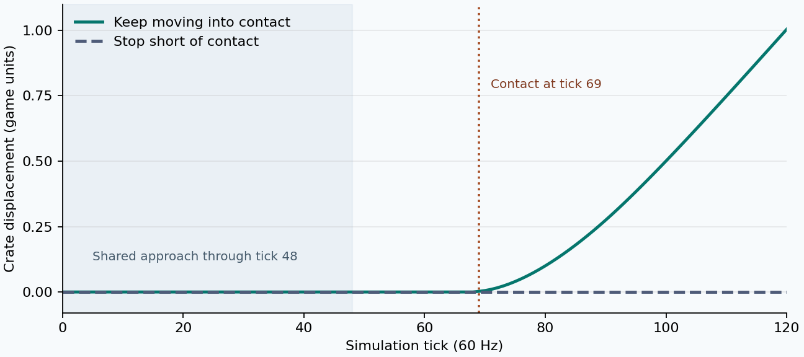
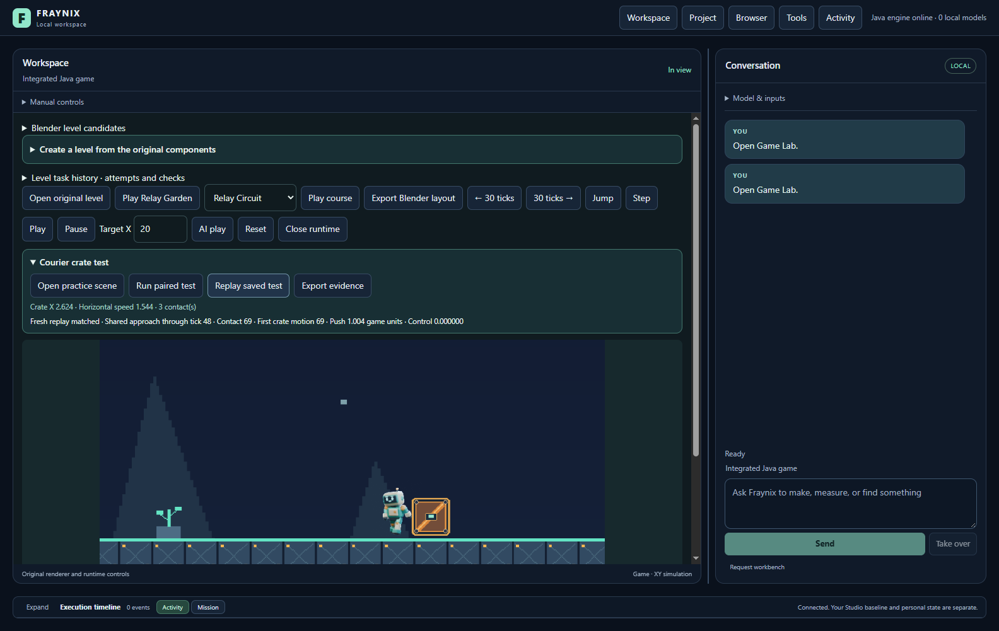

# Edition 271 — Prove the Courier pushes a crate after contact

2026-11-27 · [Edition 270](README-270.md) · [Offline walkthrough](docs/readmes/271/index.html) · [Full history](docs/readmes/INDEX.md)

In chat, say **“Open Game Lab.”** Expand **Courier crate test** and choose **Open practice scene**. Use the normal movement buttons to walk into the crate, or choose **Run paired test**. After restarting the app, choose **Replay saved test**. **Export evidence** saves both full tick traces as JSON.

The Teal Courier uses the original Relay Garden controller and rotation-locked dynamic pillbox. Its artwork follows the body, with distance-based strides and poses selected from grounded or airborne state. The crate has its own dynamic body and box collider. The scene uses the verified edition 270 sprite atlas and runs offline with no model or Blender process.

Both trials followed the same inputs through tick **48**. The control released movement and stopped short. On the continued approach, the crate was still at **X = 1.620** when the native contact callback fired at tick **69**. JBox2D reported horizontal contact impulse, then the completed step showed motion. The crate moved **1.004 game units** by tick 120. The control recorded zero player–crate contacts and zero horizontal displacement.

A full Windows desktop restart launched a fresh native process in offline mode. It reproduced both 121-sample traces and the final frame hash. A changed receipt was refused before opening a new runtime.

[Download the measured traces](docs/readmes/271/courier-crate-proof.json) · [Restart and refusal results](docs/readmes/271/result.json) · [Implementation, verification and next tests](docs/publication271/plan.md)
