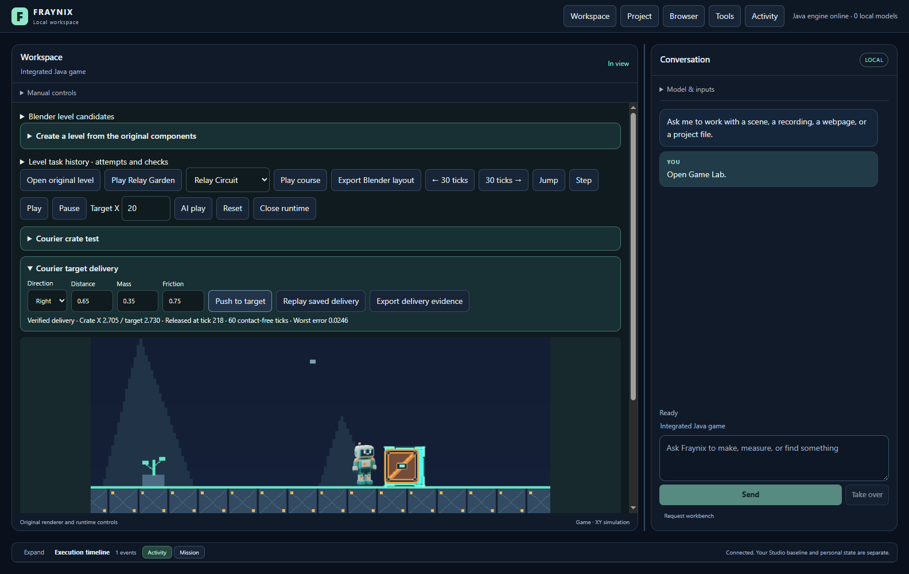
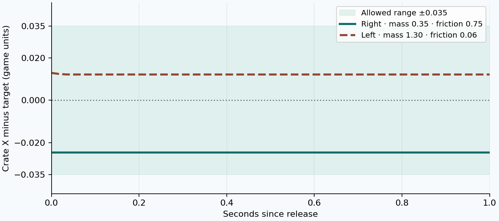
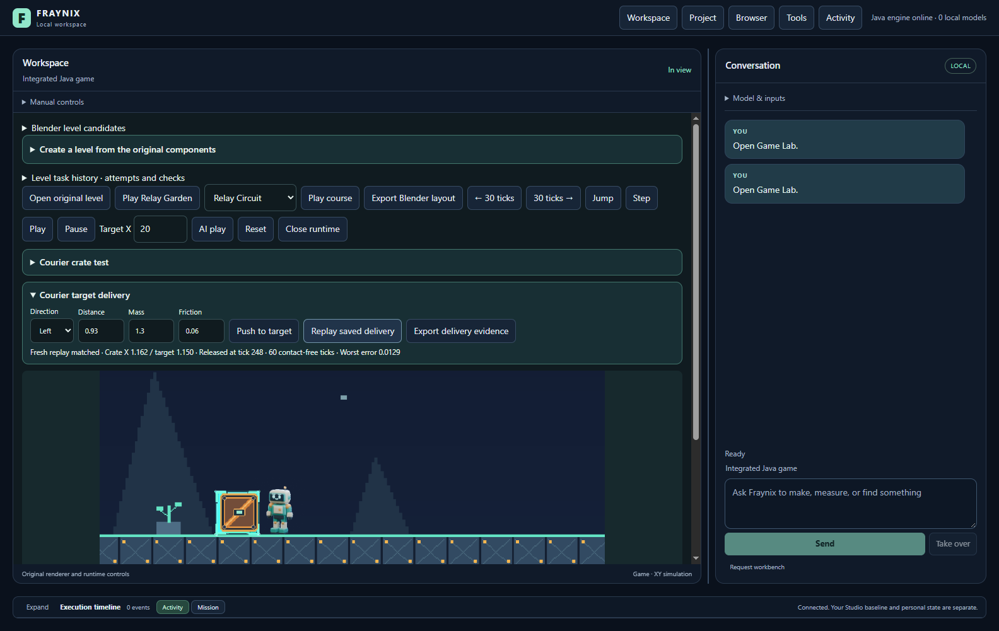

# Edition 272 — Deliver a crate and verify it stays on target

2026-11-27 · [Edition 271](README-271.md) · [Offline walkthrough](docs/readmes/272/index.html) · [Full history](docs/readmes/INDEX.md)

Open **Game Lab → Courier target delivery**. Choose left or right, set the distance, crate mass and fixture friction, then press **Push to target**. The Courier reads the moving crate, slows near the marker and backs away. Fraynix verifies the crate stays within **±0.035 game units** for **60 contact-free ticks**, one second at 60 Hz.

The Windows test passed **58 cases**. It crossed both directions, three distances, three masses and three friction settings, then tested four extra setups at the allowed distance limits. Worst held error was **0.02457** game units, maximum drift after release was **0.00095**, and the crate's recorded horizontal speed was **0** at the end of every case.

All 58 saved receipts rechecked after an offline desktop restart. Fresh native runs for one setup in each direction reproduced their exact tick traces and final frames. The verifier refused a modified receipt and a separately rehashed trace with an out-of-band movement during the hold.

[All 58 cases](docs/readmes/272/courier-target-matrix.json) · [Right trace](docs/readmes/272/courier-target-right.json) · [Left trace](docs/readmes/272/courier-target-left.json) · [Restart results](docs/readmes/272/result.json) · [Implementation and next tests](docs/publication272/plan.md)
