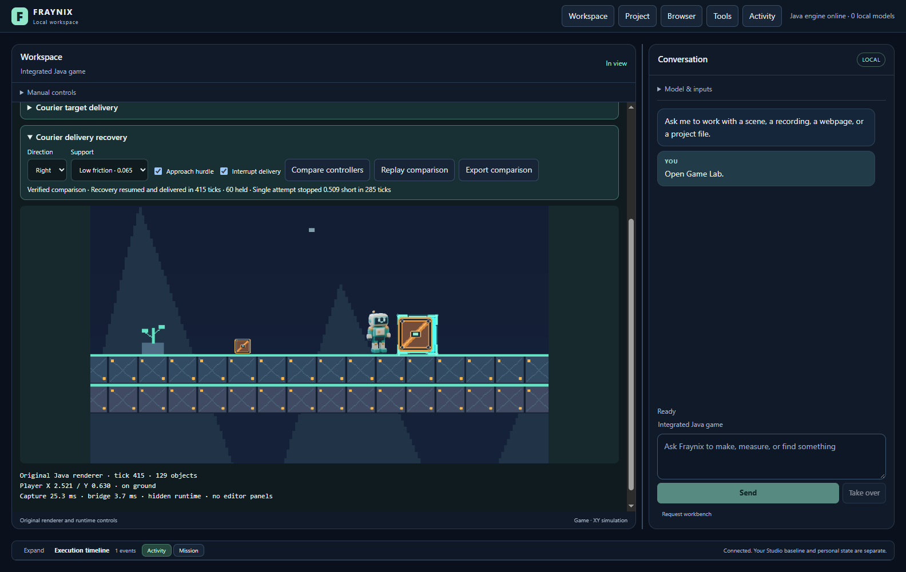
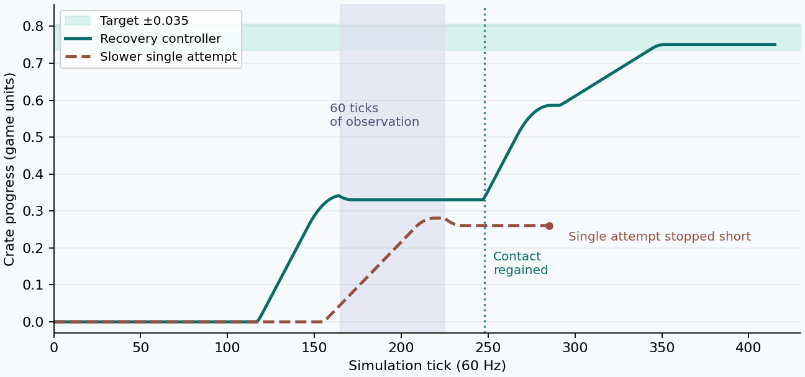
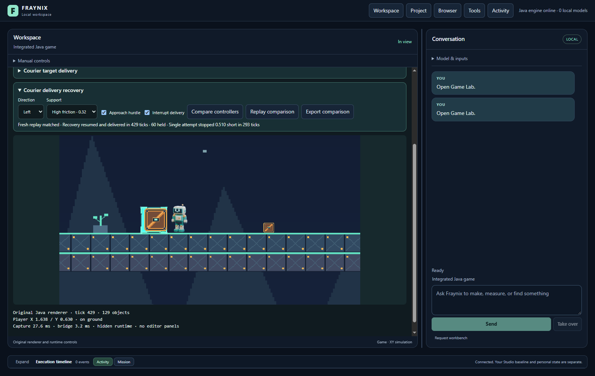

# Edition 273 — Recover an interrupted Courier delivery

2026-11-27 · [Edition 272](README-272.md) · [Offline walkthrough](docs/readmes/273/index.html) · [Full history](docs/readmes/INDEX.md)

Open **Game Lab → Courier delivery recovery**. Choose left or right, a support surface, and whether to add a hurdle or interrupt the delivery. **Compare controllers** runs both policies in fresh copies of that fixture. **Replay comparison** repeats the saved pair in a new native process.

The Courier reads the native hurdle position, jumps over it, and pushes the crate with its dynamic player body. In an interrupted trial, it backs away during the first push and the test fixture applies an opposing impulse to the crate. The controller observes the crate for one second, verifies it has stopped short, then reapproaches and pushes it to the target.

| Windows comparison | Recovery controller | Slower single attempt |
| --- | ---: | ---: |
| Delivered with verified hold | 16 | 4 |
| Stopped short after interruption | 0 | 8 |
| Missed the hold tolerance | 0 | 4 |

Both policies cleared the hurdle in every case that used it. The recovery controller saved **45–47 ticks** in the four cases both policies finished. It recovered all eight interruptions and held the crate within **0.02337 game units** in the worst case, with **zero recorded horizontal drift after release**.

All 16 receipts rechecked after offline restart. Fresh leftward and rightward comparisons reproduced both controllers' traces and their final frames. The verifier refused a changed receipt and a rehashed trace with an out-of-band hold sample.

[All 16 comparisons](docs/readmes/273/courier-recovery-matrix.json) · [Rightward trace](docs/readmes/273/courier-recovery-right.json) · [Leftward trace](docs/readmes/273/courier-recovery-left.json) · [Restart results](docs/readmes/273/result.json) · [Design and reproduction](docs/publication273/plan.md)
