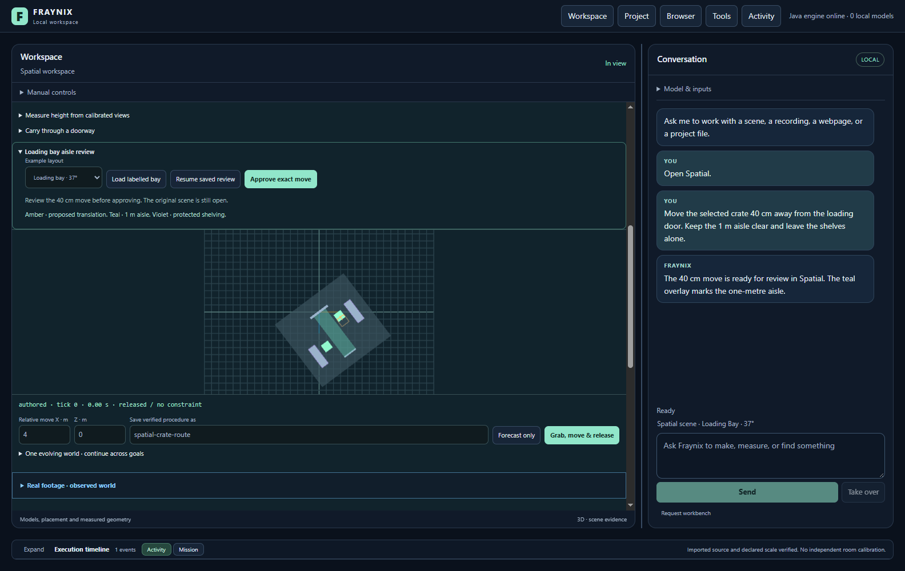
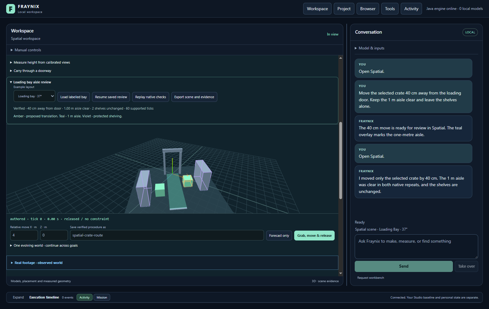
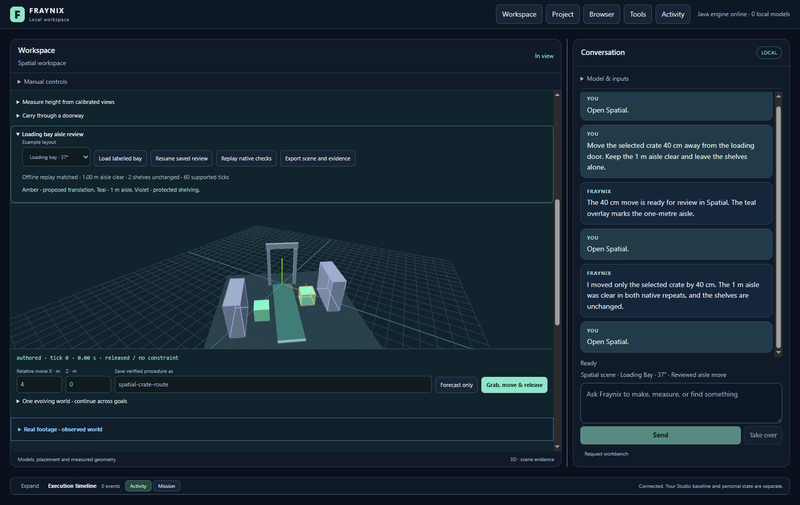

# Edition 274 — Move a crate and verify a clear loading aisle

2026-11-27 · [Edition 273](README-273.md) · [Offline walkthrough](docs/readmes/274/index.html) · [Full history](docs/readmes/INDEX.md)

1. Send “Open Spatial.” In **Loading bay aisle review**, choose **Loading bay · 37°**, then **Load labelled bay**. Select **Selected crate** in the object list.
2. Send the request below. The amber outline shows the destination, teal marks the one-metre aisle and violet marks the protected shelves.
3. Click **Approve exact move**. Java verifies the intended change and the native measurements before saving a new scene.
4. After restart, open Spatial and click **Resume saved review**. **Replay native checks** measures the scene again. **Export scene and evidence** saves editable scene JSON and its receipt together.

> Move the selected crate 40 cm away from the loading door. Keep the 1 m aisle clear and leave the shelves alone.

| What Windows verified | Result |
| --- | --- |
| Door-relative move | **40.00 cm** in the 37° bay and in the square control |
| Clear passage | **1.00 m wide × 3.60 m long × 1.80 m high** in the declared-scale test bay |
| Protected objects | Both shelves, the spare crate and every other object retained their source properties |
| Release position | **60** consecutive supported, low-speed ticks after settling |
| Refused actions | Wrong approval, extra shelf edit, changed proof, trolley in the aisle and trolley in the crate path |

A Windows test kept the app offline, restored the pending proposal after one restart, then restored the approved revision and reproduced the native measurements after another. It also passed with WebGL unavailable, using the built-in top-down preview. The chat procedure runs in Java without a language model.

[Scene and verification receipt](docs/readmes/274/aisle-verified.json) · [Desktop test report](docs/readmes/274/result.json) · [2D preview test report](docs/readmes/274/result-2d.json) · [2D run export](docs/readmes/274/aisle-verified-2d.json) · [Design and reproduction](docs/publication274/plan.md)
