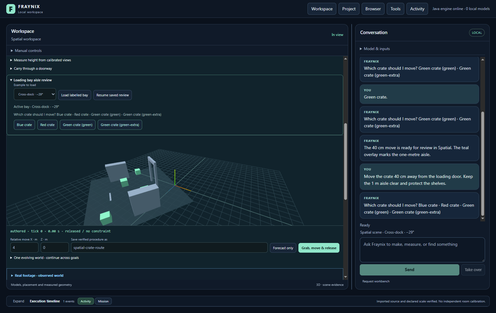
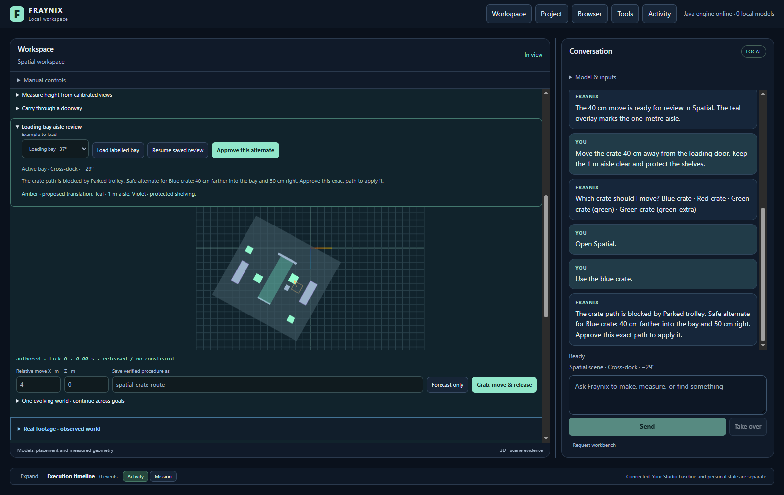
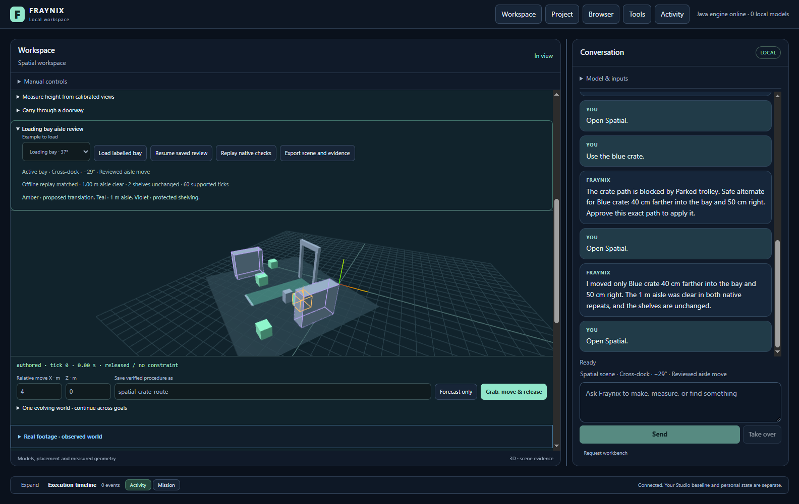

# Edition 275 — Clarify crate identity and review a safe alternate

2026-11-27 · [Edition 274](README-274.md) · [Offline walkthrough](docs/readmes/275/index.html) · [Full history](docs/readmes/INDEX.md)

1. Send “Open Spatial,” expand **Loading bay aisle review**, then load **Cross-dock · −29°**.
2. Ask “Move the crate 40 cm away from the loading door. Keep the 1 m aisle clear and protect the shelves.”
3. When the app asks which crate, answer “Use the blue crate” in chat or choose **Blue crate** in Spatial. You can also name a unique crate in the original request.
4. Review the proposed alternate. **Approve this alternate** applies the exact measured path. **Resume saved review** retrieves a crate question, pending proposal or verified revision after restart.

| Test bay | Result |
| --- | --- |
| Cross-dock, −29° | Four choices, including two green crates. A trolley blocked the blue crate’s direct path. Approved **40 cm forward, 50 cm right**. |
| Quayside, 68° | A named red crate won over the blue highlight. A trolley blocked its direct path. Approved **40 cm forward, 50 cm left**. The blue crate separately passed a direct 40 cm control. |
| Closed bay, 121° | A trolley already occupied the **1 m aisle**. Refused before proposing an alternate. |
| Narrow bay, −73° | The aisle itself was clear. The direct move and all eight alternate offsets failed. Refused without saving a new scene. |

Each accepted alternate had a clear native sweep, a clear destination, both shelves and all other authored objects intact, and **60 supported ticks** after settling. Java rechecks the original blocker and repeats the measurements at approval. Three Windows restarts with networking blocked restored the question, the pending alternate, and the verified scene in turn. The offline replay reproduced the accepted measurements and exported the exact reviewed scene and receipt.

[Editable scene and receipt](docs/readmes/275/alternate-verified.json) · [All four bay results](docs/readmes/275/result.json) · [Design and reproduction](docs/publication275/plan.md)
