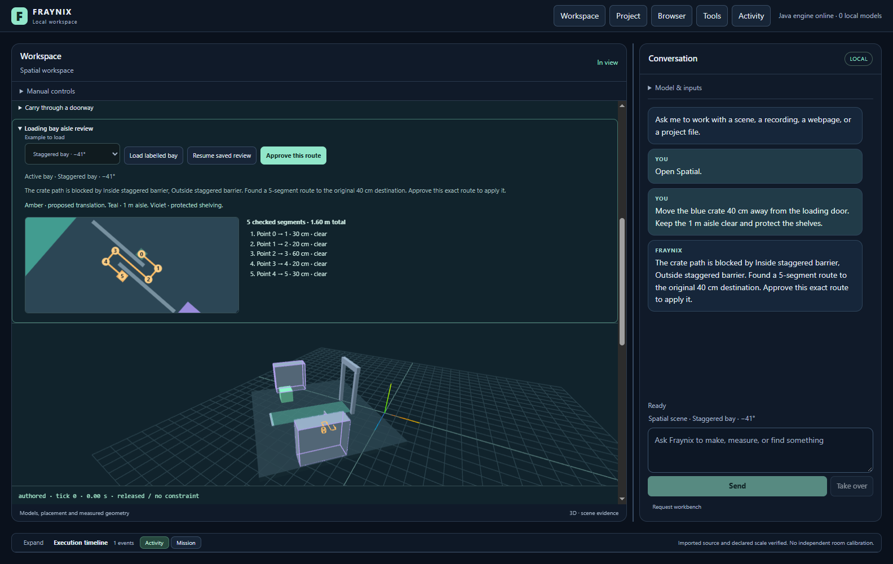
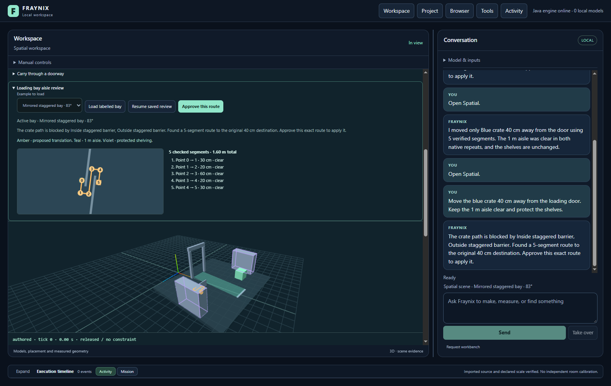
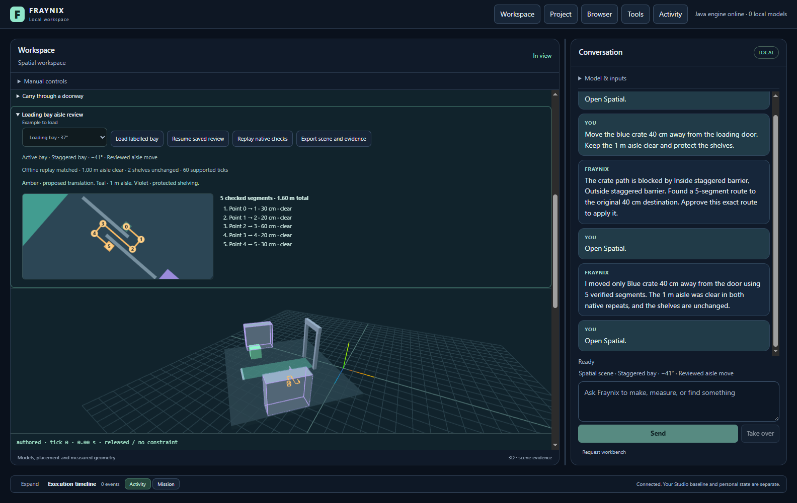

# Edition 276 — Verify multi-segment crate routes

2026-11-27 · [Edition 275](README-275.md) · [Offline walkthrough](docs/readmes/276/index.html) · [Full history](docs/readmes/INDEX.md)

1. Send “Open Spatial.” In **Loading bay aisle review**, load **Staggered bay · −41°**.
2. Ask “Move the blue crate 40 cm away from the loading door. Keep the 1 m aisle clear and protect the shelves.”
3. Review the numbered map and checks for each leg. Click **Approve this route** to apply the exact reviewed move.
4. Use **Resume saved review** after restarting. **Replay native checks** reruns the route. **Export scene and evidence** saves the editable scene, waypoints and receipt together.

The direct path and single-segment alternatives were blocked in both rotated test bays. Java found two mirrored **five-segment routes**. Each traveled **1.60 m** and reached the requested destination **40 cm farther from the door** with zero lateral change at the destination. Every segment had clear endpoints and a native sweep clear of objects and the reserved **1 m aisle**. Both shelves and every other authored object were preserved. The crate held at the destination for **60 supported ticks**.

The blocked crossover refused the move after checking 33 route edges. A separate native test rejected a barrier in the middle of leg 3 even though both leg endpoints were clear. The Windows desktop restored the pending plan and then replayed the approved route across two offline restarts. An incorrect approval digest and a changed waypoint both refused.

[Editable scene and route evidence](docs/readmes/276/route-verified.json) · [Both routes and the refusal report](docs/readmes/276/result.json) · [Design and reproduction](docs/publication276/plan.md)
