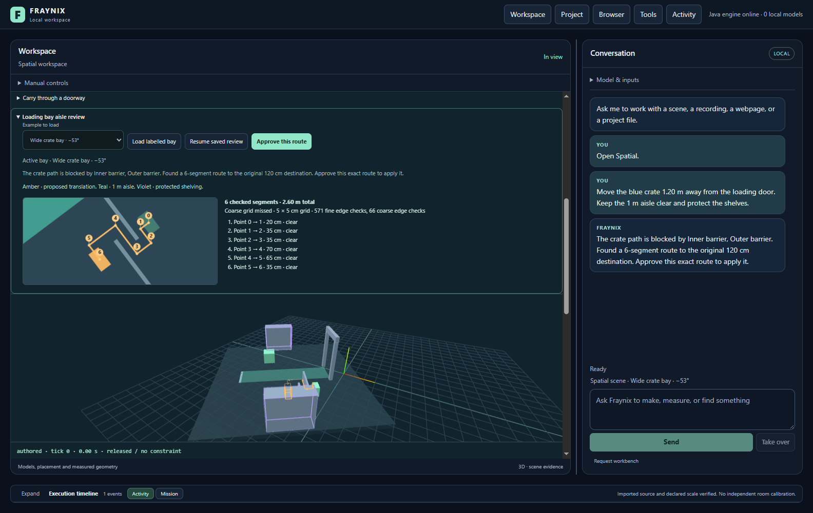
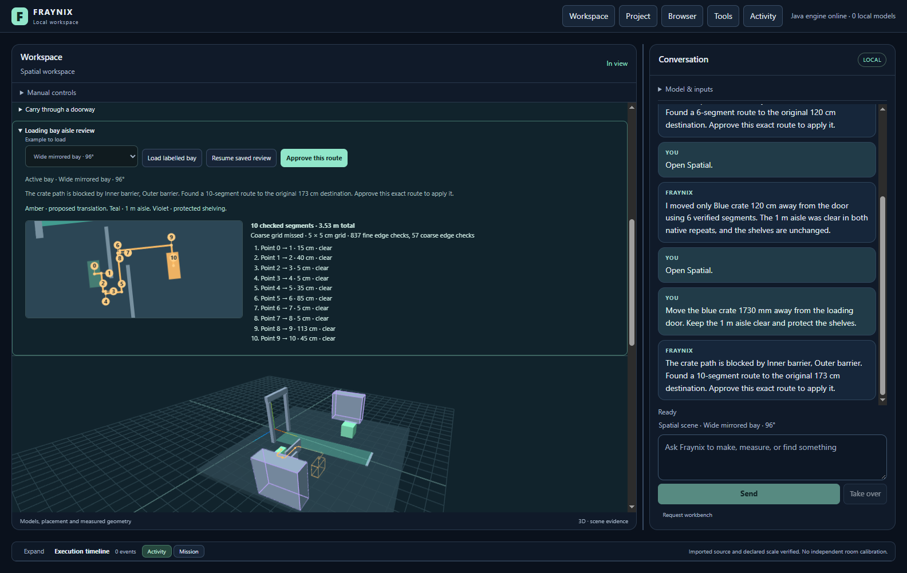
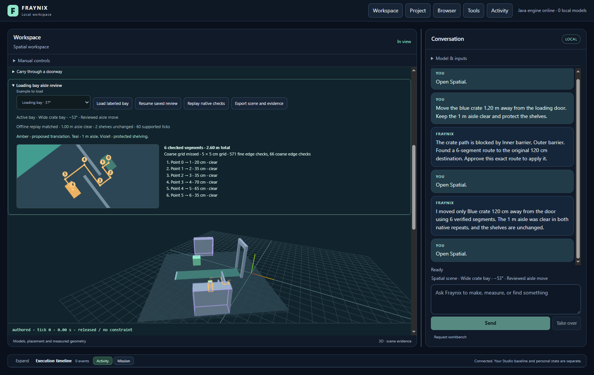

# Edition 277 — Refine routes for wider crates and longer moves

2026-11-27 · [Edition 276](README-276.md) · [Offline walkthrough](docs/readmes/277/index.html) · [Full history](docs/readmes/INDEX.md)

1. Open Spatial and load **Wide crate bay · −53°** under **Loading bay aisle review**.
2. Ask “Move the blue crate 1.20 m away from the loading door. Keep the 1 m aisle clear and protect the shelves.” Chat accepts whole-centimetre moves from **40 to 200 cm**.
3. Review the route, the search resolution and all leg checks. Click **Approve this route** to apply that exact move.
4. After restart, use **Resume saved review** and **Replay native checks**. **Export scene and evidence** saves the editable revision, waypoints and receipt.

| Test bay | Crate width | Requested advance | Coarse edges checked | Fine edges checked | Result |
| --- | ---: | ---: | ---: | ---: | --- |
| Wide crate, −53° | 42 cm | 1.20 m | 66 | 571 | 6 legs · 2.60 m traveled |
| Wide mirrored, 96° | 58 cm | 1.73 m | 57 | 837 | 10 legs · 3.53 m traveled |
| Open crossover, 27° | 42 cm | 1.20 m | 114 | 0 | 6 legs · 3.00 m traveled |
| Oversize, −127° | 74 cm | 1.20 m | 53 | 244 | Refused |

The **10 × 15 cm** grid missed the crossover in the first two bays. A **5 × 5 cm** grid recovered both. Each accepted move kept the **1 m aisle** clear, preserved both shelves and all other authored objects, and held the crate on the floor for **60 supported ticks**.

Windows restored the pending plan after one offline restart and reproduced its measurements after another. Invalid approval and changed search evidence were refused. The oversize crate stayed put after both grids failed to find a route.

[Editable scene and receipt](docs/readmes/277/fine-verified.json) · [All four bay results](docs/readmes/277/result.json) · [Design and reproduction](docs/publication277/plan.md)
