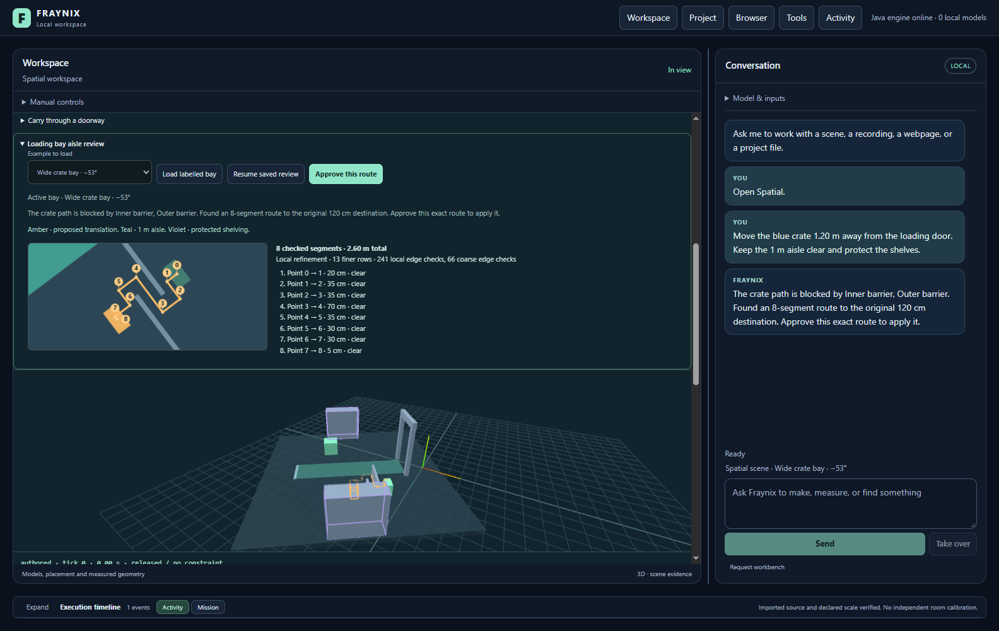
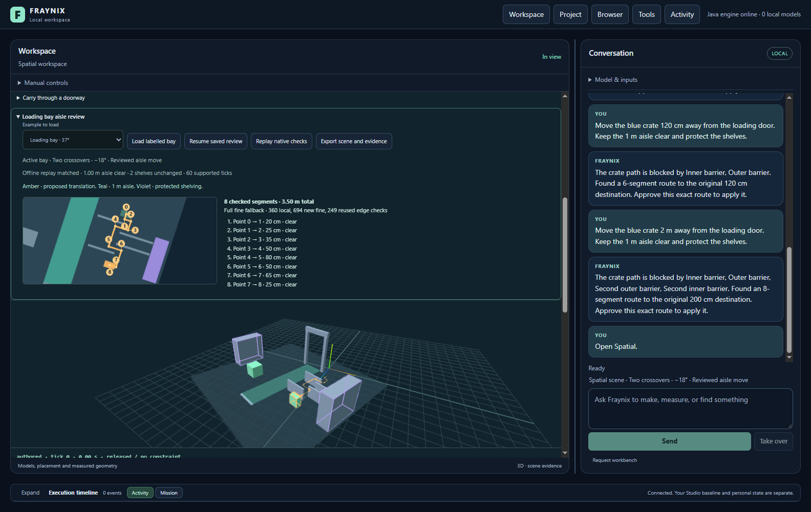
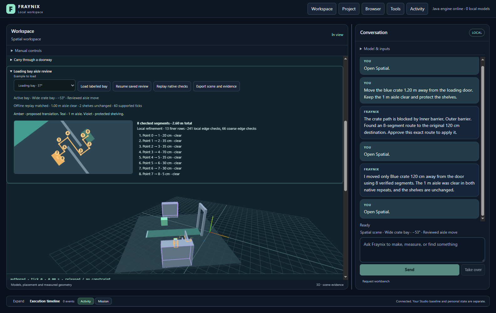

# Edition 278 — Refine crate routes near measured obstructions

2026-11-27 · [Edition 277](README-277.md) · [Offline walkthrough](docs/readmes/278/index.html) · [Full history](docs/readmes/INDEX.md)

In Spatial, load **Wide crate bay · −53°**. Ask “Move the blue crate 1.20 m away from the loading door. Keep the 1 m aisle clear and protect the shelves.” Review the local search count and numbered path, then click **Approve this route**. For the full-grid fallback, load **Two crossovers · −18°** and ask to move it **2 m**.

| Test layout | Prior edge checks | Current edge checks | Current outcome |
| --- | ---: | ---: | --- |
| 42 cm crate, 1.20 m | 637 | 307 | Local route |
| 58 cm crate, 1.73 m | 894 | 393 | Local route |
| Open crossover | 114 | 114 | Coarse route |
| 74 cm crate | 297 | 298 | Refused |
| Two crossovers, 2.00 m | 1012 | 1123 | Full fine fallback |

The five-bay comparison used **24% fewer native route edge checks** overall. Both local routes reached the same exact destinations and traveled the same distances as the previous planner, with more legs. The two-crossover case needed more total checks even after reusing 249 earlier results.

The pending local route, the approved local result and the approved fallback all reopened during three offline restarts. Each accepted route required exact approval and fresh checks for every leg, the **1 m aisle**, both shelves and **60 supported ticks** at the destination.

[Editable scene and receipt](docs/readmes/278/fine-verified.json) · [Restart results](docs/readmes/278/result.json) · [Paired comparison](docs/readmes/278/comparison.json) · [Design and reproduction](docs/publication278/plan.md)
