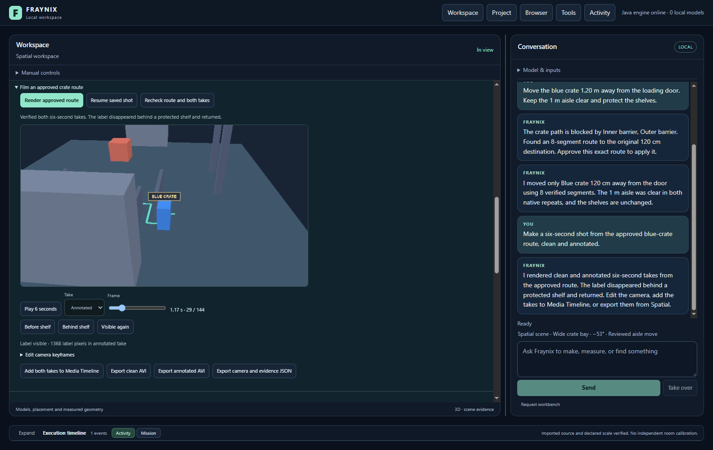
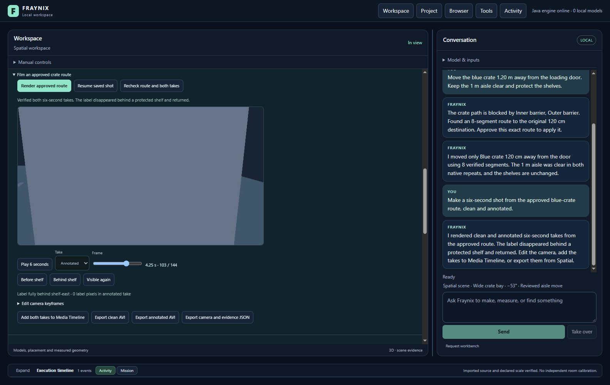
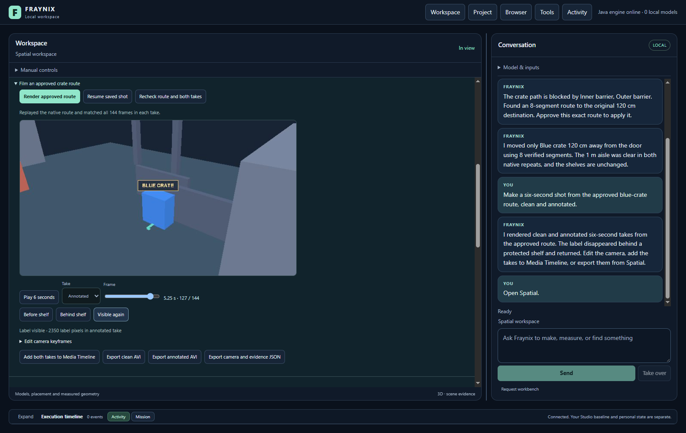
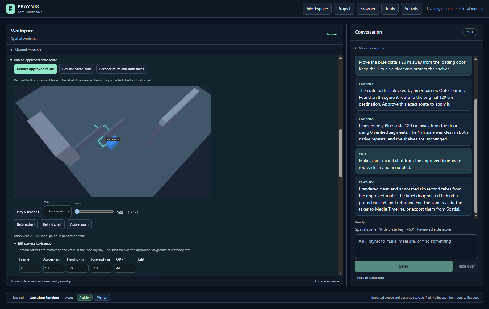

# Edition 279 — Film an approved 3D crate route

2026-11-27 · [Edition 278](README-278.md) · [Offline walkthrough](docs/readmes/279/index.html) · [Full history](docs/readmes/INDEX.md)

Fraynix can turn the approved loading-bay route into a six-second shot offline. Both takes share one editable camera track and the same 3D motion. The annotated take adds a label attached to the crate and a route line on the floor. Both graphics obey scene depth.

## Make the shot

1. In **Spatial → Loading bay aisle review**, load **Wide crate bay · −53°**.
2. Ask Chat “Move the blue crate 1.20 m away from the loading door. Keep the 1 m aisle clear and protect the shelves.” Inspect the route and click **Approve this route**.
3. Ask “Make a six-second shot from the approved blue-crate route, clean and annotated.” Spatial opens the shot when both takes are ready.
4. Play the cut, scrub individual frames, or use **Before shelf**, **Behind shelf** and **Visible again**. Expand **Edit camera keyframes** to edit framing or move the viewpoint. Rendering saves a new revision with both takes linked to the same route.
5. Export clean or annotated AVI and the camera/evidence JSON, or add both original sources to **Media Timeline** for an edit. After restarting, select **Resume saved shot** and **Recheck route and both takes**.

## Verification

| Check | Result on Windows |
| --- | --- |
| Source | 8 native-verified route legs, 1 m aisle and both protected shelves |
| Video | Both 640 × 360 takes independently decoded by FFmpeg to 144 frames at 24 fps |
| Occlusion | Zero label pixels behind a protected shelf in 65 frames. The label center returned at frame 120. |
| Restart | Fresh native replay and render reproduced the original video hashes |
| Media Timeline | Both takes retained exact provenance and a 12-frame cut verified |
| Refusal | Pending approval, edited video bytes and a changed route each refused |

This first cut visualizes the approved route in a declared-scale box scene. The six-second timing is editorial. The renderer runs in Java and produces silent MJPEG AVI. The camera JSON records editable keyframes, route identity and frame evidence.

[Camera and per-frame evidence](docs/readmes/279/shot.json) · [Test results](docs/readmes/279/result.json) · [Design and reproduction](docs/publication279/plan.md)
