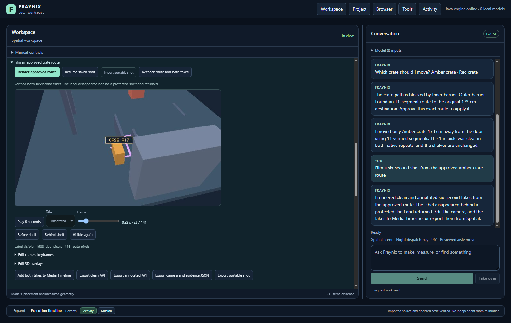
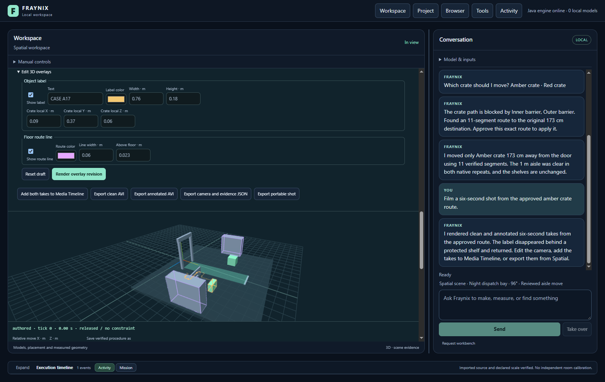
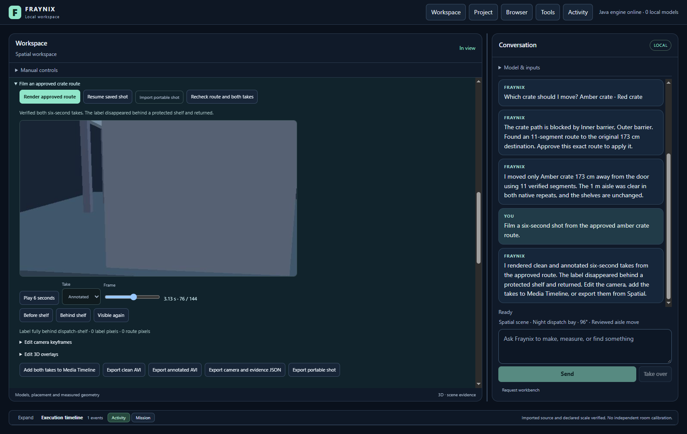
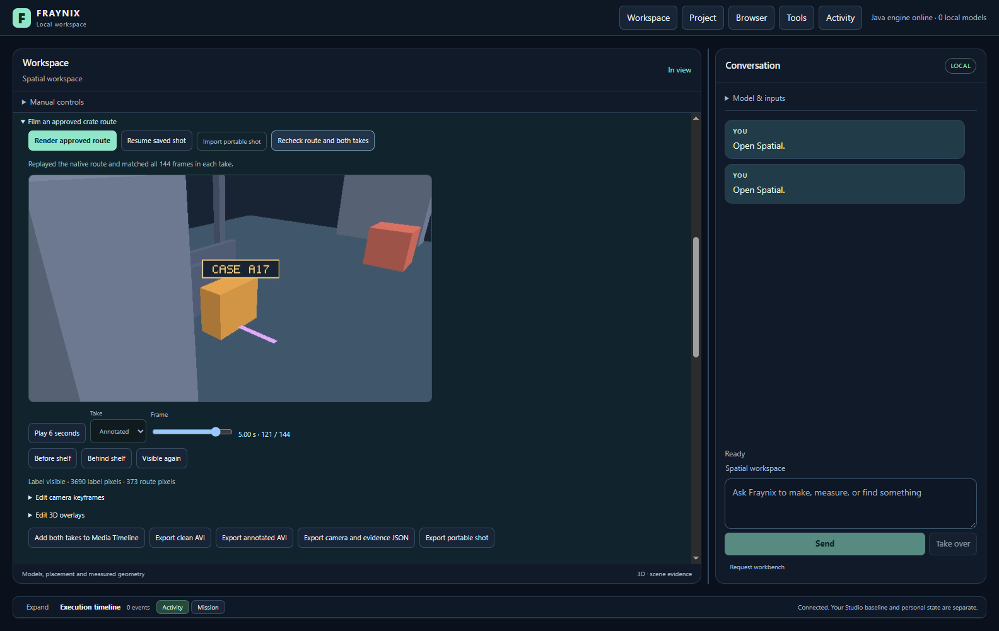

# Edition 280 — Edit 3D overlays and verify a portable shot

2026-11-27 · [Edition 279](README-279.md) · [Offline walkthrough](docs/readmes/280/index.html) · [Full history](docs/readmes/INDEX.md)

A wider amber flight case drives a new shot in the **Night dispatch bay**, rotated 96°. The case label attaches in the object's local coordinates. The route line sits at an editable height above the floor. Both are depth-tested against the scene.

## Film and transfer the shot

1. In **Spatial → Loading bay aisle review**, load **Night dispatch bay · 96°**.
2. Ask Chat “Move the crate 1.73 m away from the loading door. Keep the 1 m aisle clear and protect the shelves.” Choose **Amber crate** when prompted and approve the 11-leg route.
3. Ask “Film a six-second shot from the approved amber crate route.” Open **Edit 3D overlays** and set the label text, color, dimensions and local XYZ attachment. Set the floor line's color, width, elevation and visibility.
4. Select **Render overlay revision**. Scrub the shot, switch takes or edit the camera. **Export portable shot** writes a single file with both AVIs, camera, editable overlays and original route evidence.
5. In a separate project, go to Spatial and select **Import portable shot** under **Film an approved crate route**. After restarting that project, select **Resume saved shot** and **Recheck route and both takes**. You can render and export a separate overlay revision there.

## What passed on Windows

| Check | Result |
| --- | --- |
| Route | 11 verified legs, exact 1.73 m destination, 1 m aisle and two protected shelves |
| Attachment | Independently calculated local-to-world offset matched all 144 label anchors |
| Occlusion | The dispatch shelf completely hid the label in 79 frames. The takes were identical in a frame where that shelf hid both graphics. |
| Media | FFmpeg decoded 144 frames at 24 fps in each six-second export. Disabling both overlays produced the exact clean take. |
| Clean project | The original package was reproduced byte for byte after restart. A recipient edit made a separate shot. |
| Tamper checks | A changed crate-choice record and edited video with a recomputed hash were both refused. |

The package is an editable media artifact. Import runs native checks in isolated simulation worlds and preserves the original approval as evidence. A new move still goes through Spatial's own approval. This shot uses the planned route from the declared-scale test bay, with six seconds of editorial timing.

[Frame audit](docs/readmes/280/shot.json) · [Test results and package hash](docs/readmes/280/result.json) · [Design and reproduction](docs/publication280/plan.md) · [Portable CI artifacts](https://github.com/eyeoverthink/Fraynix-Agent-Workspace/actions/workflows/portable-workspace.yml)
