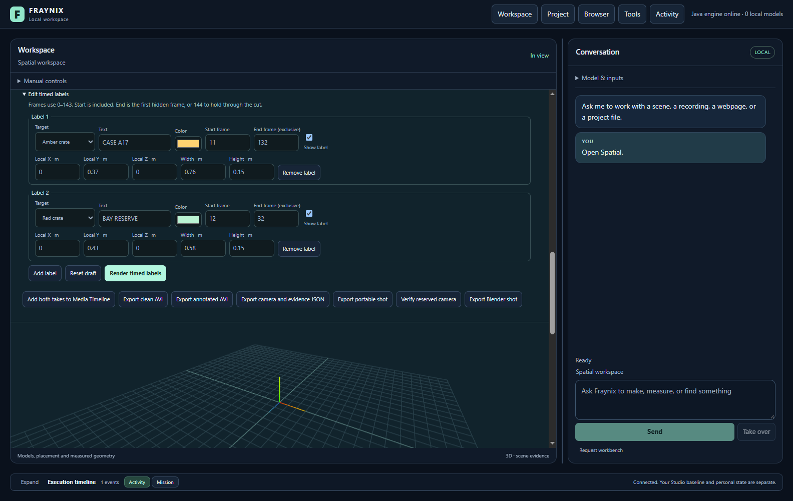
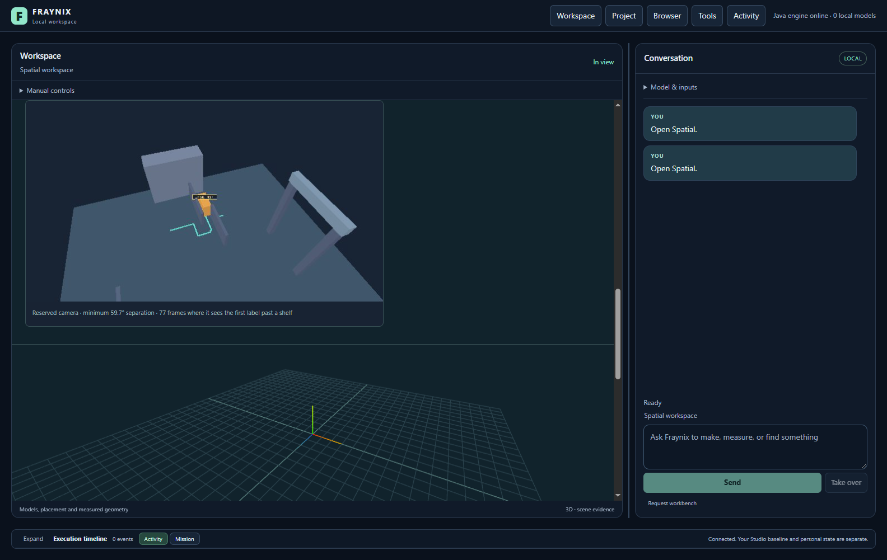
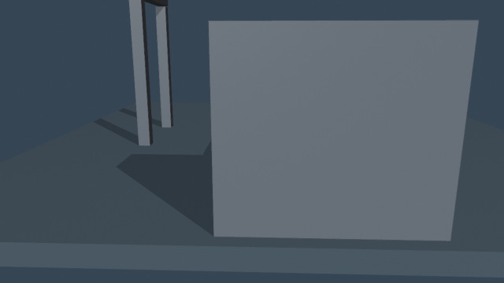
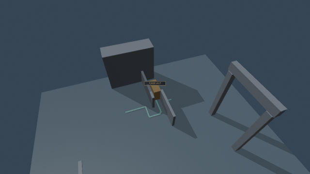

# Edition 281 — Replay timed 3D labels in Blender

2026-11-28 · [Edition 280](README-280.md) · [Offline walkthrough](docs/readmes/281/index.html) · [Full history](docs/readmes/INDEX.md)

Edition 281 adds up to six timed labels to one approved 3D route shot. Each label attaches to a source object and has its own editable text, color, size, local XYZ offset and frame range. The Night dispatch bay demonstration labels both the moving amber flight case and the red reserve crate.

## Edit, transfer and check a shot

1. In Spatial, film an approved multi-leg crate route. With the example **Night dispatch bay · 96°**, ask for the amber crate to move **1.73 m** away from the door and approve the reviewed route.
2. In the shot panel, open **Edit timed labels**. Set the first label's start and end, select **Add label** and choose a second object. Start is inclusive. End is exclusive. Use 144 to hold a label through the last frame.
3. Select **Render timed labels** and **Export portable shot**. Import that file in another project, adjust the label timing and render a revision there.
4. Restart the recipient project, reopen its saved shot and recheck both takes. Select **Verify reserved camera** to compare against the independently reserved view.
5. Select **Export Blender shot** with Blender installed locally. The .blend contains a primary scene and a reserved-camera scene. Both have animated cameras, object-parented editable text and keyed label visibility. Fraynix frame 0 corresponds to Blender frame 1.

## Verification on Windows

| Check | Measured result |
| --- | --- |
| Recipient timing | CASE A17 active on [11, 132), BAY RESERVE on [12, 32) |
| Restart | Both 144-frame takes and the recipient package matched byte for byte |
| Reserved camera | 59.7° minimum separation, 77 frames revealing the first label from behind the shelf |
| Blender readback | Blender 5.3.0 reopened the exported file and checked 144 frames per view, including 248 projected label-center rays |
| Same-frame evidence | At frame 38, the primary camera is occluded and the reserved camera sees CASE A17 |

The Blender replay verifies geometry, camera projection and timing. BAY RESERVE is offscreen from the reserved camera during its 20-frame cue and has its center in view on six primary-camera frames. Blender uses its own render style. The shot visualizes the approved route with editorial timing in a box-geometry scene.

[Restart and timing result](docs/readmes/281/result.json) · [Blender readback](docs/readmes/281/blender-proof.json) · [Design and reproduction](docs/publication281/plan.md)
