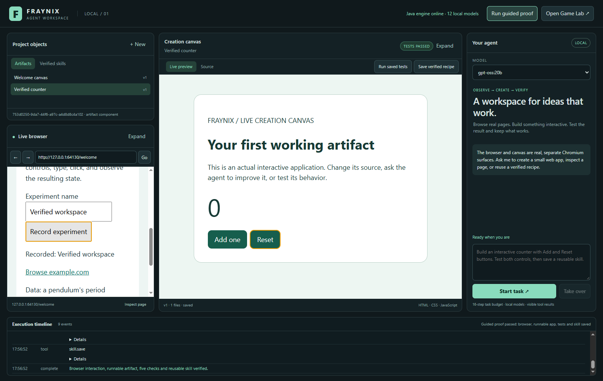

# Fraynix Agent Workspace

**A local visual environment for agents to browse, create runnable artifacts, test behavior and reuse verified skills.**

> **Latest system edition: [README 006 — complete guide and roadmap](README-006.md)** · [Interactive explorer](docs/readmes/006/index.html) · [Design and scope](docs/AGENT_WORKSPACE_DESIGN.md) · [Edition history](docs/readmes/INDEX.md)

Independent successor to [Fraynix Studio](https://github.com/eyeoverthink/Fraynix-Studio), starting from verified commit `6341404`. The original application and personal project state remain separate. Full game sources, assets, licenses and earlier editions are preserved here.

## Start

Run **Launch-Agent-Workspace.bat** with JDK 21 and Node.js 22.12 or newer installed. First setup downloads pinned Electron/Chromium dependencies. Use an installed local Ollama model for agent tasks. Docker and WSL are not required.

The app includes a real browser, live creation canvas, editable source, versioned artifact library, local-model agent, execution timeline and tested recipe library. **Run guided proof** demonstrates the complete local workflow. **Open Game Lab** launches the preserved Java editor in its own successor project directory.

Local `gpt-oss:20b` is the verified default for the first agent fixture. The custom FRAYNIX 3B trial returned an Ollama native-format error; advertised tool capability alone does not establish task reliability. You can select other eligible installed models explicitly.



Application frame export composed from the actual shell and child Chromium renderers. See [verification](docs/readmes/005/verification.json) for integration checks, the live-model fixture and independent acceptance assertions.

## Verify

```powershell
.\gradlew.bat check installDist :workspace-engine:installDist
cd workspace-desktop
npm.cmd ci --no-audit --no-fund
npm.cmd test
npm.cmd run test:integration
# Optional actual local-model fixture:
$env:FRAYNIX_LIVE_MODEL='gpt-oss:20b'
npm.cmd run test:live
```

Project files, test receipts, learned recipes, browser cookies and event history live under `%USERPROFILE%/.fraynix-agent-workspace/projects/default`, outside Git. `FRAYNIX_WORKSPACE_PROJECT` selects another independent project.

The current skill type is a tested web-artifact recipe. General code workers, broader computer control, visual-model perception and evaluated neural/system improvement are subsequent milestones in the [design plan](docs/AGENT_WORKSPACE_DESIGN.md).

## First session step by step

1. Launch the app and wait for **Java engine online**.
2. Click **Run guided proof**. Watch the actual lower-left browser fill and submit the local practice form.
3. Use the counter that opens in the creation canvas. Its passing badge follows real Add/Reset assertions.
4. Inspect the execution timeline, then open **Verified skills** to reuse the saved recipe.
5. Select **gpt-oss:20b** and ask the agent to create a new small application with explicit tests. Click **Start task**.
6. Switch to **Source** to inspect or edit files. **Save & run** saves another version. Rerun its tests before saving another verified recipe.
7. Use **Take over** whenever you want to stop the task. **Open Game Lab** opens the preserved native game editor separately.

Example first request:

> Create a counter with count initially 0, an Add button and a Reset button. Test that Add changes 0 to 1 and Reset restores 0. Correct failures, retest and save a verified recipe.

[Full setup, walkthrough and troubleshooting](README-006.md) explains each control, project persistence and the local-model requirements. After Java source changes, rebuild the installed distributions; the launcher only builds when they are missing.

## What the app brings together

The left side contains saved project objects and a real browser. The center runs generated HTML/CSS/JavaScript and exposes its saved source. The right side holds model selection, the goal, result and takeover. The bottom records actual actions and measured outcomes. The same visible page is available to both human browsing and supported agent actions.

Java reuses the existing model catalog, entity/component runtime, transactions, checkpoints and kernel memory. Electron hosts isolated browser and artifact renderers. Source versions and test receipts stay bound together, so a passing old version cannot certify a later edit. A frozen implementation inventory contains **338 source/assets**, all verified against a fresh GitHub clone.


October 29, 2026 live-model fixture, reused from edition 005. Actual application frame export; the source, tests and independent acceptance results are in the [verification record](docs/readmes/005/live-model.json).

## Development and next direction

The project grew from the full Mario game editor and sensory/nervous-system integration, through reliable placement, level persistence, power-up rendering and gameplay practice, into this independent browser/canvas workspace. [README 006](README-006.md) traces those steps and the [earlier editions](docs/readmes/INDEX.md) retain their original evidence.

Next, examine the creator's **Fraymus-OS-One** learning implementation, map its real mechanisms to this workspace, add replayable episodes and evaluate candidate improvements against baseline tasks. Broader browser adapters, more artifact types, isolated general-code workers and aligned game/vision observations follow their own acceptance gates. The current app design remains the foundation.

Recipe reuse, retrieval memory, nervous-system adaptation and actual model-weight training are tracked separately. A training integration should record data provenance, checkpoint identity, held-out results and rollback. The next stage begins by assessing existing work rather than assuming that a new training engine must be written from scratch.
