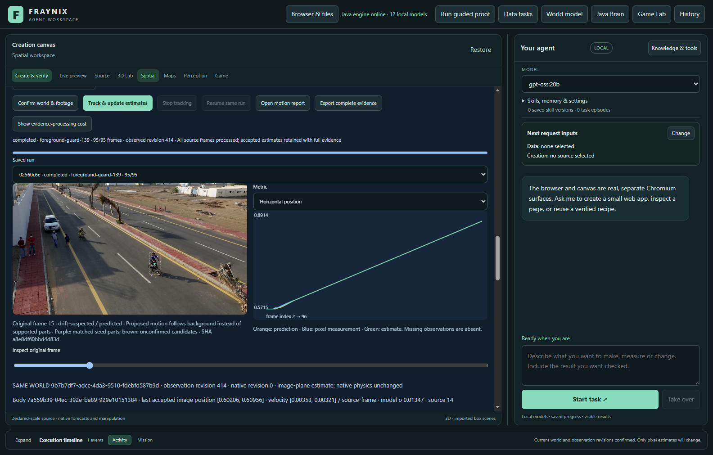
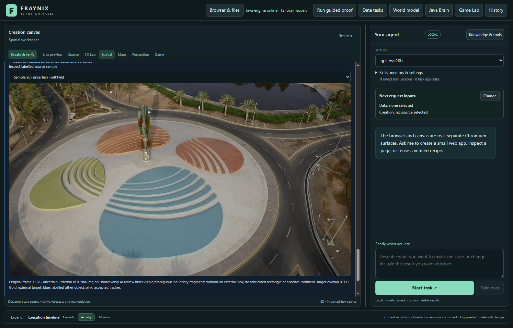
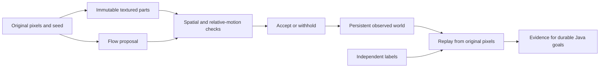

# Fraynix Agent Workspace — Edition 139

[Published and fetched verification receipt](docs/PUBLICATION_139.json) · [Release tag](https://github.com/eyeoverthink/Fraynix-Agent-Workspace/tree/readme-139)

**Check foreground motion and spatial structure before trusting a tracked box.** Fraynix connects durable chat goals, Java simulation, observed worlds, browser interaction, creation tools and verified reusable procedures. This edition adds an optional drift guard and tests it against new disappearance and return footage. The established tracker remains the default.

[Previous edition](README-138.md) · [All editions](docs/readmes/INDEX.md) · [Offline interactive guide](docs/readmes/139/index.html) · [Integrated roadmap](docs/INTEGRATED_AGENT_ROADMAP.md) · [Contributor handoff](README-CONTRIBUTORS.md)



This capture shows a limitation, not a successful detection: the orange proposal was correctly positioned according to the independent box, but the candidate withheld it. The full comparison below retains that cost.

## What changed

Color alone can remain plausible while a tracking rectangle gradually slips onto background pixels. **foreground-guard-139** selects up to nine eligible textured parts from the original object. It searches for those parts, checks whether they still form a coherent arrangement, and compares their motion with nearby background motion and the flow tracker's proposed movement. Two consecutive structural disagreements can withhold a measurement while the underlying tracker still reports success.

This is handwritten Java computation. It adds no model weights or runtime vision library. The initial appearance is immutable: tracked predictions never become new templates. Missing texture or surrounding background is insufficient evidence for the spatial-part checks, not a fabricated certainty. The trace exposes eligible parts, matched parts, geometric agreement, original proposal, foreground/background displacement, warning reasons and recovery confirmations.

Edition 138's whole-appearance checks remain. Recovery requires a strong unique original-source match, spatial support when enough seed parts exist, and agreement across two images. A newly rejected image cannot alone certify recovery. Identical lookalikes must remain unresolved. This is appearance tracking, not person identification or general object understanding.

**monitor-only-139** computes the evidence without changing any incumbent tracker/filter output. Comparisons include **legacy-flow**, the unchanged default, and **drift-guard-138**. Earlier verified-reference features remain available with their original checks. No automatic appearance-memory admission is introduced.

## Fresh results

Fresh guard: **43/201 correct visible/partial observations**, versus **119/201** for the default. Accepted wrong overlaps: **0 versus 8**. Missing observations: **158 versus 74**. Confirmed labelled-other matches: **0 versus 0**. Hidden outputs: **0/85 versus 0/85**. These measured tradeoffs do not qualify a default promotion; the candidate remains explicit.

| Method / source | Correct / visible | Missing | Wrong overlaps | Other-object matches | Hidden outputs |
| --- | ---: | ---: | ---: | ---: | ---: |
| legacy-flow / ballet-100 | 22/34 | 12 | 0 | 0 | 0/11 |
| drift-guard-138 / ballet-100 | 12/34 | 22 | 0 | 0 | 0/11 |
| monitor-only-139 / ballet-100 | 22/34 | 12 | 0 | 0 | 0/11 |
| foreground-guard-139 / ballet-100 | 20/34 | 14 | 0 | 0 | 0/11 |
| legacy-flow / bicycle-98 | 10/34 | 24 | 0 | 0 | 0/15 |
| drift-guard-138 / bicycle-98 | 10/34 | 24 | 0 | 0 | 0/15 |
| monitor-only-139 / bicycle-98 | 10/34 | 24 | 0 | 0 | 0/15 |
| foreground-guard-139 / bicycle-98 | 10/34 | 24 | 0 | 0 | 0/15 |
| legacy-flow / bike1-1 | 87/95 | 0 | 8 | 0 | 0/0 |
| drift-guard-138 / bike1-1 | 87/95 | 0 | 8 | 0 | 0/0 |
| monitor-only-139 / bike1-1 | 87/95 | 0 | 8 | 0 | 0/0 |
| foreground-guard-139 / bike1-1 | 13/95 | 82 | 0 | 0 | 0/0 |
| legacy-flow / bird1-641 | 0/18 | 18 | 0 | 0 | 0/55 |
| drift-guard-138 / bird1-641 | 0/18 | 18 | 0 | 0 | 0/55 |
| monitor-only-139 / bird1-641 | 0/18 | 18 | 0 | 0 | 0/55 |
| foreground-guard-139 / bird1-641 | 0/18 | 18 | 0 | 0 | 0/55 |
| legacy-flow / car1-1508 | 0/20 | 20 | 0 | 0 | 0/4 |
| drift-guard-138 / car1-1508 | 0/20 | 20 | 0 | 0 | 0/4 |
| monitor-only-139 / car1-1508 | 0/20 | 20 | 0 | 0 | 0/4 |
| foreground-guard-139 / car1-1508 | 0/20 | 20 | 0 | 0 | 0/4 |


| Method / source | Useful warnings | False warnings | Missed wrong proposals |
| --- | ---: | ---: | ---: |
| drift-guard-138 / ballet-100 | 0 | 0 | 0 |
| monitor-only-139 / ballet-100 | 0 | 0 | 0 |
| foreground-guard-139 / ballet-100 | 0 | 0 | 0 |
| drift-guard-138 / bicycle-98 | 0 | 0 | 0 |
| monitor-only-139 / bicycle-98 | 0 | 0 | 0 |
| foreground-guard-139 / bicycle-98 | 0 | 0 | 0 |
| drift-guard-138 / bike1-1 | 0 | 0 | 8 |
| monitor-only-139 / bike1-1 | 4 | 5 | 4 |
| foreground-guard-139 / bike1-1 | 4 | 5 | 4 |
| drift-guard-138 / bird1-641 | 0 | 0 | 0 |
| monitor-only-139 / bird1-641 | 0 | 0 | 0 |
| foreground-guard-139 / bird1-641 | 0 | 0 | 0 |
| drift-guard-138 / car1-1508 | 0 | 0 | 0 |
| monitor-only-139 / car1-1508 | 0 | 0 | 0 |
| foreground-guard-139 / car1-1508 | 0 | 0 | 0 |

First wrong visible proposal / first warning (later-frame ordinals, monitor control): ballet-100 None / None; bicycle-98 None / None; bike1-1 73 / 14; bird1-641 None / None; car1-1508 None / None. This descriptive timing is not advance prediction of drift; warnings can arrive after an error already exists, and a warning before the first error can be a false alarm.


The continuous bike1 control reveals the main failure: its first warning at later-frame ordinal 14 flagged a proposal with overlap 0.895 as background-following. That correct proposal entered quarantine, and no source-qualified recovery succeeded during the rest of the window. Correct outputs fell from 87 to 13 while wrong overlaps fell from 8 to 0. One false alarm therefore has a much larger cost than its warning count suggests. This is post-run diagnosis, not a threshold adjustment; the original traces and diagnostic record are retained.

Useful warnings identify an already wrong or hidden proposal; they do not prove advance knowledge. False warnings flag correct visible proposals. Missing measurements stay in the denominator. Withholding everything is not successful tracking. An overlap failure does not by itself establish an identity switch, and unlabelled distractors cannot establish switch-free behavior.

## Sources and limits

| Recording / target | Original frames | Stride | Visible or partial | Hidden | Uncertain | Distractor-labelled samples |
| --- | --- | ---: | ---: | ---: | ---: | ---: |
| ballet / 1 | 100–161 | 1 | 34 | 11 | 16 | 0 |
| bicycle / 1 | 98–165 | 1 | 34 | 15 | 18 | 0 |
| bike1 / 1 | 1–96 | 1 | 95 | 0 | 0 | 0 |
| bird1 / 1 | 641–791 | 2 | 18 | 55 | 4 | 0 |
| car1 / 1 | 1508–1565 | 1 | 20 | 4 | 33 | 0 |


Original [VOT-LT2018 recordings](https://www.votchallenge.net/vot2018/dataset.html) and official annotation archives were acquired after the method/scorer freeze. Selection follows the [contract](docs/EDITION_139_CONTRACT.md) and [source-only clarification](docs/EDITION_139_SOURCE_NOTE.md). Every selected image was inspected without tracker predictions, then source labels were frozen. No thresholds were changed after seeing fresh outcomes.

Ballet and bicycle test exits from the frame and returns. Some NaN annotation boundaries contain visible fragments; these are uncertain rather than falsely counted as completely hidden. Bike1 has no annotated absence and remains a continuous-motion control. Bird1 and car1 were selected through the documented source-only extension. Bird1 is another active-image exit; car1 passes behind a central structure. Their source evidence is described in the [source manifest](docs/publication139/source139.json). VOT bird1 is distinct from the earlier rendered OTB Bird1. External rectangle/absence data and additional AI source judgments are separately recorded; AI review is not independent human adjudication. This bounded study is not a full VOT benchmark submission.

All362 selected source images reviewed in source-only contact sheets before predictions. Ballet/bicycle edge fragments inspected in detail; their absence labels begin before full visual disappearance and end after partial return, so ambiguous boundaries remain uncertain. VOT bird1 is a real onboard flight camera with black borders, distinct from rendered OTB Bird1; its selected event is another active-image exit. Car1 enters behind a central vertical structure and returns; detailed source crops support four confidently hidden frames1533–1536, with19 NaN boundary frames uncertain. Bike1 first96 images remain visible. Bird1 stride2 with explicit interval endpoints gives78 sampled images and skips intervening frames. External boxes plus separate AI visibility/cause review, no independent human adjudication and no other-object geometry. Frozen scorer breaks recovery episodes at uncertainty; descriptive boundary return tables must not invent recovery timing across those gaps. Existing audit format requires every scored rectangle to have both normalized sides at least0.025. 14 visible small/clipped external boxes are therefore retained as uncertain/unscorable, never expanded or classified hidden. Original external rectangles remain intact; pre-format inputs retained in Git d84ccd12 and original evidence. Unsupported extra row metadata was removed; the same external finite/NaN distinction remains in row notes. Six score boxes and one seed meet the exact rational1/40 side bound but double subtraction rounded below it; a single outward endpoint ULP preserves the mathematically valid rectangle. No pixel-scale padding, relaxed bound or changed source image; each exact correction retained.



### Previously exposed development footage

The four edition 138 windows are development data, not fresh evaluation. Across 332 visible/partial samples, the default and the 138 guard each retained 122 correct observations; the 139 guard retained 72. Wrong accepted overlaps fell from 132 for the default and 130 for 138 to 1 for 139. Missing measurements rose from 78 to 259. On the single confidently hidden sample, the default and 138 produced an unsupported box; 139 withheld it. These substantial recall losses prevent a promotion claim. The monitor control preserved the first skater’s 95 later tracker/filter outputs exactly. Complete development traces and costs are retained.

## Verification and recovery

Local checks passed: 301 distinct Java tests, 161 desktop checks, kernel integration, actual agency regression and isolated offline/package preparation. Twenty actual-app fresh comparisons use 1428 later-frame outcomes. Exact monitor equivalence, original-pixel audit replay, independent host arithmetic, export, stop/resume and abrupt-process cold restart are verified.

- Twenty actual-app fresh comparisons: five fixed target windows, four methods, identical source pixels. Independent host overlap/distractor/warning arithmetic agrees with Java. Monitor-only preserves every incumbent tracker/filter output. No automatic anchor admissions; defaults unchanged.
- Explicit method selection, warning explanation, original-proposal overlay, independent audit UI, complete bounded export and exact stopped-prefix resume passed. Native physical world unchanged.
- Owned-process crash and cold reopen preserve exact completed-state bytes/timestamp and zero observation writes. All20 runs/audits reverified, including original-pixel decision replay. Source modification refuses audit/export; original restoration revalidates.

Before outcome scoring, the Java audit rebuilds the entire 139 decision sequence from original pixels and the original seed. Each recorded decision must match. Independent labels never enter tracking. Source hashes, implementation identities, stored histories, world bindings and outcome checks remain mandatory. Changed pixels or forged decisions refuse verification/export. Completed-state restart does not silently rewrite evidence. Interrupted work requires explicit resume.

The production interface shows accepted boxes, withheld original proposals and seed-part candidates separately. Purple marks uniquely matched seed parts; brown marks unconfirmed candidates. Neither color is a ground-truth label. A withheld observation does not move the native physical world.

## Complete workflow costs

| Measured run phase | Tracking / ms | Audit with replay / ms |
| --- | ---: | ---: |
| legacy-flow / ballet-100 | 8028.5 | 112.5 |
| drift-guard-138 / ballet-100 | 10630.3 | 12314.0 |
| monitor-only-139 / ballet-100 | 18621.1 | 22358.0 |
| foreground-guard-139 / ballet-100 | 23646.0 | 22570.4 |
| legacy-flow / bicycle-98 | 18051.0 | 155.1 |
| drift-guard-138 / bicycle-98 | 21343.7 | 11362.1 |
| monitor-only-139 / bicycle-98 | 31375.7 | 23278.9 |
| foreground-guard-139 / bicycle-98 | 34394.8 | 23053.6 |
| legacy-flow / bike1-1 | 40030.9 | 303.1 |
| drift-guard-138 / bike1-1 | 48057.7 | 3466.8 |
| monitor-only-139 / bike1-1 | 86384.6 | 49473.8 |
| foreground-guard-139 / bike1-1 | 98299.3 | 50187.6 |
| legacy-flow / bird1-641 | 71604.1 | 219.9 |
| drift-guard-138 / bird1-641 | 76178.7 | 24812.2 |
| monitor-only-139 / bird1-641 | 97972.5 | 59800.0 |
| foreground-guard-139 / bird1-641 | 102755.0 | 60281.4 |
| legacy-flow / car1-1508 | 59598.5 | 337.6 |
| drift-guard-138 / car1-1508 | 62356.0 | 14795.6 |
| monitor-only-139 / car1-1508 | 79014.2 | 41485.6 |
| foreground-guard-139 / car1-1508 | 80659.1 | 41884.1 |

The entire actual-app harness took 1928.5 seconds (32.1 minutes), including imports, UI inspection, repeated verified reads, export, captures, stop/resume, crash/reopen and tamper checks. The phase intervals above are subsets of this elapsed time, not additional costs to add to it. Regression/build/documentation work is separate.


These are measured durable tasks, including retained history and a separate audit with original-pixel replay. They are not a same-workload scaling benchmark or proof of live webcam speed. Extra spatial matching and replay have real costs. The bike1 control took about 40.0 seconds with the default and 98.3 seconds with the active guard before the separate audit; the guard also retained far fewer correct observations. These single measured runs do not establish a general speed ratio. The study uses one owned Java process, bounded heap/processor settings and an isolated J: project; private projects and shared desktop dependencies remain intact.

## Review it locally

Use JDK 21 and the prepared desktop dependencies. From the checkout:

```powershell
$env:FRAYNIX_WORKSPACE_PROJECT = Join-Path $env:LOCALAPPDATA 'Fraynix-Review-139'
.\scripts\Start-Agent-Workspace.ps1
```

After dependencies are cached, add `-Offline` to require local operation. Preserve your existing project path and stop its Java owner through its app before rebuilding that owner's installation.

1. Open **Spatial → Real footage · observed world**. Select a saved world, import footage and mark the initial object rectangle.
2. Run **Existing flow tracker** as the baseline. Choose the 139 experimental method explicitly for a comparison; use the 139 monitor to retain incumbent outputs.
3. Inspect original pixels, the proposed box, matched parts and warning explanations. Do not treat the prediction overlay as a measurement.
4. Import independently prepared identity/visibility labels under **Object identity · occlusion & recovery**. Audit the run and inspect false warnings, missing measurements and recovery outcomes.
5. Stop/resume, reopen and reverify. Export the complete evidence within existing bounds. Keep the original project if an export exceeds a limit; never discard evidence to make it fit.

## Where this fits



The destination remains one local agent system: Java owns durable goals, environment state, action validation, recovery and evaluation; the desktop presents the world, browser and creation canvas. Better measurements should support useful tasks, not replace the application with an isolated tracking demonstration. No default, action-authority or capacity increase is part of this edition.

## Next steps

1. **Reduce false withholding before adding more autonomy.** Use these now-exposed failures for development: separate genuine replacement or background drift from normal scale, pose and lighting changes. Keep the immutable source anchor; any additional appearance example must pass the existing independent admission checks. Freeze the next candidate before new evaluation.
2. **Make disappearance and return measurable.** Use larger targets, complete obstruction, re-entry and labelled lookalikes. Obtain independent visibility and target-identity review, retain uncertain boundaries, and measure correct recovery alongside false recovery and missing observations. Four confidently covered car images cannot establish general occlusion handling.
3. **Earn back the added processing cost.** Profile full tracking, persistence and original-pixel replay. Compare any optimization on identical histories and interrupted tasks, retaining every source and outcome check. Faster computation without useful observations is insufficient.
4. **Keep the connected application central.** Feed only qualified measurements into durable Java world, browser and creation goals. Clearly separate observed position, predicted position and unknown state. A missing or suspect measurement must not silently authorize a physical action or become appearance memory.


## Attempts and publication evidence

- Synthetic development first failed on resampling aliasing and a recovery search that preferred a smaller wrong candidate. Anti-aliasing and source-supported recovery were corrected before the method freeze. The first two failed attempts, subsequent targeted passes and the full regression results are retained.
- The Python downloader initially rejected the certificate chain. Acquisition used Windows curl with certificate validation intact. Published compressed byte counts also differed from the retrieved archives; published SHA1, archive CRC and uncompressed byte counts were checked, and the discrepancy remains in the records.
- Source-only inspection found no absence in bike1. It remains a continuous-motion control. The documented extension retained bird1 even though its disappearance was another exit, then added car1's actual obstruction. All five selected windows remain in the comparison.
- Before predictions, strict label validation rejected an unsupported annotation field and undersized boxes. The original external annotations remain unchanged. Fourteen visible boxes below the existing minimum are explicitly unscorable. Exact-rational boundary normalization fixes floating-point representation at 1/40 without pixel-scale padding or relaxing the minimum. Original label attempts and corrections are retained.
- The code and scorer were frozen before new imagery or annotations. Final source labels were committed before fresh predictions. Fresh outcomes have not been used to tune this candidate.

- The actual-app harness completed all twenty comparisons, restart/replay, export and source-tampering checks on its first attempt. No fresh-outcome changes or default promotion were made.


- The first publication audit refused stale hashes for two roadmap documents updated after the inventory was generated. The failed attempt remains in Git history and the publication log. Documentation hashes were finalized after notes; the frozen production lock is still checked. This was corrected before any push.

Hosted CI, local tests and fetched publication checks are distinct. Raw footage archives and private projects are not published. Exact source identities, external annotations, frozen labels, run traces, failures, tests and limited attributed app screenshots are retained.

[Validation](docs/readmes/139/verification.json) · [Original evidence](docs/readmes/139/original-evidence.json) · [Comparison](docs/readmes/139/comparison.json) · [Source manifest](docs/publication139/source139.json) · [Method lock](docs/OBSERVATION_139_LOCK.json) · [Source inventory](docs/readmes/139/file-inventory.json)

[Spatial evidence](workspace-engine/src/main/java/fraymus/workspace/SpatialEvidence139.java) · [Guard](workspace-engine/src/main/java/fraymus/workspace/ForegroundGuard139.java) · [Replay audit](workspace-engine/src/main/java/fraymus/workspace/ForegroundAudit139.java) · [Actual-app test](workspace-desktop/test/foreground139-integration.cjs) · [Project memory](docs/PROJECT_MEMORY.md)

Preserve every frozen edition, original failed comparison and private dataset. No candidate promotion or publication claim without supporting evidence. Read [AGENTS.md](AGENTS.md) before continuing.
