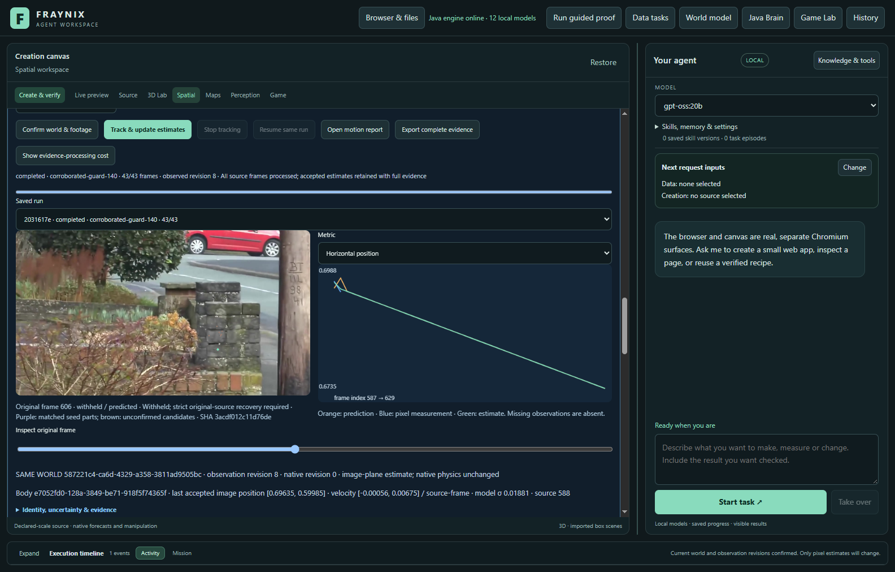
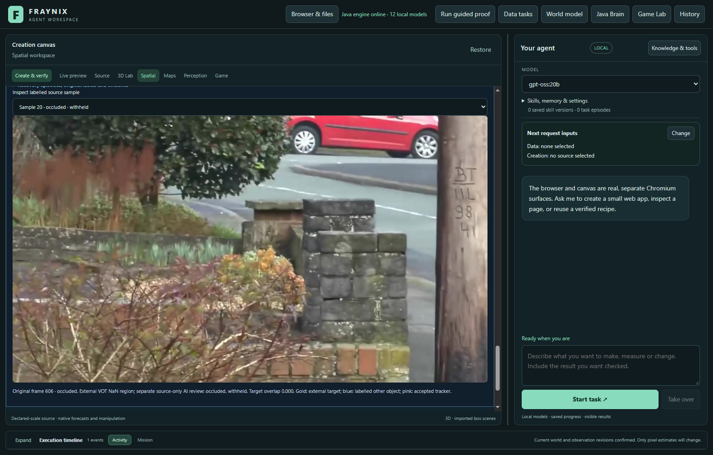
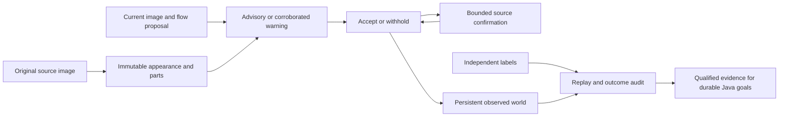

# Fraynix Agent Workspace — Edition 140

[Published and fetched verification receipt](docs/PUBLICATION_140.json) · [Release tag](https://github.com/eyeoverthink/Fraynix-Agent-Workspace/tree/readme-140)

**Warnings, recovery and the cost of waiting.** Fraynix connects durable chat goals, a Java brain and simulation, observed worlds, browser interaction, data and creation tools, and reusable verified procedures. This edition tests a response to a concrete failure: one false motion warning in edition 139 suppressed many later valid observations.

[Previous edition](README-139.md) · [All editions](docs/readmes/INDEX.md) · [Interactive offline guide](docs/readmes/140/index.html) · [Integrated roadmap](docs/INTEGRATED_AGENT_ROADMAP.md) · [Contributor handoff](README-CONTRIBUTORS.md)



## What changed

The optional **corroborated-guard-140** distinguishes advisory spatial disagreement from confirmed warnings. Motion following the background, or a different arrangement of matched parts, does not by itself quarantine a box. The immutable source parts must also weaken, and the corroborated disagreement must persist for three images. Existing whole-appearance, scale and competing-appearance checks remain.

After a structural warning, a separate restoration path has a **12-image window**. It requires uninterrupted motion, a stable candidate location, strong original-source part agreement, robust flow, sufficient whole-appearance/color agreement and a margin over competing source-like appearances. **Three consecutive confirmations** are needed. Broken support resets the confirmation streak. Loss, a recovery jump, hard appearance disagreement or ambiguity disables that path for the episode. Expiry never releases a box.

The stricter original-source search remains available after loss and other hard failures, with its unique match and two-image confirmation. The new path provides a bounded way to recover continuity under supported appearance variation; it does not relax every recovery case or grant semantic identity.

**monitor-only-140** computes the same evidence while leaving every incumbent tracker and filter output unchanged. The existing **legacy-flow** default and earlier experimental methods remain available. Predictions never enter appearance memory. No model weights, new runtime vision library, action authority or capacity increase is introduced.

The interface shows advisory status, confirmed warnings, confirmation progress and the reason a stricter recovery is required. The outcome view reports false warnings and correct, incorrect or unresolved restorations separately.

## Fresh results

Fresh guard: **83/162 correct visible/partial observations**, versus **83/162** for the default. Accepted wrong overlaps: **12 versus 42**. Missing observations: **67 versus 37**. Confirmed labelled-other matches: **0 versus 0**. Hidden outputs: **0/12 versus 7/12**. These measured tradeoffs do not qualify a default promotion; the candidate remains explicit. Compared with the earlier139 guard, the new candidate has **83 versus 83 correct**, **12 versus 10 wrong**, and **67 versus 69 missing** observations. Fresh continuity restorations: **0 correct, 0 incorrect, 0 unresolved**. Every extra accepted error remains counted. Confirmed false warnings were **0 with140 and 0 with139**. This cohort does not demonstrate a false-alarm reduction or a useful continuity-restoration gain. The positive restoration result remains a controlled synthetic test, and the observed fresh-error regression is retained.

| Method / source | Correct / visible | Missing | Wrong overlaps | Other-object matches | Hidden outputs |
| --- | ---: | ---: | ---: | ---: | ---: |
| legacy-flow / cat1-586 | 2/33 | 31 | 0 | 0 | 0/5 |
| foreground-guard-139 / cat1-586 | 2/33 | 31 | 0 | 0 | 0/5 |
| monitor-only-140 / cat1-586 | 2/33 | 31 | 0 | 0 | 0/5 |
| corroborated-guard-140 / cat1-586 | 2/33 | 31 | 0 | 0 | 0/5 |
| legacy-flow / cat2-129 | 9/34 | 6 | 19 | 0 | 7/7 |
| foreground-guard-139 / cat2-129 | 9/34 | 23 | 2 | 0 | 0/7 |
| monitor-only-140 / cat2-129 | 9/34 | 6 | 19 | 0 | 7/7 |
| corroborated-guard-140 / cat2-129 | 9/34 | 22 | 3 | 0 | 0/7 |
| legacy-flow / group1-1 | 72/95 | 0 | 23 | 0 | 0/0 |
| foreground-guard-139 / group1-1 | 72/95 | 15 | 8 | 0 | 0/0 |
| monitor-only-140 / group1-1 | 72/95 | 0 | 23 | 0 | 0/0 |
| corroborated-guard-140 / group1-1 | 72/95 | 14 | 9 | 0 | 0/0 |


| Method / source | Useful warnings | False warnings | Missed wrong proposals |
| --- | ---: | ---: | ---: |
| foreground-guard-139 / cat1-586 | 0 | 0 | 0 |
| monitor-only-140 / cat1-586 | 0 | 0 | 0 |
| corroborated-guard-140 / cat1-586 | 0 | 0 | 0 |
| foreground-guard-139 / cat2-129 | 30 | 0 | 2 |
| monitor-only-140 / cat2-129 | 29 | 0 | 3 |
| corroborated-guard-140 / cat2-129 | 29 | 0 | 3 |
| foreground-guard-139 / group1-1 | 4 | 0 | 19 |
| monitor-only-140 / group1-1 | 1 | 0 | 22 |
| corroborated-guard-140 / group1-1 | 1 | 0 | 22 |

First wrong visible proposal / first warning (later-frame ordinals, monitor control): cat1-586 None / None; cat2-129 10 / 13; group1-1 71 / 82. This descriptive timing is not advance prediction of drift; warnings can arrive after an error already exists, and a warning before the first error can be a false alarm.


| Source / method | Advisory samples / on correct proposals | Continuity restorations: correct / incorrect / unknown |
| --- | ---: | ---: |
| cat1-586 / monitor-only-140 | 0 / 0 | 0 / 0 / 0 |
| cat1-586 / corroborated-guard-140 | 0 / 0 | 0 / 0 / 0 |
| cat2-129 / monitor-only-140 | 36 / 2 | 0 / 0 / 0 |
| cat2-129 / corroborated-guard-140 | 36 / 2 | 0 / 0 / 0 |
| group1-1 / monitor-only-140 | 17 / 3 | 0 / 0 / 0 |
| group1-1 / corroborated-guard-140 | 17 / 3 | 0 / 0 / 0 |


Advisories are reported even when they do not change an output. A confirmed warning on a correctly placed proposal is a false alarm. A continuity restoration is scored against the independent target box or visibility label; an internally accepted restoration is not automatically a correct one. Restoration counts describe returned tracker boxes; the observation filter can still refuse a measurement. The main tracking table includes filter acceptance, missing measurements and final accepted-output errors. Unknown labels cannot establish success. Warnings are per-frame flags. One warning can keep later outputs withheld, so missed warnings on underlying proposals are different from accepted tracking errors.

## Development and controlled tests

Edition 139 footage is now exposed development data. On bike1, current-code comparisons retain 87 correct observations and 8 wrong overlaps with the default, 13 correct and 0 wrong with the 139 guard, and **72 correct and 4 wrong with the 140 candidate**. The early background-motion false alarm no longer suppresses most of the sequence, but late missing measurements and errors remain. Ballet retains 20/34 correct with both guards versus 22/34 with the default. Current 140 also runs on the other three exposed windows; complete traces and costs are retained. These are not fresh qualification results.

A controlled image sequence gradually replaces a texture, then restores it under a local shadow. The new path restores a correctly positioned box after three original-source confirmations; the earlier strict-only guard stays withheld in this fixture. A second matching object prevents restoration. An abrupt texture return that loses flow cannot use continuity restoration. These are labelled synthetic controls, not camera demonstrations.

Tests also cover confirmation reset, candidate jumps, expiry, hard-warning exclusion, dimensions, deterministic replay, gradual same-color replacement, benign camera motion, complete loss/two-image return, identical copies, low texture, defaults, stopped prefixes and changed evidence. The restoration audit replays original pixels, then checks independent labels. A deliberately contradictory outcome label changes the verdict without changing the replayed decision.

## Sources, visibility and limits

| Recording / target | Original frames | Stride | Visible or partial | Hidden | Uncertain | Distractor-labelled samples |
| --- | --- | ---: | ---: | ---: | ---: | ---: |
| cat1 / 1 | 586–629 | 1 | 33 | 5 | 5 | 0 |
| cat2 / 1 | 129–172 | 1 | 34 | 7 | 2 | 0 |
| group1 / 1 | 1–96 | 1 | 95 | 0 | 0 | 0 |


The four source names were fixed before source access: **cat1, cat2, group1 and group2** from [VOT-LT2018](https://www.votchallenge.net/vot2018/dataset.html). Group2 failed the existing minimum-size rule for every prescribed event seed and its control seed. The bounded replacement, group3, also failed the same size rule. Both are retained as exclusions; the three remaining recordings form the evaluated cohort under the [source-only clarification](docs/EDITION_140_SOURCE_NOTE.md). Selection otherwise follows the [frozen contract](docs/EDITION_140_CONTRACT.md). Every selected image was reviewed without tracker predictions, then labels were committed before evaluation. Code, thresholds and scoring rules were not tuned on fresh outcomes.

Source-only AI review inspected all 184 selected original images in eight contact sheets, then unannotated enlarged crops around both disappearance/return boundaries, before any fresh prediction. Cat1 crosses behind a pole and stone wall: definite full obstruction at source603-607, with visible fragments at596,601-602 and608-609 kept uncertain because external target rectangles are absent. Cat2 is covered by a moving dog: definite full obstruction145-151, uncertain boundary144/152, then partial return. Group1 is an unobstructed aerial walking-person control throughout1-96; neighboring people are visible but have no independently supplied distractor boxes. Cat1 return remains partly hidden by the wall/vegetation; cat2 overlap remains partial through163. These are separate AI visibility judgments added to external benchmark geometry, not independent human adjudication or semantic identity proof. No recorded target is out of view in the selected windows. Any external box below the unchanged measurable minimum becomes unscorable. No tracker output was used to choose these labels.

External rectangles and NaN annotations are independent of this tracker. Additional source-only AI judgments about full cover, exits and uncertain boundaries are separately attributed; they are not independent human adjudication. No independent other-object boxes are supplied, so zero labelled-other matches cannot prove switch-free tracking. Original annotations, source hashes, selection exclusions and any exact-rational normalization corrections are retained. Tiny or uncertain observations remain unscored rather than being expanded or called hidden.



## Verification and persistence

Local checks passed: 316 distinct Java tests, 161 desktop checks, kernel integration, actual agency regression and isolated offline/package preparation. Twelve actual-app fresh comparisons use 724 later-frame outcomes. Exact monitor equivalence, original-pixel audit replay, independent host arithmetic, export, stop/resume and abrupt-process cold restart are verified.

- Twelve actual-app fresh comparisons: three fixed target windows, four methods, identical source pixels. Independent host overlap/distractor/warning arithmetic agrees with Java. Monitor-only preserves every incumbent tracker/filter output. No automatic anchor admissions; defaults unchanged.
- Explicit method selection, warning explanation, original-proposal overlay, independent audit UI, complete bounded export and exact stopped-prefix resume passed. Native physical world unchanged.
- Owned-process crash and cold reopen preserve exact completed-state bytes/timestamp and zero observation writes. All12 runs/audits reverified, including original-pixel decision replay. Source modification refuses audit/export; original restoration revalidates.

Each 140 decision is reconstructed from original pixels and the initial seed before independent outcome scoring. Stored implementation identities, source hashes, world bindings, histories and outcome checks remain mandatory. A changed source or forged decision refuses verification and export. Completed-state restart preserves the original bytes and timestamps; interrupted work resumes explicitly. Observation tests do not silently move the native physical world.

## Measured costs

| Measured run phase | Tracking / ms | Audit with replay / ms |
| --- | ---: | ---: |
| legacy-flow / cat1-586 | 7407.4 | 120.1 |
| foreground-guard-139 / cat1-586 | 19304.4 | 32073.6 |
| monitor-only-140 / cat1-586 | 20191.3 | 31840.3 |
| corroborated-guard-140 / cat1-586 | 26206.5 | 31481.9 |
| legacy-flow / cat2-129 | 7385.9 | 158.7 |
| foreground-guard-139 / cat2-129 | 20209.7 | 22860.6 |
| monitor-only-140 / cat2-129 | 22487.7 | 23055.9 |
| corroborated-guard-140 / cat2-129 | 24403.8 | 23178.6 |
| legacy-flow / group1-1 | 35626.8 | 292.2 |
| foreground-guard-139 / group1-1 | 69854.4 | 47427.5 |
| monitor-only-140 / group1-1 | 82133.0 | 47318.4 |
| corroborated-guard-140 / group1-1 | 94264.6 | 49058.0 |

The entire actual-app harness took 978.3 seconds (16.3 minutes), including imports, UI inspection, repeated verified reads, export, captures, stop/resume, crash/reopen and tamper checks. The phase intervals above are subsets of this elapsed time, not additional costs to add to it. Regression/build/documentation work is separate.


These are bounded durable workflows and separately measured audit phases, not a live-camera speed claim. Imports, UI reads, replay, restart and export also cost time; the total harness duration includes them. Development comparisons use identical exposed windows. Fresh windows differ from the previous edition, so cross-edition total duration is not a controlled speed benchmark.

## Review it locally

Use JDK 21 and the prepared desktop dependencies. From the checkout:

```powershell
$env:FRAYNIX_WORKSPACE_PROJECT = Join-Path $env:LOCALAPPDATA 'Fraynix-Review-140'
.\scripts\Start-Agent-Workspace.ps1
```

After dependencies are cached, add `-Offline` to require local operation. Preserve your existing project path and stop its Java owner through the app before rebuilding that owner's installation.

1. Open **Spatial → Real footage · observed world**, choose a world, import footage and mark the initial rectangle.
2. Run **Existing flow tracker** as a baseline. Choose the 140 experimental method explicitly for comparison; the 140 monitor keeps incumbent outputs.
3. Inspect source pixels, part matches, advisory messages, warnings and restoration confirmation counts. Predictions are not measurements.
4. Import independently prepared visibility/target labels under **Object identity · occlusion & recovery**. Compare correct outputs, missing observations, false warnings and restoration outcomes.
5. Reopen, reverify and export complete evidence within existing bounds. Keep the original project if an export is too large; do not discard evidence to make it fit.

## Role in the connected application



Java continues to own durable goals, environment state, validation, recovery and evaluation. The desktop presents the world, browser and creation canvas. The purpose of better perception is to support complete tasks in that shared application. It must preserve the distinction between an observation, a forecast and an unknown state.

## Next steps

1. **Recover useful observations after loss.** Use the now-exposed140 failures for development, then freeze the next method before new recordings. Separate motion-range failure, full obstruction and changed appearance. A recovered candidate must be checked against original evidence, competing matches and independent outcomes; waiting longer is not evidence.
2. **Measure the price of delayed warnings.** Three-image corroboration can retain legitimate motion but also delay rejection of a wrong proposal. Compare correct retained measurements, missed wrong proposals, confirmed false warnings and restoration failures on the same histories. Keep the stronger139 guard and existing default available while this tradeoff is unresolved.
3. **Qualify real-camera restoration.** Positive synthetic restoration tests establish the implemented mechanism, not its value on camera footage. Obtain independently reviewed full-cover/return and similar-object cases, preserving ambiguous boundaries and reporting every missed or incorrect return.
4. **Reduce full-workflow cost without dropping checks.** Original-pixel replay and repeated verified reads contribute substantial latency. Profile complete tracking, UI review, restart and export; any retained computation must remain bound to exact source, code and outcome identities and pass corruption/restart checks.
5. **Keep the shared application central.** Only qualified observations should feed durable Java world, browser and creation goals. The agent must distinguish measured state, predicted state and unknown state before choosing an action or retaining an appearance example.


## Attempts and publication

The first synthetic study helper failed compilation because a Java `var` declaration combined two variables. The fix used separate declarations; the original failure log is retained. The initial abrupt texture-return probe lost flow and correctly could not use continuity restoration. A later gradual-return probe exercised the three-confirmation route. All probe and targeted-test attempts remain in the evidence archive.

Before new source pixels or predictions, annotation geometry excluded the originally chosen group2 and the single bounded replacement group3. The minimum-size rule stayed unchanged; source search stopped with three eligible recordings. Original annotations, geometry findings and download receipts preserve both exclusions. Exact UTF-8/LF lock bytes and renderer hashes were finalized before fresh source access; the source-only cohort-count clarification is linked in the lock.

The production guard, audit/scoring rules and thresholds were frozen before new source labels and images. All 184 selected source images were reviewed without predictions, then labels were committed at `ee0c9854` before the actual-app study. Fresh outcomes were not used to retune the implementation or replace recordings. The fresh candidate preserves83 correct observations, matching139, but accepts12 wrong overlaps versus10; confirmed false warnings are0 for both and fresh continuity restorations are0. It is not promoted. These negative results are retained.

A report-only helper edit encountered a Windows text-decoding mismatch. Its templates were restored from committed originals and the intended changes reapplied with explicit UTF-8; production and labels were untouched.


Hosted CI, local validation and fetched Git verification are distinct. Raw footage archives and private projects are excluded from publication. Exact source identities, original external annotations, frozen labels, complete run/audit traces, failed attempts and attributed app screenshots are retained.

[Validation](docs/readmes/140/verification.json) · [Original evidence](docs/readmes/140/original-evidence.json) · [Comparison](docs/readmes/140/comparison.json) · [Source manifest](docs/publication140/source140.json) · [Method lock](docs/OBSERVATION_140_LOCK.json) · [Source inventory](docs/readmes/140/file-inventory.json)

[Guard](workspace-engine/src/main/java/fraymus/workspace/CorroboratedGuard140.java) · [Restoration gate](workspace-engine/src/main/java/fraymus/workspace/RestorationGate140.java) · [Pixel replay and independent outcome audit](workspace-engine/src/main/java/fraymus/workspace/CorroboratedAudit140.java) · [Actual-app test](workspace-desktop/test/corroborated140-integration.cjs) · [Project memory](docs/PROJECT_MEMORY.md)

Preserve defaults, private data, frozen editions and every source/outcome check. Read [AGENTS.md](AGENTS.md) before continuing.
