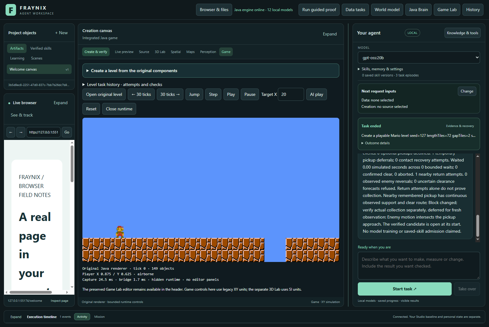
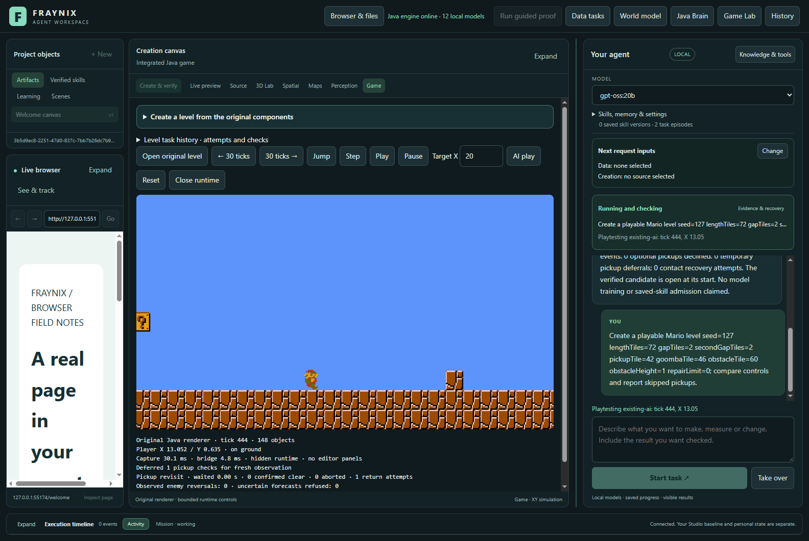
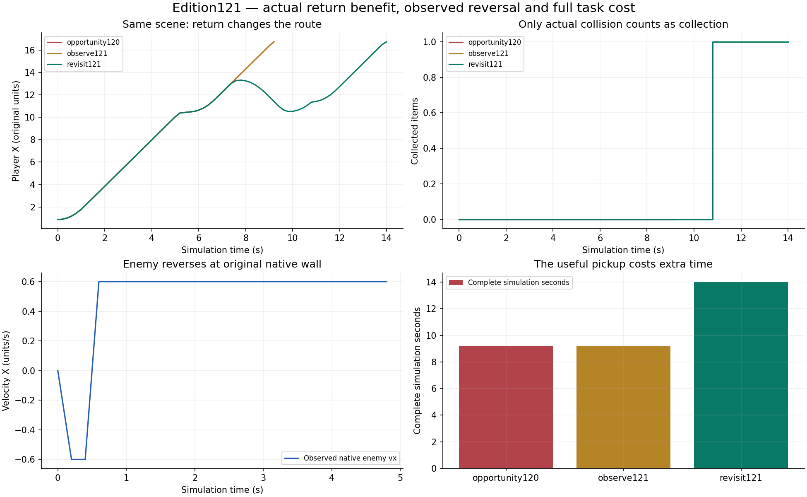
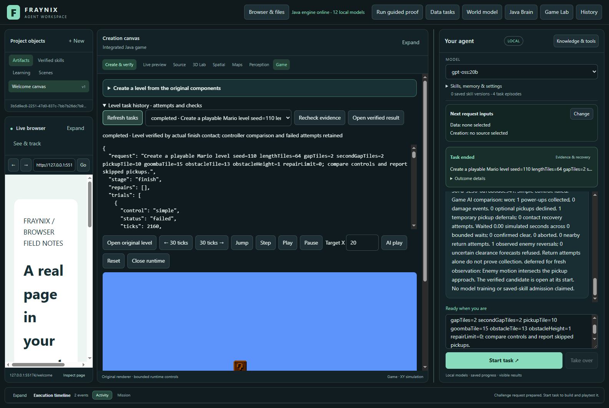
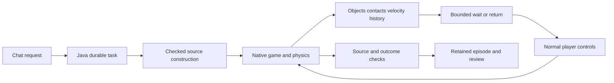

# Fraynix Agent Workspace · Edition 121

[Published and fetched verification receipt](docs/PUBLICATION_121.json) · [Release tag](https://github.com/eyeoverthink/Fraynix-Agent-Workspace/tree/readme-121)

**Observed enemy reversals, bounded returns, and an actual pickup benefit.**

2026-11-11 · Java owns execution and evidence; the integrated desktop shows the world, chat and task history.

[Previous edition 120](README-120.md) · [All editions](docs/readmes/INDEX.md) · [Interactive offline guide](docs/readmes/121/index.html) · [Development contract](docs/EDITION_121_CONTRACT.md) · [Phased plan](docs/PLAYABLE_LEVEL_CREATION_PLAN.md)



## What changed

Edition 120 proved that waiting for an enemy to clear could recover two previously missed optional pickups. It did **not** establish that returning to a missed pickup was useful. Edition 121 supplies that missing comparison on a declared development course: the revised controller goes back, hits the original question block, collects the released mushroom through native collision, and reaches the finish without damage. The same revised controller with returns disabled finishes without the item. The original 120 policy also finishes without it.

This is a measured improvement within a bounded game task. It does not mean every return is worthwhile or every enemy encounter is solved. Two of the eight new development courses still kill the player under both 120 and 121. A simple controller survives one of those. Those results remain in the report and define a useful next engineering target.

All 71 older regression courses finish without damage. These include the 54 original courses, 120's seven development and six reserved courses, and four early-return probes. The original 24 collection courses retain their pickups. The controller still refuses the unsupported gap item; larger reach is not permission to cross missing ground.

## Try it in the app

1. Open the workspace and select **Game Lab**. The original Java renderer appears within the integrated view.
2. Expand the level-building controls. Choose **Return to a cleared pickup** and prepare the chat request.
3. Start the task. Java constructs a separate, source-verified candidate, runs the simple comparison and the AI trial, and checks the result. The saved personal scene is not used for these experiments.
4. Watch the return counter and the live player. A return attempt is not collection; the collision counter and final verification settle the outcome.
5. Open saved task history to inspect the retained decisions and verification. The completed candidate reopens at its start for review.
6. Try **Enemy reverses at a wall**. The enemy direction changes because of the existing collision behavior. The history records its actual velocity sign change.
7. Try the gap refusal. The optional item remains uncollected when its approach lacks observed support.

The explicit chat route uses owned Java scheduling and zero model calls. Choosing an Ollama model in the interface does not imply it authored these controller actions. Natural-language routes outside the supported task grammar retain their existing model and verification boundaries.



## Run or update from source

The supported Windows launcher is [Launch-Agent-Workspace.bat](Launch-Agent-Workspace.bat), backed by [Start-Agent-Workspace.ps1](scripts/Start-Agent-Workspace.ps1). It requires JDK 21 and Node.js LTS. Initial preparation downloads the locked Java and desktop dependencies; later prepared runs can use `-Offline`.

Before updating an existing installation, use **Stop Java & close app**. Closing only the window may leave the durable Java owner running. The launcher protects that owner rather than rebuilding its loaded installation. Edition 121 also fixes the stopped-owner preparation path to refresh the native Game Lab code and assets together with the workspace engine; an existing game folder must not leave an older controller installed.

For an isolated review, choose a new project directory rather than reusing a live personal world:

```powershell
$env:FRAYNIX_WORKSPACE_PROJECT = Join-Path $env:USERPROFILE '.fraynix-agent-workspace/projects/review-edition121'
.\Launch-Agent-Workspace.bat
```

Use a distinct unused review name if that directory is already active. `-PrepareOnly` builds and checks dependencies without opening the desktop. Ollama remains optional for the explicit Java game-task grammar; general model chat uses the configured provider. This release does not install model weights.

## The experiment that proves return value

A late supported block is initially deferred because of a moving enemy. After the encounter, the player lands farther than120's 1.75-unit return limit. The new policy considers up to 2.75 original game units, with the same 240-tick deadline, at most three return starts, once per object, continuous ground, braking room and fresh approach checks. The item remains identified by its persistent object ID.

The comparison below uses the same declared scene and fresh runtime memory for every policy. **observe121** is the same new controller with returns disabled. It includes the observation and collectible-handling improvements, so the contrast isolates return availability.

| Policy | Actual pickups | Total ticks | Return ticks | Complete trial time |
| --- | ---: | ---: | ---: | ---: |
| opportunity120 | 0 | 552 | 0 | 3.495 s |
| observe121 | 0 | 552 | 0 | 3.539 s |
| revisit121 | 1 | 840 | 143 | 4.856 s |

Returning earns an item at extra time cost. It is useful for an objective that values the optional power-up; it is not a speed improvement. These are single complete-run timings through the final frame, including native simulation, rendering and bridge work; later process cleanup is excluded. Repeated timing distributions and a calibrated benefit gate remain future work.



[All measurements](docs/readmes/121/measurements.json) · [Exact original evidence index](docs/readmes/121/original-evidence.json)

## What the failures taught us

The first longer-return prototype did not succeed. Braking away from forward travel caused the local recovery logic to count a stall before the player could turn. For 121, recovery is reset while the returning player is still braking away from the local goal. The return's fixed deadline remains in force, so this does not permit endless retries.

The next run reached and hit the block but missed the released mushroom. The ordinary wall ray saw the collectible as an obstacle and triggered a jump over it. 121 excludes mushroom/flower bodies from obstacle jumping. It still uses the original body, collision, power-up and sprite behavior; no pickup counter or transform is edited to manufacture success.

Both unsuccessful runs are retained. The final run establishes collection through actual native collision, then finish contact. Early unsupported/braking-limited returns remain refused. Two late-enemy contact deaths remain unresolved. Their player, enemy, velocity, timing and decision traces are included rather than converted into successful certificates.

## Reversals and observation

`OpportunityMotion121` remembers at most 64 live enemy identities and at most 16 detailed reversal events. It observes actual body velocities, removes departed identities, and requires increasing observation ticks. A nearby reversal makes a linear clearance estimate uncertain for 30 ticks. A forecast whose projected enemy path intersects observed ground geometry is also refused, because a wall may reverse that enemy before the predicted clearance occurs.

The native wall courses record actual direction reversals and finish safely. Boundary tests separately demonstrate that a nearby reversal or a native wall invalidates an otherwise linear clearance forecast. These are different claims: recording reversals is proven in playable courses; a general survival advantage from the uncertainty guard is not established by those courses alone.

Waiting keeps the existing 180 ticks per wait, 360 total and three-start bounds. Return and waiting cannot overlap. Permanent structural refusal remains authoritative. A recent threat or missing ground does not become acceptable because the controller remembers the object.

## New development and reserved results

Eight development courses were declared before tuning. Six finish under 121, with four pickups and two deaths; 120 and the return-disabled comparison retain six finishes and three pickups. Simple control's results are included as a meaningful baseline, including the course it finishes while the more elaborate controllers fail.

Six reserved courses: revisit121 finishes 5/6 with 5 pickups, 0 damage and 0 deaths. Previous120 finishes 5/6 with 2 pickups, 0 damage and 0 deaths. Software repeat: 5/6, 5 pickups, 0 damage, 0 deaths. No tuning against these reserved outcomes.

The reserved turtle-reversal course collects its optional item but then stalls for 25 seconds under 120, 121 and the return-disabled comparison. Its item is included in the pickup total, but the course is not a successful finish and is not certified as a completed task. This is a separate remaining gap from the two development deaths.

The reserved return comparison below lists courses where both policies finish safely and enabling returns earns an extra item. The controller was fixed before these scenes ran.

| Reserved course | With returns | Returns disabled | Extra total simulation ticks |
| --- | ---: | ---: | ---: |
| reserved-late-goomba | 1 | 0 | 288 |
| reserved-late-turtle | 1 | 0 | 288 |
| reserved-return-room | 1 | 0 | 312 |

[Per-course return benefit](docs/readmes/121/reserved-return-benefit.json)


| Partition | Policy | Finishes | Pickups | Deaths | Return ticks | Median complete time |
| --- | --- | ---: | ---: | ---: | ---: | ---: |
| development | observe121 | 6/8 | 3 | 2 | 0 | 3.281 s |
| development | opportunity120 | 6/8 | 3 | 2 | 0 | 3.221 s |
| development | revisit121 | 6/8 | 4 | 2 | 143 | 3.236 s |
| development | simple | 1/8 | n/a | 5 | 0 | 2.420 s |
| reserved | observe121 | 5/6 | 2 | 0 | 0 | 3.454 s |
| reserved | opportunity120 | 5/6 | 2 | 0 | 0 | 3.508 s |
| reserved | revisit121 | 5/6 | 5 | 0 | 440 | 4.601 s |
| reserved | simple | 0/6 | n/a | 4 | 0 | 2.362 s |
| software-reserved | observe121 | 5/6 | 2 | 0 | 0 | 3.639 s |
| software-reserved | opportunity120 | 5/6 | 2 | 0 | 0 | 3.574 s |
| software-reserved | revisit121 | 5/6 | 5 | 0 | 440 | 4.615 s |
| software-reserved | simple | 0/6 | n/a | 4 | 0 | 2.496 s |

The original game camera still activates and removes enemies according to its existing rules. The useful return is not evidence of avoiding a persistent off-screen enemy. Software rendering repeats the same reserved scenes; it does not create additional unseen examples. Native simulation is unchanged. Across eight development trials,121 used 3885 opportunity checks and 90.987 ms in that decision code. Complete trial median was 3.236 s. Timing is from single runs, not a statistical speed claim.

## Durable chat, restart and verification

The task runner still binds the original source and assets, constructed component lineage, installed engine identity, native owner/session, exact bounded actions, frame receipts and final outcome. `GameEvidence121` adds bounds and consistency checks for motion history, reversal events, return policy settings and the return-disabled comparison. It calls the existing waiting/contact verifiers; it does not replace them.

Older proofs remain bound to their original compiled engine identity; this release does not relabel them as new evidence. Changing a counter, inventing a same-direction reversal, altering policy limits or tampering with a retained task remains refused. A completed result is recomputed from retained evidence. A process interruption does not relabel partial execution as success: explicit resume starts a fresh native trial and retains the interrupted one.

Five actual visible requests cover old terrain repair, return with abrupt process recovery, wall reversal, unsupported pickup refusal and a genuinely failed challenge. Screenshots are dated captures from those isolated runs.

| Actual request | Complete wall time | Durable status | Certified AI pickups |
| --- | ---: | --- | ---: |
| Create a playable Mario level gapTiles=10 repairLimit=2; construct, playtest and repair it. | 63.915 s | completed | 1 |
| Create a playable Mario level seed=127 lengthTiles=72 gapTiles=2 secondGapTiles=2 pickupTile=42 goombaTile=46 obstacleTile=60 obstacleHeight=1 repairLimit=0; compare controls and report skipped pickups. | 60.982 s | completed | 1 |
| Create a playable Mario level seed=110 lengthTiles=64 gapTiles=2 secondGapTiles=2 pickupTile=10 goombaTile=15 obstacleTile=13 obstacleHeight=1 repairLimit=0; compare controls and report skipped pickups. | 120.278 s | completed | 1 |
| Create a playable Mario level seed=50 lengthTiles=72 gapTiles=3 secondGapTiles=2 pickupTile=18 goombaTile=28 obstacleTile=25 obstacleHeight=2 repairLimit=0 | 40.684 s | completed | 0 |
| Create a playable Mario level gapTiles=10 pickupTile=17 goombaTile=45. | 19.965 s | interrupted | not certified |



## CI was checked first

The edition119 main run43104121657 failed an older load interruption test. The test slept 30 milliseconds and assumed cancellation would occur inside an active simulation attempt. That assumption depends on scheduling. Edition 121 coordinates cancellation after a real durable native checkpoint, confirms retained partial rows, then checks interrupted status, restart, fresh completed evaluation and the existing force/gap/initial-state forgery refusals.

Final publication review also restored the original UTF-8 punctuation in the older load-result label. The focused load check and complete visible review were repeated after this presentation correction; the controller and reserved outcomes were unchanged.

The production entry point retains its existing behavior. A package-local checkpoint observer enables deterministic coordination at the actual checkpoint boundary. No simulation, verification or attempt budget is relaxed. A final repeat caught a second test race: cleanup could interrupt the worker again while it saved the stopped result. Cleanup now waits after the single requested cancellation and only forces shutdown if the test times out. Three fresh native repetitions retain the full stopped-state, restart and tampering assertions. The original CI log and both failed test reports are archived. A prior120 continuity note mistyped the119 run ID as43104121687; this edition records the correct43104121657 without rewriting frozen history.

At implementation start,120 hosted jobs were still running. Local pass counts and a fetched Git publication do not establish hosted CI success. The publication receipt records the later observed status separately.

## Validation scope

- 181 distinct Java test methods, including native game trials, observed-motion boundaries, interruption coordination, task recovery, source verification and forged-evidence refusal.
- 168 desktop checks and five actual visible chat requests, including abrupt termination of this test's own Java process.
- Normal launcher preparation, replacement of an older installed game JAR, and refusal while a live Java owner uses the installation.
- 71 older courses preserved; original 24 pickup successes retained.
- Six transformed reference-image cases and four refusals per renderer, plus the original reference regression.
- Real integrated game captures, narrow desktop review, and offline guide interaction at 1440 and 390 pixels.
- Complete source inventory, original compressed evidence, immutable numbered editions, documentation validation and fetched Git byte audits.

[Machine-readable scope](docs/readmes/121/verification.json) · [Actual UI record](docs/readmes/121/actual-ui.json) · [Hardware references](docs/readmes/121/reference-hardware.json) · [Software references](docs/readmes/121/reference-software.json)

## Architecture and project direction

The broader app remains a local Java-owned agent workspace with durable goals, verified procedures, persistent worlds, native physics, data/creation workflows, browser/canvas presentation and observed-camera experiments. Game Lab is one testable environment in that system. Its serialized objects expose state; their Java components provide behavior. JSON alone does not supply intelligence or physics.



```text
src/main/java/agent/OpportunityMotion121.java   observed enemy history
src/main/java/agent/PickupOpportunity120.java   bounded optional goals
src/main/java/agent/GameInput.java              ordinary control boundary
workspace-engine/.../GameEvidence121.java       added receipt checks
workspace-engine/.../GameTask115.java           durable execution and audit
workspace-desktop/renderer/brain-game.js        integrated view and presets
workspace-desktop/test/game121-integration.cjs  actual visible review
```

No new external framework or model is introduced. The original native physics/rendering dependencies remain. This edition is controller engineering and evidence retention, not transformer training, general intelligence, arbitrary image understanding or automatic admission of a new reusable procedure.

## Next phases

**122: late-enemy survival and reversal-course stalls.** Use the retained deaths and turtle-course stall to study airborne landing/contact timing and when a pickup should remain abandoned. Declare new reserved courses first. Preserve the successful return and older-course gates; compare simple control again.

**123: value-aware optional goals.** Measure repeat runs and complete return cost, then let explicit task preference distinguish finishing quickly from collecting a useful power-up. Keep a return-disabled comparison and count cases where extra observation or return hurts.

**Later: broader creation and reusable procedures.** Expand supported image components with explicit unknown-region refusal, then qualify a versioned procedure only after source reconstruction, independent playtests, restart and changed-condition checks. The existing collection limits and provenance requirements remain.

See [architecture](docs/ARCHITECTURE.md), [project memory](docs/PROJECT_MEMORY.md), [development log](docs/DEVELOPMENT_LOG.md), [contributor handoff](README-CONTRIBUTORS.md), and the [Obsidian map](docs/obsidian/129-enemy-reversals-and-return-value.canvas). Published numbered editions remain historical evidence; later changes belong in later editions.
