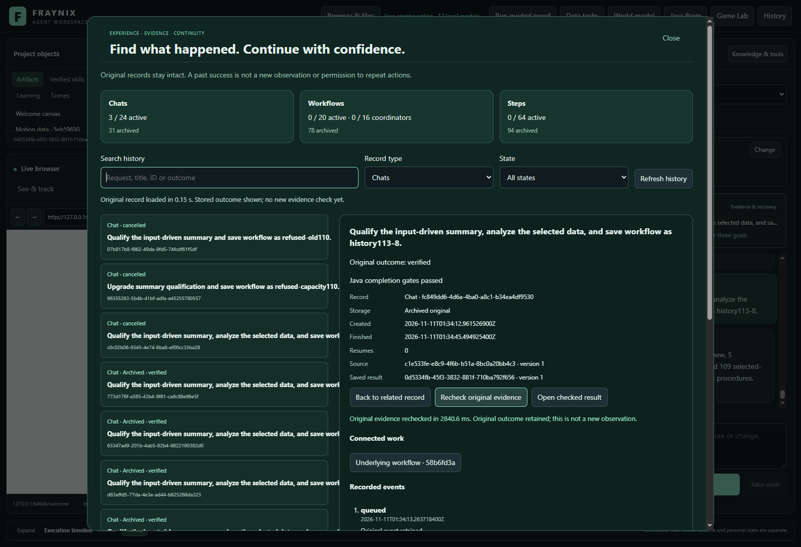
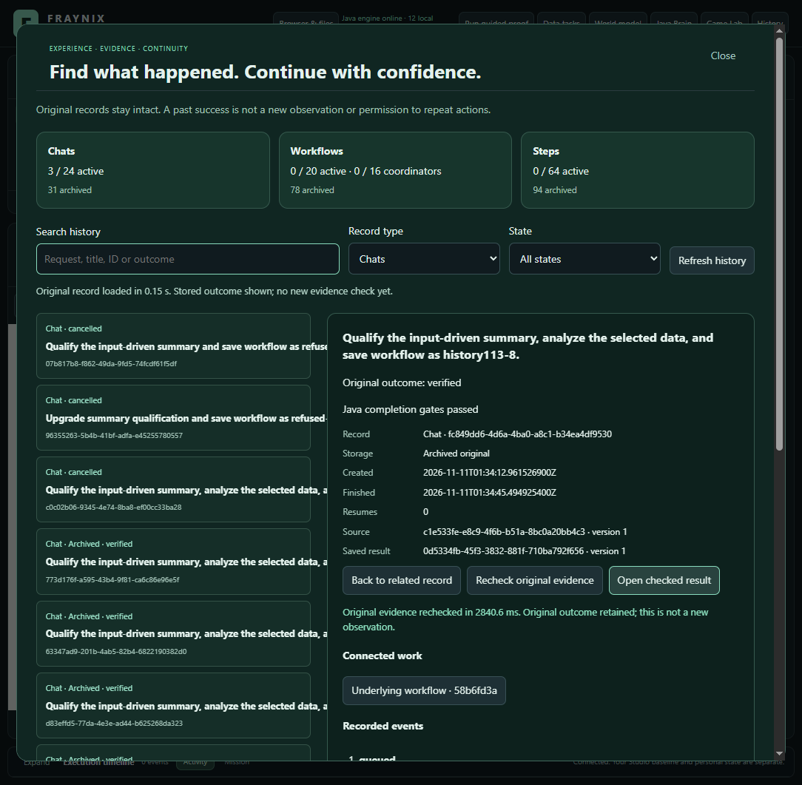
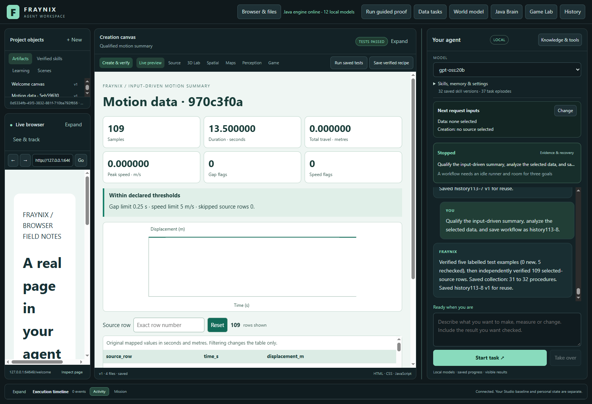

# Fraynix Agent Workspace — edition 113

## Find the agent's experience, inspect the original, open the checked result

Edition113 brings retained chats, workflows and child steps into **one searchable History view**. It shows the original request and outcome, follows explicit connected-work IDs, exposes full original records and offers a fresh evidence recheck. **Open checked result** verifies the original evidence and exact saved report version and contents before displaying it in the existing canvas.

The actual app completed eight fresh chat requests, retained their verified procedures and grew the genuine saved bank **24 → 32**. One request survived an abrupt Java interruption and explicit same-ID recovery. Final retained history contains **31 archived chats,78 workflows and94 steps**, plus the same three cancelled active chats. All capacities and Java verification rules remain unchanged.

[Previous edition112](README-112.md) · [Offline interactive guide](docs/readmes/113/index.html) · [Full review and development plan](docs/APP_REVIEW_113.md) · [Measured results](docs/readmes/113/analysis.json) · [Validation](docs/readmes/113/verification.json) · [Contributor direction](README-CONTRIBUTORS.md)

## What Fraynix is becoming

The useful foundation is a local runtime that connects requests, observations, actions, verification, memory and recovery. Java owns durable task execution and evidence. The desktop presents browser/canvas content, chat, world views, project objects and tools. Existing physics and observation paths can support bounded experiments and persistent object identities. Reusable procedures connect actions to success checks and recovery.

This is substantial infrastructure, with real task execution and retained outcomes. It is still a bounded engineering workspace. Neither Java itself nor an accumulated log establishes general intelligence, consciousness or weight training. The eight113 requests used the existing deterministic Java summary/qualification implementation with **zero model calls**. A local model is selectable in the app, but these results do not claim fresh LLM reasoning.

The review found a usability gap: the previous three history selectors hid useful work behind long lists and rawJSON. This edition makes that memory inspectable without adding a second memory store or turning old receipts into new authority. Broader tasks and real-model evaluation should follow this usability work.

## Use it step by step

1. Start the workspace using its existing launch scripts and a deliberately selected project. Keep private projects separate from test copies. Java21 and the existing desktop dependencies are required; this phase adds no new dependency.
2. Click **History** in the main toolbar. Counts show each active limit and archive separately.
3. Search by request, title, ID or outcome. Filter **Chats**, **Workflows** or **Steps**, and use **Needs attention** for cancelled/interrupted records. Lists display12 entries per page.
4. Select a record. Read its stored outcome, source/report references and recent events. Expand **Full original record** for all original fields and the complete journal.
5. Follow **Connected work** to the exact workflow/step IDs, then use **Back to related record**. Navigation does not start or resume execution.
6. Click **Recheck original evidence**. The new receipt is displayed separately from the old outcome. A failed check shows its reason; an unverified conversation remains unverified.
7. Use **Open checked result** for supported completed workflow reports. The host rechecks Java evidence and matches the retained artifact ID, version and content hash before opening the canvas.
8. Expand **Preserve completed work and free active slots** when needed. Each category has an explicit archive button and eligible count. Interrupted, cancelled and unsupported records stay in their original history. Resume remains the existing explicit task action.

## What changed and what remains authoritative

The new desktop component reads the existing Java history/read/verify/archive endpoints. Search, filters, pagination and related links are presentation logic. It does not invent eligibility or outcome status. Late reads cannot replace a newer selection; closed/reopened dialogs reject stale responses. Original text is rendered as text rather than executable markup.

The saved-result operation accepts only a record type and ID. It rejects unfinished or unverified chat results, unsupported reports, foreign verification IDs, changed versions and changed contents. Browser fixture checks exercise these boundary cases; the actual app study separately changes originals and records real refusals. A successful recheck is not permission to replay actions.

All **347 installed production Java class files** and **54 HTML/JS/JSON resources** are byte-identical to112. The source/outcome checks, execution ownership, recovery protocol and archive formats are unchanged. Active limits remain chat24/queue4, workflows20, qualification coordinators16, child goals64 and saved procedures32. Existing archive limits remain in force. Pagination bounds visible rows; it does not turn the underlying bounded history endpoint into a streaming database.

## Actual requests and complete cost

The trial copied the closed112 final test project exactly. It first archived the remaining completed native records through the actual UI. Eight new visible-chat requests each rechecked the input-driven summary against five retained original synthetic examples, analyzed the selected freshCSV, checked the actual browser output and saved the procedure. Selected inputs contain3–109 rows, including flat and signed/reversing sequences. These are declared software tests, not new camera or physical measurements.

| Request | Selected rows | Saved bank | Request seconds |
| --- | ---: | --- | ---: |
| history113-1 | 3 | 24 → 25 | 16.806 |
| history113-2 | 17 | 25 → 26 | 19.538 |
| history113-3 | 23 | 26 → 27 | 22.877 |
| history113-4 | 31 | 27 → 28 | 29.684 |
| history113-5 | 41 | 28 → 29 | 27.731 |
| history113-6 | 61 | 29 → 30 | 24.843 |
| history113-7 | 83 | 30 → 31 | 28.020 |
| history113-8 | 109 | 31 → 32 | 34.858 |

Request5 was interrupted at the actual selected-data browser boundary after five qualification cases. The Java process was terminated, the same project reopened and the same task explicitly resumed. Workflow/child IDs and original report contents remained unchanged. Its recovery cost is included.

**Whole trial: 622.837s.** Request intervals total204.357s; explicit archive intervals total100.253s; six cold UI/history measurement intervals total140.442s; copying, source/control checks and remaining work total177.785s. These non-overlapping top-level categories sum to the complete trial. Per-request browser/recovery/coordination partitions are retained in the evidence.

## Retrieval as the real bank grows

At bank24/28/32 and archived-chat counts23/27/31, two repetitions reopen the actual app and reverse category order. Each searches/selects a chat, workflow and step, performs a fresh Java recheck, follows connected IDs and opens the original checked report. Actual filters, pagination and1600/1100-pixel layouts are exercised.

| Bank / chat archives | Repeat | App readiness / s | History preview / s | Three fresh checks / s |
| --- | ---: | ---: | ---: | ---: |
| bank24-chat23 | 1 | 3.205 | 0.542 | 7.492 |
| bank24-chat23 | 2 | 2.929 | 0.535 | 7.755 |
| bank28-chat27 | 1 | 3.402 | 1.124 | 7.599 |
| bank28-chat27 | 2 | 3.392 | 1.122 | 7.519 |
| bank32-chat31 | 1 | 4.236 | 1.408 | 8.167 |
| bank32-chat31 | 2 | 3.822 | 1.482 | 8.359 |

These are caller-observed timings including transport/UI overhead. A cold application process does not clear the operating-system cache. Two repetitions and a changing bank do not establish a scaling law or causal speedup. The new UI makes existing experience easier to use; verification still performs real work. The five qualification examples were retained originals rechecked on each request, not40 newly executed examples. The eight saved procedures reuse the same qualified implementation with separate verified source/outcome lineage; this is not eight new skill families.

## Tests and limits of the claims

**165 desktop checks pass**, including17 targeted history/host/browser-component checks. The first focused run passed10/11; its wording assertion led to a clearer outcome sentence. The first broad run passed153/154; the existing startup-integrity test fixture was missing the three new renderer files. The fixture now includes them and still checks invalidUTF-8/NUL refusal. Both initial logs are retained. Final review also caught a delayed failed recheck overwriting status after a dialog close/reopen. A sixth component test reproduced it before the fix; the final155-test desktop run plus10 additional checks passes. The view now rejects late failures by operation generation. A separate actual Electron/Java check reproduced the real changed-report refusal, closed/reopened during a second recheck, then verified and opened an unchanged report. Its original records and separate cost are retained; the eight-request study used the earlier113 desktop response handling with identical Java classes and evidence checks.

Fresh113 Java installation passed; all compiled production classes/resources matched112. The prior112 suite had127 relevant Java methods; those are explicitly prior evidence, not a relabelled fresh113 test run. The actual113 application study uses the newly installed identical Java engine.

Independent inspection reconstructs originalCSV arithmetic, normalized inputs, every displayed summary/point, behavior checks, qualification cases, retained procedures, journals, archive identity, recovery and complete costs. **20 altered-evidence controls** must be refused. Live corruption and missing-chat-snapshot controls refuse reading, verification and opening. A revised original report refuses opening. Adding dataset version2 preserves the immutable version1 actually used by the original proof; this is checked explicitly.

The new result button supports retained completed workflow reports. It does not promise to open every historic artifact type, replay a task, manage saved-procedure retirement or create a new skill family. The GameLab, webcam, physical controllers and local-model reasoning were not freshly evaluated in113. Remote CI status is reported separately from passed local checks.

## Next development gates

1. **114 — explicit saved-procedure lifecycle.** Keep32 active slots; retire eligible procedures with original provenance/descendants retained and recheck compatibility before deliberate reactivation. Test a full bank, crash boundaries and corrupt/missing ancestors.
2. **115 — another complete useful skill.** Proposed: compare two data sources, retain unit/time conventions, create an interactive difference report and independently verify every value. Test fresh inputs and restart before saving.
3. **116 — real-model selection and recovery.** Evaluate supported and unsupported requests using an installed local model against simple routing; preserve failed drafts and total costs.
4. **117 — calibrated observation to world to artifact.** Bind a measured sequence to a persistent object, predict bounded motion, compare outcomes and retain the checked procedure. Add physics/perception only where that task reveals a measurable gap.

[The full review](docs/APP_REVIEW_113.md) explains the strengths, current limits, design priorities and acceptance criteria. The aim is coherent useful agency: a tool acts; a skill completes a task through actions, checks and recovery.

## Reproduce and audit

The actual recorder is [history113-integration.cjs](workspace-desktop/test/history113-integration.cjs). It requires a closed genuine112 project, the installed113 engine, the existing desktop dependencies and an available local model catalog; it deliberately makes no model inference calls. `EDITION113_BANK112` selects that closed source, and `EDITION113_OUTPUT` selects a new output directory. Existing output is refused so prior trials cannot be overwritten. Use the documented build stamp before running; heavy validation is serial.

The [independent inspector](scripts/Inspect-History113.cjs), [source inventory](docs/readmes/113/file-inventory.json), [lossless original evidence index](docs/readmes/113/original-evidence.json), [contract](docs/EDITION_113_CONTRACT.md) and [offline guide](docs/readmes/113/index.html) retain the detailed evidence. Original test projects are included as content-addressed compressed originals; private running projects are excluded. Frozen001–112 remain intact. Publication is only confirmed after an actual push and fetched Git-tree audit.

Published to main. [Edition113 fetched GitHub verification](docs/PUBLICATION_113.json).
