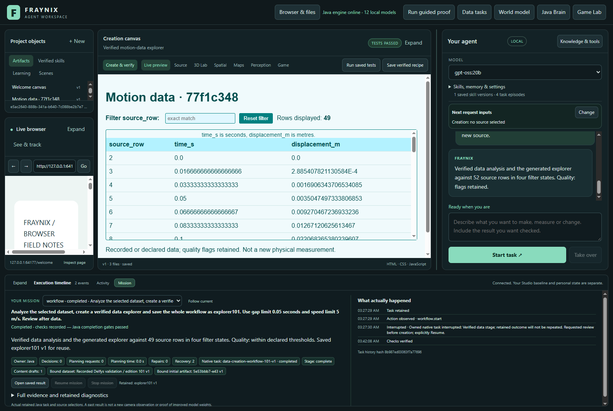

# Fraynix Agent Workspace

Edition101 completes a supported data-to-content task from one durable chat request: analyze selected data, generate a working explorer, independently verify it and retain the whole procedure. Restart preserves verified stages.

[Edition101: one request, verified data, working content](README-101.md) · [Offline guide](docs/readmes/101/index.html) · [Previous edition](README-100.md) · [Contributor direction](README-CONTRIBUTORS.md)

Java owns durable goals, physics, tools, verification and retained procedures. Chat, browser, creation canvas, Game Lab and spatial views share those capabilities.

Published to main. [Fetched GitHub verification](docs/PUBLICATION_101.json).
