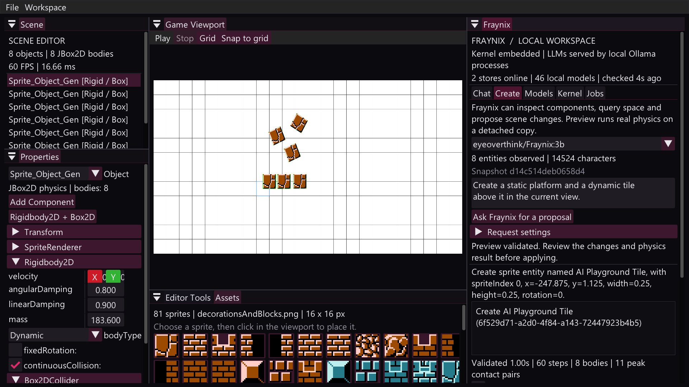

# Fraynix Studio

> **Latest system edition: [README 002](README-002.md)** · [Sequential editions](docs/readmes/INDEX.md) · [Interactive explorer](docs/readmes/002/index.html) · [Obsidian maps](docs/obsidian/00-home.md)

**A local creator system combining a Java entity/component engine, a visual physics playground, persistent memory, and local AI.**

Created by **Vaughn Scott / eyeoverthink**. This is the independent home of the combined editor and Fraynix runtime, with its own source tree, Git history, build, distribution, and default project storage.

The working loop is:

```text
Observe the world -> ask a local model -> query components and space
-> propose a structured change -> validate and simulate
-> apply validated edits and save -> observe the changed world
```

The model receives the actual authored component data and spatial relationships. The engine owns identities, validates changes, runs physics, and persists the result. This makes Fraynix Studio a foundation for local scene, entity, component and agent creation. General software generation and autonomous factories are development goals beyond the current scene-editing protocol.



## System outline

| Part | Responsibility | Current implementation |
| --- | --- | --- |
| Studio | Human creation and inspection | Java desktop app, GLFW/OpenGL rendering, dockable ImGui panels |
| Entity/component engine | Represent, validate and change structured objects | Pure-Java schemas, persistent IDs, versioned world snapshots and staged transactions |
| Physics playground | Ground proposals in executable motion | JBox2D rigid bodies, box/circle colliders and detached previews |
| Scene knowledge | Give models access to the world | Full serialized authored components, runtime physics observations, camera/grid metadata and spatial queries |
| Local AI | Generate answers and proposed operations | Installed Ollama models, exact-tag routing across configured loopback services |
| Offline kernel | Process tasks and retain evidence | Task/planner/executor/verifier interfaces, hybrid memory, routing state, journals and trace storage |
| Persistence | Keep creations and history across restarts | Checksummed checkpoints, atomic saves, chat journals, durable proposal receipts and guarded undo |
| Local tools | Execute versioned functions under host grants | Five typed JDK-only handlers with input/output checks and journaled results |

The application is Java-based; the graphical runtime uses native libraries, and Ollama runs in a separate local process. The shared entity/component runtime and kernel build from JDK-only Java sources. The model adapter also uses JSON-java.

## What you can do now

- Place sprites, snap them to the grid, select objects and edit transforms.
- Attach and inspect `Rigidbody2D`, `Box2DCollider` and `CircleCollider` components.
- Run physics through Play/Stop or simulate an AI proposal without changing the live scene.
- Ask local models about the complete supplied scene observation.
- Let a model query entities, components and spatial relationships before proposing a change.
- Review a concrete operation list and physics preview, then apply and save it.
- Restore checkpoints and undo an AI edit after restarting the application.
- Inspect live model/service status, kernel memory and processing receipts.
- Stream actual Ollama replies, test a fresh connection nonce, load/unload models and save runtime profiles in **Models**.
- Inspect the captured world, search memory, parse Java, generate world documentation and verify file hashes through **Fraynix > Tools**.
- Verify journal continuity on restart, inspect retained staging evidence and review unfinished tool calls.

The model observes **structured scene state**, rather than seeing pixels. It does not automatically know every file on the computer or every memory in the kernel. Task retrieval supplies relevant memory; scene observations supply the current component/space data.

## Independent repository boundary

All three Fraynix modules are checked in under `fraynix-modules/`. Builds always use those local sources. They do not select `F:\Full-AI-System`, another checkout, a Git submodule or an external source symlink.

- Remote: `https://github.com/eyeoverthink/Fraynix-Studio`
- Application name and distribution: `Fraynix-Studio`
- Window title: `Fraynix Studio`
- Default project: `%USERPROFILE%\.fraynix-studio\projects\default`
- Default model catalog: `%USERPROFILE%\.fraynix-studio\models\local-model-catalog.json`

Existing Fraynix/Fraymus repositories, project checkpoints and model weights remain separate. Local Ollama services may be shared deliberately. New changes in this repository do not propagate to the earlier repositories automatically.

See [provenance and project boundaries](docs/PROVENANCE.md).

## Requirements

- Windows x64 and an OpenGL 3.3-capable graphics driver.
- JDK 17 or later; JDK 21 is the documented build/CI target.
- For AI features: a local Ollama installation and at least one installed model.
- A first build needs the pinned Gradle distribution and Maven dependencies, either cached locally or downloaded during setup.

A packaged distribution includes application libraries, native dependencies, assets and documentation. It does **not** include Java, Ollama or model weights. A source checkout is self-contained as a project, rather than a replacement for those installed runtimes.

## Quick start

```powershell
git clone https://github.com/eyeoverthink/Fraynix-Studio.git
cd Fraynix-Studio
.\gradlew.bat check installDist
.\Launch-Fraynix-Studio.bat
```

The repository is private: cloning requires access through your GitHub account.

To launch from source directly:

```powershell
.\gradlew.bat run
```

To use only cached build dependencies:

```powershell
.\gradlew.bat --offline check installDist
powershell -NoProfile -ExecutionPolicy Bypass -File .\scripts\Run-Studio.ps1 -Offline
```

An extracted application distribution can run offline without Gradle or the Maven cache. Keep its `lib`, `bin` and `assets` folders together.

## Connect local models on any drive

Ollama owns the weight files. Fraynix Studio connects to local services, so the weights can live on C:, F:, another disk or several configured stores. The app does not copy a 65 GB model into the repository.

With the default Ollama service already running:

```powershell
.\scripts\Configure-Models.ps1
```

For two already-running local stores:

```powershell
.\scripts\Configure-Models.ps1 -Endpoints @(
  'http://127.0.0.1:11434',
  'http://127.0.0.1:11435'
)
```

This discovers exact installed model names, excludes cloud proxies, and writes the Studio-specific catalog outside Git. Endpoint order determines the winner when the same exact tag exists in more than one store. The script configures discovery; it does not download weights or start additional Ollama servers.

Use **Fraynix > Models** to inspect availability and residency. Choose an available model in **Chat** or **Create**. Availability means a local service advertises it; residency means the service currently reports it loaded. Neither proves task quality.

`FRAYNIX_LOCAL_MODEL_CATALOG` or the JVM property `fraynix.localModelCatalog` can select a different catalog explicitly.

### GPT-OSS 120B: measured local behavior

On October 22, 2026, the actual local `gpt-oss:120b` on F: was tested with cloud inference disabled. Its metadata reported 116.8B total parameters and MXFP4 weights, approximately 65.37 GB on disk.

The test machine had a Ryzen 9 3900X, about 96 GiB RAM and an RTX 3070 with 8 GiB VRAM. The test used **CPU only, 12 threads, a 4K context and low reasoning effort**.

| Measurement | Observed result |
| --- | --- |
| Cold model load | 341 seconds, after extending the temporary server's load timeout |
| Sampled runner RAM | Approximately 61.3 GiB peak working set |
| Generation | Approximately 5.25-5.41 tokens/second, including reasoning tokens |
| Warm scene proposal | 136.7 seconds |
| Numerical checks | Correct negative-grid snap, density/mass calculation and resting height |
| Engine-grounded scene task | Valid floor/falling-tile proposal; two real physics bodies; collision and landing verified over 120 JBox2D steps; original entity preserved |

Without the actual application schema, it guessed component class names incorrectly. With the schema and observation, its first scene proposal passed. The 3B comparison missed the three numerical checks and produced a scene proposal rejected for duplicate JSON fields. These are two single-attempt tasks per model, not a general capability benchmark.

**Current integration:** Chat streams replies and provides load/unload, cancellation and saved profiles, with a default 900-second response-idle allowance. The older scene adapter also allows 900 seconds. Ollama's server-side load timeout is separate: the historical 120B test needed an isolated server with a 15-minute load allowance. Cold 120B operation was not repeated for this release. See [live model controls](docs/LIVE_MODEL_CONTROLS.md).

See [model test evidence](docs/MODEL_TEST_RESULTS.md) and [sanitized measurements](docs/evidence/gpt-oss-120b-2026-10-22.json). Weights, private conversations and the user's model-store paths are not included.

## Use the workspace

1. Open **Scene**, **Game Viewport**, **Properties**, **Assets**, **Editor Tools** and **Fraynix**. **Workspace > Reset studio layout** restores the arrangement.
2. Place a sprite in the viewport. Grid snapping aligns placement; selecting an object exposes its actual components.
3. Add or edit physics components in Properties. Use **Play** and **Stop** to inspect motion.
4. Open **Fraynix > Create**, choose a local model, and enter a goal.
5. Review the proposed changes, preview paths and validation results. Choose **Apply and save proposal** to commit them.
6. Use **Undo last AI edit** to recover the prior authored state, including after restart. Undo refuses to overwrite later unrelated authored edits.

| Fraynix tab | Live purpose |
| --- | --- |
| Chat | Streamed replies, collapsed scene attachments, separate conversations and saved HTTP evidence |
| Create | Observation, spatial queries, structured proposal, detached validation, reviewed apply and undo |
| Models | Live tags/residency, connection checks, load/unload and saved runtime profiles |
| Kernel | Embedded kernel status, verified journal continuity and memory search |
| Tools | Compiled local tool registry, typed inputs, host capabilities, actual results and restored receipts |
| Jobs | Checkpoint actions, inspection tasks, receipts and trace locations |

## Creation protocol and guarantees

Supported operations are `create`, `duplicate`, `rename`, `delete`, `set`, `add_component` and `remove_component`. Engine-generated identities and the observation fingerprint bind a proposal to its source scene.

```text
Live authored scene
  -> immutable component/space observation
  -> local model query/proposal
  -> strict JSON + allowed-field checks
  -> staged WorldTransaction
  -> deserialize/serialize round-trip
  -> detached JBox2D preview
  -> operator review
  -> guarded checkpoint commit + scene installation
  -> persisted undo receipt
```

Unknown fields, duplicate JSON fields, unsupported types, invalid dimensions and stale authored state reject a draft. Failed preview operations do not partially edit the live scene. A failed scene installation restores the checkpoint.

Spatial tools include `inspect`, `components`, `nearest`, `overlap` and `relative`. Bounds include rotation and collider offsets. AABB overlap is a broad-phase result, not proof of exact contact.

Legacy field semantics are preserved: `Box2DCollider.halfSize` holds **full dimensions**, and `Rigidbody2D.mass` is used as **fixture density**. Measured runtime mass is reported separately. Models receive these conventions explicitly.

Validation establishes supported data, stable identities, serialization fidelity and finite physics over the tested interval. It does not prove arbitrary creative intent or long-term physical correctness. The scene protocol cannot execute arbitrary Java, shell commands or host-file changes.

## Persistence and the real-time loop

The render/physics loop operates on live scene state. AI workers receive immutable observations; inference does not run on the rendering thread. Candidate changes are staged, simulated and committed as an authored revision. This is the current buffering boundary; the system does not claim to journal every rendered frame.

Within each project:

```text
scene.fworld                 Checksummed authored-world checkpoint
scene.fworld.previous        Recovery copy when available
scene-edits/                 Proposal requests, before/candidate worlds, validation and undo stack
chat/exchanges.jsonl         Completed local conversation exchanges
studio-layout-v1.ini         Project layout
.northstar-kernel/           Kernel memory, routing state, journal and traces
```

Choose a different project explicitly with `FRAYNIX_STUDIO_WORKSPACE` or JVM property `fraynix.studio.workspace`. The legacy `fraymus.factoryWorkspace` override remains accepted for existing native-test tooling; it is never selected automatically.

The sample `level.txt` remains a legacy scene import/export surface in the application working directory. Durable project checkpoints are the primary authored state. Model installation is shared host infrastructure; project scenes, chats and model catalog configuration have their own Studio defaults.

## Repository layout

```text
Fraynix-Studio/
  src/main/java/             Desktop editor, scene adapter, creator loop, renderer and physics bridge
  src/test/java/             Editor, geometry, physics, persistence and creator integration tests
  fraynix-modules/
    factory-runtime/         Entity/component schemas, transactions, spatial bounds and checkpoints
    factory-kernel/          Embedded offline kernel, memory, validation and trace machinery
    factory-models/          Local Ollama adapters, catalog, live status and conversation persistence
  assets/                    GLSL shaders and supplied sample graphics
  libs/                      Vendored JBox2D binary
  gradle/wrapper/            Pinned, checksummed Gradle wrapper
  scripts/                   Launch, model discovery, packaging and native checks
  docs/                      Architecture, provenance, validation and model measurements
  .github/workflows/         Windows build/test/package workflow
  Launch-Fraynix-Studio.bat  Repository and distribution launcher
```

## Build and verify

```powershell
.\gradlew.bat clean check distZip installDist
.\scripts\Verify-Native-Factory.ps1
```

`check` runs the editor's JUnit suite plus executable runtime, transaction/spatial, kernel and model integration harnesses. These use temporary projects and loopback fixtures; they do not require downloaded LLM weights.

It also enforces repository isolation: every Gradle project and source root must resolve inside this checkout. `offline-toolchain.toml` points the kernel's default verifier at this project's own `Verify-Studio.ps1`.

The embedded kernel is also usable without opening the graphical editor:

```powershell
.\scripts\Run-Kernel.ps1 -Offline status "$PWD"
.\scripts\Run-Kernel.ps1 -Offline refresh-memory "$PWD"
.\scripts\Run-Kernel.ps1 -Offline skills "$PWD"
.\scripts\Run-Kernel.ps1 -Offline verify-journal "$PWD"
```

Optional real-model checks require the chosen local models and configured services:

```powershell
.\scripts\Verify-Native-Studio.ps1 -PrimaryModel 'fraynix-3b:latest' -SecondaryModel 'fraymus-oracle:latest'
.\scripts\Verify-Native-SceneAgent.ps1 -Model 'fraynix-3b:latest'
```

Distributions are written to `build/distributions/Fraynix-Studio-0.1.0.zip`; the unpacked application is `build/install/Fraynix-Studio/`. GitHub Actions builds on Windows/JDK 21 and retains distribution and test-report artifacts. Interactive OpenGL and real-model checks are local, separate validation surfaces.

See [current verification](docs/VERIFICATION.md).

See [continuity, typed tools and recovery](docs/CONTINUITY_AND_SKILLS.md) for contracts, capability grants, CLI examples, explicit damaged-tail recovery and limits. Hash-chain verification checks internal consistency; it is not a signature, an OS sandbox or verification of every kernel state file. General dispatcher calls are currently operator-driven; the existing Create agent retains its own scene/spatial tool protocol.

## Development plan

The [model/agency and Base44 source review](docs/MODELS_AGENCY_REVIEW.md) covers the supplied model exports, Python agency, Dreamer bundle and selected existing GitHub implementations. The [full integration plan](docs/IMPLEMENTATION_PLAN.md) maps them into one Java-first Studio, distinguishes GUI/CLI/provider boundaries and defines verification gates. These documents describe proposed integration; they do not imply the separate packages already run inside Studio.

The [Dreamer 120B package review](docs/DREAMER_120B_REVIEW.md) tests the newer F: package, WAT, Java daemon, portal and proposed B200 trainer. It includes measured defects, a staged model recipe and the plan for binding real model calls to Studio's existing tools. The proposed trainer does not currently train weights.

The reviewed [Dreamer 120B inference model](docs/DREAMER_120B_SETUP.md) is installed in the F: Ollama service, tested through Studio and published as [eyeoverthink/fraynix-dreamer-ultimate:120b](https://ollama.com/eyeoverthink/fraynix-dreamer-ultimate:120b). The setup guide contains the local command, measured cold/warm timings and public-registry verification.

1. **Large-model operation:** complete cold-load supervision, context budgeting and measured routing on top of the implemented streaming, cancellation, loading and runtime profiles.
2. **Measured model routing:** compare small fast models and larger planners on repeatable task suites; route only after observed results justify the choice.
3. **Creator quality:** add goal-level checks for intended layouts, constraints and behavior beyond numerical stability.
4. **Factory expansion:** introduce versioned data/component templates, reusable creation recipes and domain-specific processors behind the same transaction and verifier boundaries.
5. **Release quality:** document and replace sample assets with clear distribution permissions, improve import/export migration, and test clean-machine installation.

The current release does not establish AGI, automatic weight training, model merging, complete legacy brain-system integration, pixel-based perception, or unrestricted self-modifying software generation. The research vision is broader than the verified shipping surface.

## Provenance and licensing

This project combines supplied editor code and selected Fraynix Java modules. It starts a new Git history while preserving source provenance and third-party notices. Independence does not remove inherited attribution or license terms.

See [THIRD_PARTY_NOTICES.md](THIRD_PARTY_NOTICES.md) and [the import record](docs/provenance/IMPORT_MANIFEST.json). No new project-wide redistribution license has been assigned. Sample artwork provenance remains unresolved; the repository is private.
