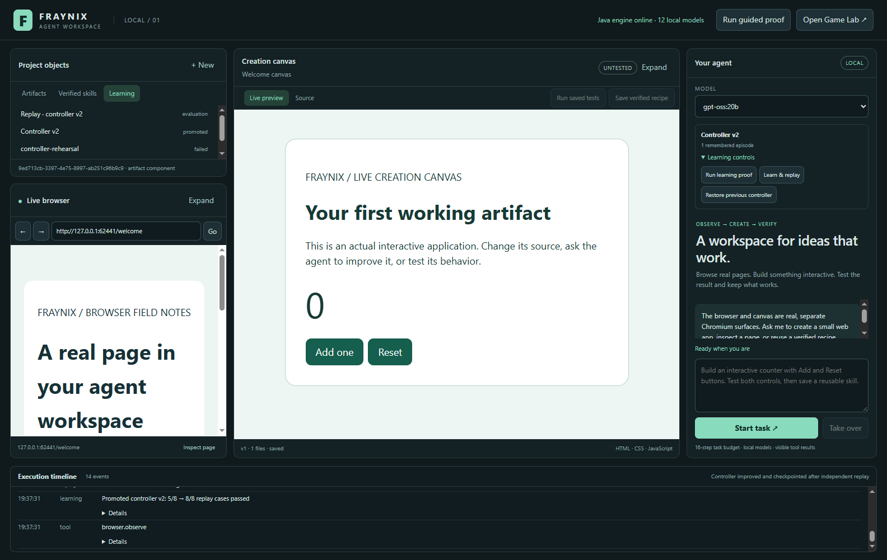
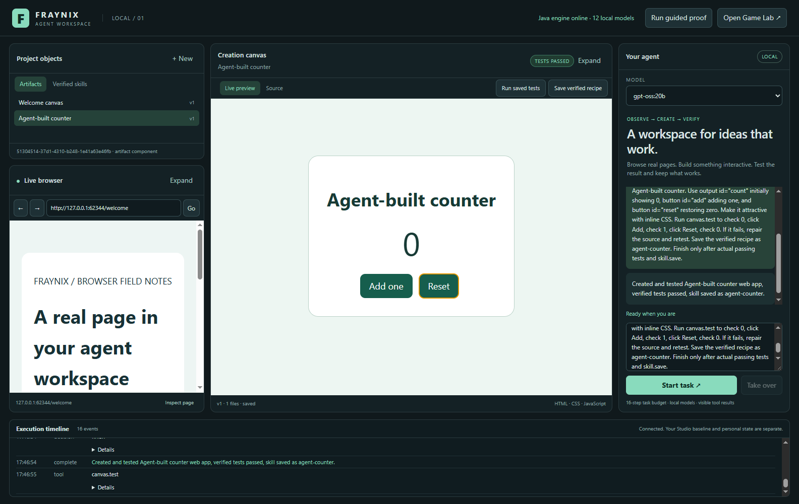

# Fraynix Agent Workspace

**A local visual environment for agents to browse, create runnable artifacts, test behavior and reuse verified skills.**

> **Latest system edition: [README 007 — persistent learning and evaluated control](README-007.md)** · [Interactive explorer](docs/readmes/007/index.html) · [Complete operating guide](README-006.md) · [Edition history](docs/readmes/INDEX.md)

Independent successor to [Fraynix Studio](https://github.com/eyeoverthink/Fraynix-Studio), starting from verified commit `6341404`. The original application and personal project state remain separate. Full game sources, assets, licenses and earlier editions are preserved here.

## Start

Run **Launch-Agent-Workspace.bat** with JDK 21 and Node.js 22.12 or newer installed. First setup downloads pinned Electron/Chromium dependencies. Use an installed local Ollama model for agent tasks. Docker and WSL are not required.

The app includes a real browser, live creation canvas, editable source, versioned artifact library, local-model agent, execution timeline and tested recipe library. **Run guided proof** demonstrates the complete local workflow. **Open Game Lab** launches the preserved Java editor in its own successor project directory.

Local `gpt-oss:20b` is the verified default for the first agent fixture. The custom FRAYNIX 3B trial returned an Ollama native-format error; advertised tool capability alone does not establish task reliability. You can select other eligible installed models explicitly.



October 29 learning fixture. Application frame export composed from actual shell and child Chromium renderers. The controller's passing replay is separate from the welcome artifact's untested badge. See [current verification](docs/readmes/007/verification.json).

## Verify

```powershell
.\gradlew.bat check installDist :workspace-engine:installDist
cd workspace-desktop
npm.cmd ci --no-audit --no-fund
npm.cmd test
npm.cmd run test:integration
npm.cmd run test:learning
# Optional actual local-model fixture:
$env:FRAYNIX_LIVE_MODEL='gpt-oss:20b'
npm.cmd run test:live
```

Project files, test receipts, learned recipes, browser cookies and event history live under `%USERPROFILE%/.fraynix-agent-workspace/projects/default`, outside Git. `FRAYNIX_WORKSPACE_PROJECT` selects another independent project.

The current skill type is a tested web-artifact recipe. A bounded adaptive controller now learns from recorded outcomes and activates only after independent replay. Whole-model training, general code workers and broader computer control remain separate milestones in the [design plan](docs/AGENT_WORKSPACE_DESIGN.md).

## Persistent learning in the working app

Task episodes now retain the actual policy version, typed actions, failures, artifact revisions and test outcomes. A separate worker uses pinned Fraymus prototype-learning code to propose two bounded strategy changes: refresh stale observations and reduce repeated reads. Candidate policies cannot add tools or bypass tests.

Expand **Learning controls** and choose **Run learning proof**. Its separate fixtures leave your browser untouched. The first verified candidate improved **5/8 → 8/8** cases. A later candidate retained **8/8** while reducing repeated reads. A harmful candidate was rejected. Restart, rollback, cancellation and retry pass.

Use the new **Learning** tab inside Project objects to inspect episodes, candidates and replay evidence. The left browser, center canvas, right agent and bottom timeline keep their existing design. The actual local `gpt-oss:20b` workflow also passes with the learned policy and a retained verified episode.

[README 007](README-007.md) explains the mechanism and limits. [Project memory](docs/PROJECT_MEMORY.md) and the [development log](docs/DEVELOPMENT_LOG.md) provide engineering continuity. These changes adapt a small controller; they do not update Ollama language-model weights.

## First session step by step

1. Launch the app and wait for **Java engine online**.
2. Click **Run guided proof**. Watch the actual lower-left browser fill and submit the local practice form.
3. Use the counter that opens in the creation canvas. Its passing badge follows real Add/Reset assertions.
4. Inspect the execution timeline, then open **Verified skills** to reuse the saved recipe.
5. Select **gpt-oss:20b** and ask the agent to create a new small application with explicit tests. Click **Start task**.
6. Switch to **Source** to inspect or edit files. **Save & run** saves another version. Rerun its tests before saving another verified recipe.
7. Use **Take over** whenever you want to stop the task. **Open Game Lab** opens the preserved native game editor separately.

Example first request:

> Create a counter with count initially 0, an Add button and a Reset button. Test that Add changes 0 to 1 and Reset restores 0. Correct failures, retest and save a verified recipe.

[Full setup, walkthrough and troubleshooting](README-006.md) explains each control, project persistence and the local-model requirements. After Java source changes, rebuild the installed distributions; the launcher only builds when they are missing.

## What the app brings together

The left side contains saved project objects and a real browser. The center runs generated HTML/CSS/JavaScript and exposes its saved source. The right side holds model selection, the goal, result and takeover. The bottom records actual actions and measured outcomes. The same visible page is available to both human browsing and supported agent actions.

Java reuses the existing model catalog, entity/component runtime, transactions, checkpoints and kernel memory. Electron hosts isolated browser and artifact renderers. Source versions and test receipts stay bound together, so a passing old version cannot certify a later edit. [Edition 007 inventories 369 implementation source/assets](docs/readmes/007/file-inventory.json); the earlier 338-file baseline was also verified against a fresh clone.



October 29, 2026 live-model fixture, reused from edition 005. Actual application frame export; the source, tests and independent acceptance results are in the [verification record](docs/readmes/005/live-model.json).

## Development and next direction

The project grew from the full Mario game editor and sensory/nervous-system integration, through reliable placement, level persistence, power-up rendering and gameplay practice, into this independent browser/canvas workspace. [README 006](README-006.md) traces those steps and the [earlier editions](docs/readmes/INDEX.md) retain their original evidence.

The [Fraymus-OS-One assessment](docs/FRAYMUS_OS_ONE_ASSESSMENT.md) maps its actual Think rule revisions, synaptic adaptation, continuity, creator tools and related **fraymus-brain** weight-training kernel to this workspace. Durable episodes, a bounded adaptive controller and evaluated promotion/rollback are now implemented. Next: broader end-to-end task replay, more failure classes, Game Lab episode alignment and evaluated small-model training. Browser adapters, artifact types and isolated general-code workers follow their own gates. The current app design remains the foundation.

Recipe reuse, retrieval memory, nervous-system adaptation and actual model-weight training are tracked separately. The related kernel's small neuron example measurably lowers training loss; its saved Qwen layer experiment is a representation-training checkpoint, not a newly deployed Ollama model. A training integration should record data provenance, checkpoint identity, independent task results and rollback. [Read the complete findings and implementation order](docs/FRAYMUS_OS_ONE_ASSESSMENT.md).
