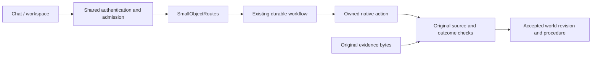

# Fraynix Agent Workspace — edition 166

[Published and fetched receipt](docs/PUBLICATION_166.json) · [Release tag](https://github.com/eyeoverthink/Fraynix-Agent-Workspace/tree/readme-166)

**2026-11-18 UTC · Consolidating the integrated Java agent without losing its evidence.**

[Previous edition](README-165.md) · [Edition history](docs/readmes/INDEX.md) · [Offline interactive guide](docs/readmes/166/index.html) · [Architecture renewal](docs/ARCHITECTURE_RENEWAL_PLAN.md) · [Contributor continuity](README-CONTRIBUTORS.md)

The application connects observations, a persistent simulated world, durable chat requests, browser/canvas tools and checked artifacts. Java owns state and execution; the presentation host supplies rendering and interaction. A successful task must pass its original source and outcome checks. A model's answer is not proof that an action succeeded.

This edition starts the consolidation promised in165. Eighteen existing recorded-object and small-world routes now live in **SmallObjectRoutes**, a capability-named handler with an explicit route table. The server still applies authentication, method/body limits, host admission and busy guards before delegation. Saved parent workflows retain ownership of their children. URLs and controller/tracker defaults are unchanged. This is one tested domain extraction, not a claim that the whole server or workflow runner has been decomposed.

## What was verified

95 selected Java tests, 181 desktop tests and nine archive tests passed. Three actual Chromium midpoint/pose checks passed. Four direct boundary/ownership tests also passed in the small candidate clone. Ten completed edition 165 workflows were reverified; ten new edition 166 workflows completed with eight accepted native revisions, two process interruptions and four saved procedure versions. All ten fresh source/numerical/report comparisons match edition 165 exactly.

The fresh application session mixed eight simulated object actions with two fresh-data report workflows. Two Java interruptions resumed the same parent tasks; four procedure versions were saved. Exact numerical, uncertainty, source and actual-report contents match edition165 after only fresh identifiers are normalized. A same-size report edit with a restored timestamp is rejected. Restoring its original bytes permits verification again.

Ten completed edition 165 workflows were also opened and reverified on a separate project copy. No new native child was added and the eight-revision world stayed unchanged. Original private projects were checked for byte changes. The unchanged native/controller/report and recorded-parent class identities are retained in the evidence. This is a functional compatibility check, not a performance study or new physical validation. No LLM inference was used in these deterministic, explicitly bound requests.


Screenshots show the actual Java/Electron application on 2026-11-18, with historical/generated inputs identified in the receipts. They contain no private webcam frames. The layout still has expert panels and historical labels; broader product simplification remains planned.

## Attempt history

The first saved-workflow compatibility attempt stopped after the original verifier passed its first parent: JavaScript deep comparison distinguished returned -0 from 0 in the retained JSON receipt. The harness now compares both in the receipt's JSON representation, where serialization canonicalizes -0 to 0. The failed result, log, earlier harness and preliminary locks are retained in the external evidence. A subsequent lock-only correction excludes the lock document from its own hash inventory. The first fresh application session passed all ten tasks. The initial historical audit was then stopped because Git mapped about 14.6 GB into its working set. Git object windows are now explicitly capped at 128 MiB, 16 MiB per window, with 32 MiB delta cache. The same full audit was restarted, archive tests repeated, and a second full app session run under a new lock. Both earlier fresh sessions passed. The first small clone built successfully, but an independent exact-source check found 311 originally tracked log files omitted by ordinary git add and current ignore rules. The export now force-adds only the explicit tracked inventory inside its new disposable directory. The first clone and refusal are retained; a new clone is built and every selected source blob compared. The final app session is repeated under the corrected tool lock; reported final comparison uses on-c. The final saved-workflow check passes all ten parents. No source, outcome or acceptance tolerance was relaxed.

The initial full documentation audit was stopped after reading8.62GB through about2.13million small reads. The binary SHA-256 path now uses a64KiB sequential file buffer, retaining the same bytes, hash algorithm, text canonicalization and sharing rule. Four alternating hashes match an existing published binary; a changed copy is refused and its original remains unchanged. These short local timings are affected by caching and do not establish a general speed improvement. The complete documentation check is rerun with every frozen source and link check preserved. This maintenance-tool change does not affect the app runtime or its locked workflow trials.

## Reversible archive rehearsal

The original tracked tree contains 17,965,515,667 bytes, including 17,889,852,146 in docs/readmes. The local candidate contains 97,166,929 tracked bytes including its compressed historical catalog. Its fresh local clone has 47,007,859 bytes of Git metadata/objects and took 16.06 seconds on this machine. 52,362 prior frozen files were verified; 69 edition 164 originals were restored from the archive (78,221,935 original bytes).

Every frozen 001–165 README and snapshot identity was checked against the immutable original Git commit. The catalog records both original byte hashes and the existing text/binary canonical hashes. Edition164 was packed, restored through the archive provider, and compared byte for byte to its Git blobs. Corrupt/missing archives cannot silently fall back to Git. Restore paths must be new and cannot escape their destination.

The candidate is a **local rehearsal**, not the published repository and not a backup. It has one new local commit, no remote, and retains current165 guide assets. Earlier historical images need retrieval. Older evidence still depends on the original repository until explicitly archived. Its Java engine builds and its four boundary/ownership tests pass using this machine's installed JDK and dependency caches. This is not a clean-machine installer test. Main's existing history, snapshots and private projects were not deleted or rewritten.

Original logs, catalog, inventory, legacy archive and workflow receipts are available in the [hash-verified evidence archive](https://github.com/eyeoverthink/Fraynix-Agent-Workspace/releases/download/evidence-166/evidence166.zip). [Retrieval manifest](docs/readmes/166/original-evidence.json) · [Publication/download receipt](docs/readmes/166/evidence-publication.json).

```powershell
python scripts/evidence_archive.py download --manifest docs/readmes/166/original-evidence.json --archive evidence166-local.zip
```

Choose a new download path. The manifest checks the archive and every original member. The enclosed legacy164 archive has its own manifest. `scripts/history_archive.py --help` documents restoring selected catalog paths from that verified archive or the retained original repository. The catalog's expected digest is in [migration results](docs/readmes/166/migration.json). Neither a catalog nor a hash recreates missing bytes.

## Asset inventory and shipping limits

The reproducible inventory covers 366 tracked delivery/media and imported-source files. 39 game-content files are explicitly marked rights-unresolved. Other entries require their own provenance review; they are not automatically marked cleared.

The inventory includes tracked media, delivery resources, levels, license notices, model recipes, vendored binaries and imported source records. Historical snapshot payloads are counted separately. Exact imported-file matches are distinguished from adapted bytes. A matching hash establishes identity, not redistribution permission.

The imported engine has an MIT code notice. The supplied Mario-style images, audio and levels do not have established redistribution rights in the available notices. No application-wide license has been selected. Vendored dependencies still need a complete review, including the unidentified jbox2d version. **The small candidate is not a rights-cleared distribution.** Nothing in this edition grants rights to those assets or removes them from the user's private work.

The actual screenshots retain a known presentation issue: the generic timeline can show a request to choose a persistent/linked-game world while a recorded small-world task has already verified successfully. Expert cost-table headings are also cramped. These issues are visible, not cropped away, and remain for the interface consolidation pass.

## How the boundary works



The extraction moves routing, not authority. Unknown operations refuse. Stale revisions refuse. A direct child resume/stop/cancel/acknowledge cannot bypass its parent. The original simulation, report reconstruction and physical uncertainty are unchanged. No new numbered runtime family was added.

## Running and inspecting it

Use JDK21 and the repository's Gradle wrapper. Build the Java workspace with `gradlew.bat :workspace-engine:installDist`; install the desktop's locked dependencies with `npm ci` in `workspace-desktop`, then run `npm start` there. Keep private project locations separate from test copies. The long-history checkout still needs Windows Git long-path support. The rehearsal does not make the main repository small yet.

[Validation receipt](docs/readmes/166/verification.json) · [Exact workflow comparison](docs/readmes/166/comparison.json) · [Asset summary](docs/readmes/166/asset-summary.json) · [Method lock](docs/DOMAIN_EXTRACTION_166_LOCK.json) · [Source inventory](docs/readmes/166/file-inventory.json) · [Continuity map](docs/obsidian/174-domain-and-archive.canvas)

## Next complete slices

1. Build original replacement assets and an original playable level; verify runtime behavior, then select project licensing with the owner after the dependency inventory. Keep the originals available privately.
2. Migrate another bounded group of historical evidence, verify download and restoration, and establish a second durable copy. Test missing-provider behavior before any separate clean-repository cutover. No destructive history rewrite is implied.
3. Extract the next domain behind the same shared guards. Introduce a capability registry with active/replay-only states and prove old tasks still recover. Retire superseded selection paths one at a time.
4. Consolidate procedure execution into a durable task kernel, then expose the same typed capabilities to external clients. Model planning may choose registered actions; verifiers remain the authority.
5. Simplify everyday presentation to Chat, Mission timeline and Evidence. Keep expert controls available, and test a genuinely fresh installation before claiming a shippable installer.

The destination remains one local integrated agent that observes, proposes, acts and checks consequences in a persistent world. This phase improves its maintainability and distribution path. It does not claim general intelligence, a new trained model, improved physical accuracy, full architecture consolidation, an MCP service or a signed installer. CI was checked first and again before publication: run44249541375 is in_progress / no final conclusion. Local validation and hosted CI status are reported separately.
