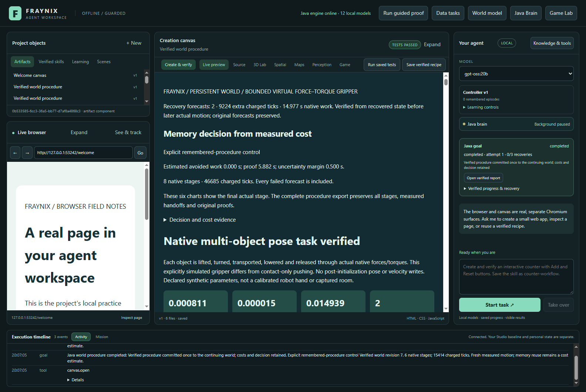

# Fraynix Agent Workspace

**24/24 sequence goals completed; 8 interruptions were explicitly recovered. 4 saved procedures executed after reopening.** Across both blocks, memory took 200.53 s longer over complete streams and 291.14 s longer after charging preparation once.

[Edition097: continuing-world costs](README-097.md) · [Interactive offline results](docs/readmes/097/index.html) · [Previous edition](README-096.md) · [Contributor direction](README-CONTRIBUTORS.md)

One local visual workspace with Java-owned goals, physics, browser and creation tools, retained skills and verified world outcomes. Read the edition for current functions, evidence, limits and next steps.

## What the application does

- Java maintains durable goals, typed tools, original evidence, explicit recovery and retained procedures.
- The integrated workspace includes chat, browser and creation surfaces, the original game/runtime and native 3D world tools. Their earlier validation remains linked in the edition history.
- Edition097 measures continuing world history and growing verified memory. It preserves current controllers and every source/outcome check; it does not add a new language model or claim physical accuracy.

The canvas displays the recovered sixth-goal report (world revision 6). The right goal panel and timeline show the later saved-skill demonstration (revision 7); they are different tasks. Controller v1 is a separate legacy episode bank, not the seven-entry procedural bank. A selected model name does not imply model inference ran.

See the full [README097](README-097.md) for setup, step-by-step reproduction, results, current limits and the next acceptance gate.
