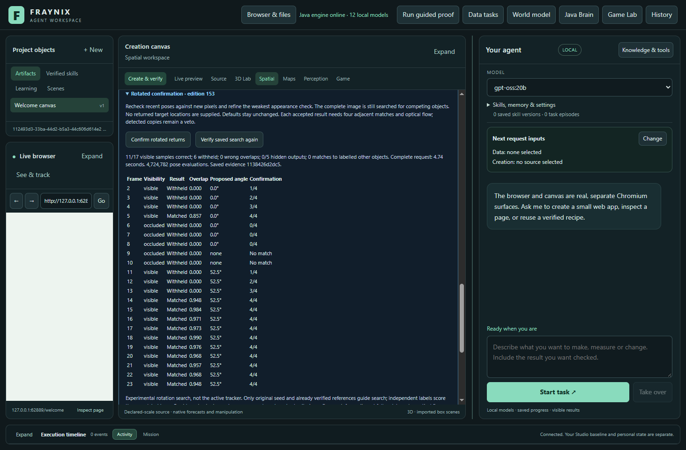
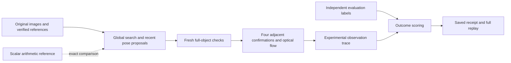

# Fraynix Agent Workspace — edition 153

[Published and fetched receipt](docs/PUBLICATION_153.json) · [Release tag](https://github.com/eyeoverthink/Fraynix-Agent-Workspace/tree/readme-153)

**Confirm rotated returns, preserve identity checks, measure the cost.** 2026-11-16.

[Previous: edition 152](README-152.md) · [All editions](docs/readmes/INDEX.md) · [Offline interactive guide](docs/readmes/153/index.html) · [Verification](docs/readmes/153/verification.json)

The explicit Java experiment confirms 23/30 returned frames on the exposed camera recording, versus 0/30 with edition 152. It has 31/42 correct visible/partial observations, 11 withheld, 0 wrong overlaps, 0/30 hidden outputs and 0 matches to the labelled red object. Both new rendered return cases recover correct observations; wrong-only, changed-quadrant and identical-copy returns are refused. The paired search measurement is 4.35× faster with exactly identical scalar/optimized traces. Defaults remain unchanged; this is recorded evidence, not fresh physical validation.

## The working application

The Java workspace still connects the persistent world, physics, Game Lab, browser, canvas, durable tasks and saved procedures. This edition improves one part of that system: deciding whether an object that disappeared has returned at a changed orientation. It does not replace the application with a tracking demo. An observation must retain its source, uncertainty and verification before a later agent task can rely on it.

Open **Spatial → Object identity → Rotated confirmation · edition 153**. Select an independently audited recording, click **Confirm rotated returns**, and watch the progress through original source checks, image search and outcome scoring. The result shows accepted and withheld observations, wrong overlaps, hidden outputs, labelled other-object matches, proposed angles and confirmation counts. **Verify saved search again** reconstructs the result from the original pixels and compares the entire saved trace.

The experiment is optional. The default remains `legacy-flow`; the edition 152 comparison remains available. No experimental result silently changes a world body, adds an appearance to memory or authorizes a physical action. An angle in this panel is an image-search hypothesis, not a calibrated measurement of an object's physical pose. Existing coordinates, native physics and durable task evidence keep their original meaning.

The app runs one calculation per experiment service and displays image progress while it works. Completed results have content-derived identities; incomplete work does not receive a completed receipt. Each service retains at most four process-local job statuses and 64 saved experiment results. Restarting loses a progress token, but the original comparison can be run again. Saved results are checked through full reconstruction, not trusted because they were present on disk.

## What edition 152 exposed

Edition 151 diagnosed the shifted camera return using independently labelled crops. Edition 152 then searched the complete image without supplied return locations. Its proposals overlapped the target in all 30 returned frames of the exposed camera recording. Eleven frames had a strong full-object match, but the longest same-reference confirmation sequence reached only three; four were required. No returned frame was accepted.

That separated two problems: finding a plausible location and maintaining sufficient evidence to confirm identity. Repeating the global search from scratch discarded useful pose hypotheses between frames. Refinement also optimized overall correlation while another mandatory appearance check could still fail. A high correlation alone was never meant to establish a valid match.

Edition 153 addresses those search limitations. It does not fill a missing observation with a prediction, lower a threshold to make a camera result pass, or use independent evaluation boxes as search inputs. The exposed recording remains development and regression evidence. The user selected **recorded tests only** for this edition; no new webcam recording occurred.

## Fresh pixels at every confirmation

The new Java search retains a recent strong, unique pose for each original source reference for at most three frames. That pose is only a candidate location, scale and angle. On the next image, it samples the new pixels and recomputes all appearance checks. It never reuses the old score. The complete global search still runs, including disjoint competitors, so a recent pose cannot hide another matching object elsewhere in the image.

Global proposals retain the existing 24 starting orientations, three scales and reference-dependent 1–4 pixel grid. Each orientation and scale retains separated hypotheses through refinement. The four best global candidates receive an additional bounded refinement aimed at the weakest normalized acceptance criterion. A recent pose receives the same fresh refinement. When a fully passing candidate exists, it is considered before a higher-correlation candidate that fails another required check.

All mandatory appearance criteria remain unchanged:

| Check | Requirement |
| --- | --- |
| Full-object correlation | At least 0.94 |
| Mean RGB error | At most 0.10 |
| Worst quadrant error | At most 0.14 |
| Gradient agreement | At least 0.85 |
| Disjoint-rival margin | More than 0.08 |

Four adjacent observations must pass for the **same original reference**. Optical flow must agree with the newly sampled box, including the existing minimum inlier count, forward/backward consistency and overlap checks. Missing or failed evidence resets confirmation. A detected competing match remains a persistent veto. Neither a previous acceptance nor a forecast can replace a current full-object match.

Recent pose proposals are not learned appearances. The original seed and already verified source descriptors remain immutable. No returned image is automatically promoted into reference memory. A visually indistinguishable substitution that occurs entirely under a cover remains unresolved without an independent witness. Successful rejection of the test copies does not establish universal object identity.

## Faster arithmetic, the same search

There are two implementations of the edition 153 arithmetic: a direct scalar reference and a precomputed path used by the explicit app experiment. The optimized path calculates frame grayscale values once and prepares the rotated sampling terms once per search orientation and scale. It preserves the original expression order where rounding can affect which source pixel is sampled.

Both implementations visit the same proposal grid, retain the same competing hypotheses and execute the same refinements, appearance checks and confirmation rules. Optimization does not skip a rival search, label check, source hash, outcome reconstruction or corruption test. The full camera trace and each new generated-control trace are compared exactly between the two paths, including poses, scores, confirmations, refusals and evaluation counts.

The full recorded search took **376.11 seconds** in scalar mode and **85.52 seconds** with precomputation. All 72 output rows are exactly equal. Three alternating paired short-sequence timings have medians of **30.78 seconds** and **7.07 seconds**, a **4.35×** ratio. Every original image is rehashed after measurement. The actual camera app request took **221.42 seconds** and cold restarted verification took **221.55 seconds**. [Exact measurements](docs/readmes/153/qualification.json) retain all paired values.

Measurements used Java 21 with two active processors and a 768 MiB heap. The isolated search measurement decodes its source images before timing; the complete app request includes decoding and evidence verification.

The repeated timing comparison alternates execution order and includes tracker initialization plus a fixed short sequence. It does not retain a score cache between measurements. These are CPU measurements on this machine, not a hardware-independent speed guarantee. Full app request timings include original verification, search, independent scoring, fingerprint checks and saving; they exclude the preceding source import, baseline run and screenshot capture. Cold restarted verification is measured separately. The original source verifier can still dominate total latency.

## Results: control, earlier search and new confirmation

| Source | Original control correct | Edition 152 correct | Edition 153 correct | Correct returned frames | Missing | Wrong / hidden / other outputs | Complete request seconds |
| --- | ---: | ---: | ---: | ---: | ---: | --- | ---: |
| return-53 | 4/17 | 11/17 | 11/17 | 10 | 6 | 0 / 0 of 5 / 0 | 4.74 |
| moving-return-minus113 | 4/17 | 11/17 | 11/17 | 10 | 6 | 0 / 0 of 5 / 0 | 4.11 |
| wrong-only | 4/4 | 1/4 | 1/4 | 0 | 3 | 0 / 0 of 18 / 0 | 3.97 |
| near-copy-only | 4/4 | 1/4 | 1/4 | 0 | 3 | 0 / 0 of 18 / 0 | 4.04 |
| copy-veto | 4/17 | 1/17 | 1/17 | 0 | 16 | 0 / 0 of 5 / 0 | 4.09 |
| exposed150-camera | 11/42 | 8/42 | 31/42 | 23 | 11 | 0 / 0 of 30 / 0 | 221.42 |

On the exposed recording, 23 of 30 returned frames are accepted correctly. The remaining 7 are withheld. The total is 31/42 correct visible or partial observations, compared with 8/42 for the separate edition152 experiment and 11/42 for the original149 run. No hidden frame or labelled red object is accepted. These results use the same original source images, run and labels; the complete trace also matches the independently executed scalar measurement. They establish improvement on this exposed recording, not general physical accuracy or fresh-camera performance.

The original control column is `legacy-flow` for the generated cases and the unchanged original 149 run for the earlier camera recording. The edition 152 column records its separate experimental comparison. A new confirmation delay reduces initial recall; the new experiment is not silently merged with incumbent continuity. Missing, wrong and hidden outputs remain part of the result rather than being trimmed away.

The five new rendered sequences have independent fixed source geometry and labels created before tracking. They contain a 53° return, a moving return rotating from −113° toward −101°, a wrong-pattern-only return, a similar object with one altered quadrant, and a target accompanied by an identical competing copy. Each includes a clear original reference and a full-cover interval. The source generator calls no tracker. A separate Python calculation checks every labelled corner and the visibility schedule without using predictions.

These are generated software controls, not new footage. They test specified rotation, motion and ambiguity cases. The red lighter in the exposed camera recording provides useful negative evidence but is visibly different from the black target. The rendered near-copy and identical-copy controls extend the rejection checks; they do not substitute for new physical lookalike footage.

Qualification gates were committed before the reserved sequences were rendered: both positive cases must recover correct returned observations; negative and copy cases must have no accepted returned observations; all cases must have no wrong overlaps, hidden outputs or labelled other-object matches. Arithmetic equivalence must be exact. The paired optimized search must be faster on its declared measurement. Execution checks and outcome gates are recorded separately.

## Verification and preserved evidence

26 selected Java checks and 164 desktop checks passed, with no failures or skipped cases. Five generated app comparisons and one exposed-camera comparison passed execution, restart and source-integrity checks. Scalar and optimized traces match exactly on all six sources. Independent source geometry and separate outcome/cost gates passed. These are scoped checks, not a rerun of every historical capability. The user selected recorded tests only.

The Java checks cover four-frame confirmation, disappearance and return, wrong patterns, a changed-quadrant near-copy, persistent competing-copy refusal, altered descriptors, changed image dimensions and interruption. Service checks cover bounded background concurrency, detached status values, cold reconstruction, changed evaluation labels producing the same tracking trace, forged outcomes with recomputed checksums, same-size/time source corruption, and unchanged original state.

Actual Electron/Java app studies execute the visible controls, use independently labelled sources, verify saved results, close and reopen the study's own app, and reproduce the complete trace. They alter a source byte without changing file size or timestamp, require refusal, then restore the exact original bytes. Original evidence namespaces and native world state are compared after closing the study-owned app. Existing private projects are copied for testing and remain unchanged.

The first eight-check development suite passed. The exposed fast development replay produced 23 correct returned observations; it was not a held-out result. The implementation and qualification gates were committed before rendering the five reserved sources. The final regression, arithmetic comparisons and actual-app evidence are retained separately. No failed reserved app attempt is omitted; the recorded final attempts passed their execution checks.

The experiment records original dataset, run and audit identities. Source and implementation fingerprints are checked before and after computation. Independent labels score the completed trace; returned coordinates and visibility cannot enter the search. Verification reconstructs the complete experimental trace before accepting a stored receipt. Adding or changing evidence elsewhere in the conservatively fingerprinted namespaces can require a new calculation. That cost and invalidation behavior remain explicit.

Public screenshots omit private camera pixels. Public evidence archives retain original non-pixel result receipts and their hashes; they cannot replace the private source images or original descriptors in a verifier. The generated-source program is included for reproducibility. Historical README editions and their frozen assets are not rewritten to describe this newer behavior.

The first publication audit refused the release before any push because Git normalized the method-lock JSON line endings. The original study hash referred to its exact Windows bytes. A narrow Git attribute now preserves those original bytes; no source hash, receipt, outcome or acceptance criterion was relabelled. The refused audit log and original lock are retained in the evidence index, and the corrected release receives the same full audit.

## Source map and reproducible work

| Source | Responsibility |
| --- | --- |
| [RotationSearch153.java](workspace-engine/src/main/java/fraymus/workspace/RotationSearch153.java) | Global proposals, fresh pose rechecking, balanced refinement and both arithmetic paths |
| [RotationReturn153.java](workspace-engine/src/main/java/fraymus/workspace/RotationReturn153.java) | Same-reference confirmation, flow checks and persistent ambiguity veto |
| [RotationExperiment153.java](workspace-engine/src/main/java/fraymus/workspace/RotationExperiment153.java) | Background work, evidence boundaries, independent scoring and exact replay |
| [Application panel](workspace-desktop/renderer/association134-panel.js) | Real controls, progress, tables and visible refusals |
| [Study harness](docs/publication153/study153.cjs) | Actual UI, restart, corruption and unchanged-world checks |
| [Recorded comparison](docs/publication153/RotationMeasure153.java) | Exact scalar/optimized trace comparison and repeated timings |
| [Source generator](docs/publication153/RotationSources153.java) | New deterministic images and independently declared geometry |
| [Qualification gates](docs/publication153/qualify153.py) | Separate correctness, rejection and cost gates |

Use the [workspace launcher](scripts/Start-Agent-Workspace.ps1) with a separate project for evaluation. The study harness verifies the installed build receipt before launching. Its generated group uses the reserved source manifest; its exposed group copies the retained original camera project. Do not point experiments at an active private project or substitute a public summary for missing source images.

The [frozen method](docs/OBSERVATION_153_LOCK.json), [source inventory](docs/readmes/153/file-inventory.json), [evidence index](docs/readmes/153/original-evidence.json), [qualification result](docs/readmes/153/qualification.json) and [Obsidian map](docs/obsidian/161-rotated-confirmation.canvas) link the implementation to its measured result. The offline guide provides source filtering, component navigation, case comparisons and actual screenshots without a CDN.

## Next gates

1. **New physical identity tests.** Use separately labelled footage with changing rotation, partial covers, full disappearance, re-entry and a genuinely similar physical distractor. Keep exposure history and incomplete attempts. Do not promote this method from the exposed recording alone.
2. **Preserve useful incumbent continuity.** Test a controlled combination that keeps valid original observations and adds only independently verified returns. Account for the confirmation delay; do not count a withheld correct observation as an improvement.
3. **Reduce complete workload cost.** Profile original replay, image decoding, refinement, source hashing and persistence separately. Reuse computation only under exact source/code/outcome identities, with the existing mutation and restart refusals retained. This experiment is still offline, not a live-camera throughput claim.
4. **Reconnect verified observations to durable tasks.** Let a chat-driven report, chart or working artifact use the qualified episode with original evidence links. Keep measured, predicted and unknown states distinct. The unified Java world and creation workflow remain the destination.

The useful advance is evidence-backed confirmation in a bounded perception task, with measured computational savings. It is not a claim of general object recognition, unrestricted physical agency, new language-model training or solved real-world accuracy.
