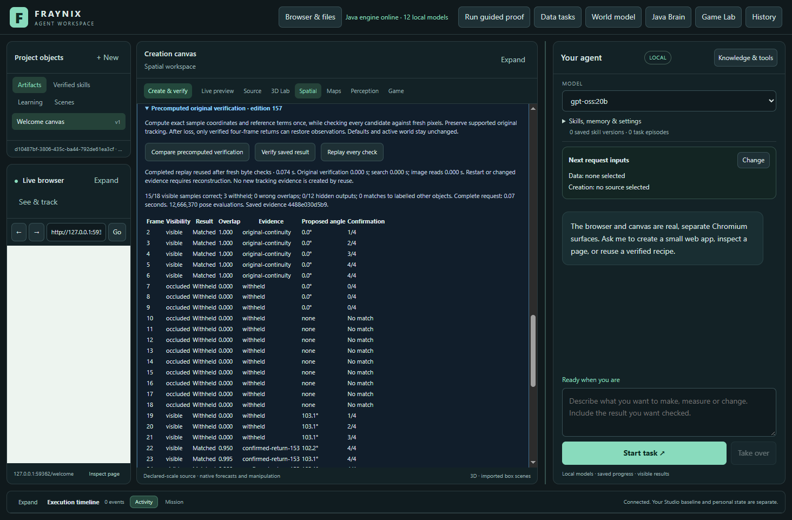
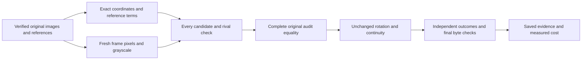

# Fraynix Agent Workspace — edition 157

[Published and fetched receipt](docs/PUBLICATION_157.json) · [Release tag](https://github.com/eyeoverthink/Fraynix-Agent-Workspace/tree/readme-157)

**Exact evidence, fewer repeated calculations.** 2026-11-17.

[Previous: edition 156](README-156.md) · [All editions](docs/readmes/INDEX.md) · [Offline guide](docs/readmes/157/index.html) · [Validation](docs/readmes/157/verification.json)

Edition 157 reconstructs exactly the same evidence while reusing exact sampling coordinates and immutable reference calculations on fresh frame pixels. The exposed camera trace remains 34/42 correct observations, 8 withheld, 0 wrong overlaps and 0/30 hidden outputs, identical to 156. All three app comparisons reproduce exact reference evidence. 2/2 new generated cases meet their separate behavioral targets. Complete paired costs include the original verification. Defaults remain unchanged. On two alternating exposed-camera pairs, complete forced verification measured 147.26 seconds through published 156 and 135.86 seconds with precomputed terms (7.7% less time).



## The application and this step

Fraynix remains one local agent workspace: Java owns persistent world state, physics, observations, goals, actions and verification; the desktop supplies the browser, creation canvas and views into that runtime. The Game Lab, durable procedures, data tasks and creation tools remain part of that design. Perception supplies evidence to the agent. A proposed action still needs an outcome check, and a proposed interpretation still needs a source.

Edition 156 reduced original-verification cost by converting a decoded image to packed RGB once. It preserved the complete historical result. This edition profiles what remains and removes repeated calculations from the same original matcher. It adds an explicit comparison, with a reference path that executes the published 156 implementation. It does not change the default tracker or claim another improvement by comparing only with the much older149 path.

No new dependency, model download, GPU requirement or parallel search was added. The application retains its existing desktop, graphics, JSON and physics dependencies. Tests use recorded material and generated controls. No webcam or model inference call ran for this study. A model name visible in an app screenshot does not establish that the model was invoked.

## What the profile identified

One complete exposed camera audit was profiled using Java Flight Recorder against the installed156 implementation, in a separate project copy. The original project inventory was checked before and after. Across 6,606 execution samples, the original full-object matcher's sampling, full comparison, grayscale and correlation methods account for approximately 57% of leaf samples. Sampling alone accounts for about 30%. These are sampled execution proportions, not exact elapsed-time fractions. The profile includes setup and inventory work and incurs profiler overhead.

This evidence points to repeated image sampling and scoring arithmetic. It does not justify dropping source checks. The profile's filtered execution stacks, counts and receipt are retained through the [evidence index](docs/readmes/157/original-evidence.json). The raw JFR container stays local; the published export contains execution-stack events rather than the recording's broader process metadata.

## What changed

`StructureReplay157` keeps the original grid, scales, refinement loops, candidate order, comparison thresholds, gradients, rival checks and evaluation counts. Its precomputed path changes when repeated values are calculated:

- It calculates horizontal sampling coordinates once per candidate row layout, using the exact original arithmetic and clipping. Vertical coordinates are calculated once per row. Every sampled pixel location remains identical.
- It calculates grayscale from each fresh source pixel once per frame. Normalization occurs before weighting, preserving the original floating-point operation order.
- It derives grayscale, sums, squared sums and gradient terms from each immutable reference once. Reference descriptors still undergo their original integrity and range checks.
- It uses bounded scratch arrays for sample indices, with no retained candidate scores. Every candidate's correlation, colour error, quadrant error and gradient agreement are computed against current-frame values.

The grayscale and RGB frame arrays are discarded after the search. Together they require at most about 24.9 MB for the existing 1920×1080 image bound, plus small sample and reference arrays. The parent tracker and optical flow still receive the unchanged decoded image. Their implementation and interpolation do not change. Neither source labels nor predicted positions provide returned-object locations.

The exhaustive RGB check tests all 16,777,216 RGB colours against the original operation order using exact double bit comparisons. Other checks compare complete matches, evaluation counts and traces through encodings, image borders, fractional coordinates, movement, loss, return, wrong objects and monitor-only mode. This establishes computational equivalence within the checked implementation; it does not establish that the historical perception policy is always correct.

## Historical evidence remains historical

The old 149, 155 and 156 classes remain unchanged. `OriginalAudit157` uses the new exact replay only for supported original149 audits. Its reference mode calls the published 156 verifier. Other original policies retain their historical verification path.

An existing audit is not relabelled with a new tracker identity. Verification checks its saved checksum, completed run, original code identity, source association, frame order, reference provenance, image hashes, object bindings, complete trace and independently calculated scores. The reconstructed audit must equal the entire saved result, including negative outcomes. Surrounding 157 evidence separately binds the new implementation bytes.

Fresh source and code-byte snapshots still run before and after reconstruction. Changing an image while retaining its size and timestamp does not qualify for reuse. Rehashing a forged summary does not turn it into a verified outcome. Missing observation history is refused rather than silently recreated. The native world, original observation history and verified appearance bank remain unchanged by this comparison.

## Use the comparison

1. Open the workspace with the intended private project and its original source files available.
2. Open **Spatial → Object identity · occlusion & recovery** and select a completed labelled comparison.
3. Expand **Precomputed original verification · edition 157** and click **Compare precomputed verification**.
4. Inspect correct, withheld, wrong-object and hidden-object outcomes separately. An angle is a search hypothesis, not calibrated physical orientation.
5. Use **Verify saved result** to reopen a result with fresh source/code byte checks. An unchanged same-process result may reuse a completed calculation.
6. Use **Replay every check** for complete reconstruction. Restarting clears process-local reuse and also requires reconstruction.

Progress is not completion. The comparison runs in a bounded background job and reports original-audit, search, image-read and total costs separately. An interrupted job cannot publish a completed receipt. The default remains `legacy-flow`; this panel does not admit appearances automatically, change the world or authorize physical action.

## Observed outcomes

| Source | Original correct | Nested 153 correct | Edition 157 correct | Withheld | Wrong / hidden / other | Full request s | Warm median s |
| --- | ---: | ---: | ---: | ---: | --- | ---: | ---: |
| long-cover-return | 5/18 | 12/18 | 15/18 | 3 | 0 / 0 of 12 / 0 | 31.90 | 0.074 |
| near-copy-only | 5/5 | 2/5 | 5/5 | 0 | 0 / 0 of 22 / 0 | 26.98 | 0.071 |
| exposed150-camera | 11/42 | 31/42 | 34/42 | 8 | 0 / 0 of 30 / 0 | 138.06 | 0.147 |


The complete camera trace, scores, source identities and candidate counts equal published 156. Accuracy remains 34/42, including the same 23/30 confirmed returned frames. Eight observations remain withheld: seven returned frames and one earlier partial view. Original-audit optimization adds no new acceptance or physical-accuracy claim. 11 original camera boxes remain numerically unchanged.

Two new generated evaluation sources use previously unused 157-pattern material: a long full occlusion followed by a translated 103° return, and a near-copy with a changed quadrant after the original disappears. A separate stationary donor source supplies the verified starting reference. Its background differs, and donor/evaluation image bytes cannot overlap. All sources and independent labels are imported before tracking. The implementation and qualification method are committed before generating the reserved inputs.

The Java source generator records known geometry without calling a tracker. An independent Python calculation checks the schedule and bounds using half-extents rather than Java's four-corner enumeration. These are generated controls, not fresh physical footage. The camera is the exposed edition 150 recording, reused only as regression evidence.

The original column is the actual initial tracking run. Nested 153 denotes the unchanged rotation-confirmation component; it is not a separate application run or the published 156 timing comparator. All withheld observations count against recall. Rejecting a near-copy is useful evidence, but it does not show that visually identical hidden substitutions can be resolved. The black/red lighter recording is not a strong same-colour lookalike test.

## Complete costs

On the exposed camera, the first complete request took **138.058 seconds**; explicit full replay **136.344 seconds**; cold restarted verification **141.971 seconds**. Three unchanged warm readings had a median of **0.147 seconds**.

| Complete forced comparison | Published 156 median s | Precomputed terms median s | Pairs | Ratio | Original audit phase, 156 → 157 s |
| --- | ---: | ---: | ---: | ---: | --- |
| generated | 33.153 | 30.310 | 3 | 1.094 | 25.989 → 23.154 |
| camera | 147.262 | 135.861 | 2 | 1.084 | 90.155 → 78.802 |

Three alternating pairs measure the generated long-occlusion return case; two pairs measure the exposed camera. The other generated case has one complete 156/157 pair. All produce identical complete evidence and unchanged project inventories. Java 21, two active processors and a 768 MiB heap. These repeated local measurements do not guarantee a universal speed advantage. [Every timing](docs/readmes/157/qualification.json), including phase costs, remains available.

Every paired measurement reconstructs the same saved 157 result through either the published 156 verifier or the new precomputed verifier. Each request starts with new verification stores and forces replay. It includes source and reference checks, original-audit reconstruction, unchanged rotation search, confirmation, independent scoring, final source snapshots and saved-result equality. Source importing, baseline-run production, store construction, process startup and screenshot capture remain separate costs. Execution order alternates. Every complete result and project inventory must match.

The development probe measures only original verification. The profile measures an exposed audit with profiler overhead. Neither substitutes for complete paired measurements. Actual app first requests, forced replay and restarted requests are reported individually because their timings can differ from the command-line measurements.

Warm reopening is another distinct workload. Reuse remains bounded to eight process-local results, with a four MB serialized-result bound and fresh byte checks. No persisted trust survives a restart. A quick reopened receipt is not a live-camera frame rate. Complete reconstruction remains a substantial workload, and measured local gains do not guarantee the same speed on other hardware or sources.

## Verification and reproducibility

57 selected Java checks and 164 desktop checks passed, with no failures or skipped cases. Two new generated app comparisons and one exposed-camera comparison passed visible-control, forced-replay, cold-restart and source-integrity checks. Complete reference/precomputed evidence matches exactly. Independent geometry and exact-evidence gates passed; harder behavioral targets and measured cost benefit are reported separately. These are scoped checks, not a rerun of every historical capability. Recorded tests only.

The new checks retain refusal coverage for source and donor-image corruption, modified run traces, changed code and reference provenance, forged checksums, changed labels, missing history and cancellation. The actual Electron/Java studies exercise the visible compare/read/force controls, take three warm readings per case, restart their owned app, alter and restore a source byte, and compare original evidence namespaces and native worlds afterwards. Private camera pixels are excluded from public screenshots before capture.

An exposed original-audit development probe took 90.938 seconds through the published 156 path and 80.873 seconds with exact precomputed terms, with complete audit equality and unchanged source files. This probe excludes the full rotation experiment. The 13 new checks passed before 44 selected regression checks; their distinct results cover the same final Java implementation. The method and qualification gates were committed at a10a6ce5 before rendering the reserved sources. The first generated and camera application attempts passed their execution checks; no failed reserved app attempt was omitted.

With Java 21 and the existing desktop dependencies installed, run the focused checks from the repository root:

```powershell
.\gradlew.bat --no-daemon --max-workers=1 :workspace-engine:test --tests fraymus.workspace.OriginalReplay157Test --tests fraymus.workspace.ContinuityExperiment157Test
npm --prefix workspace-desktop test
```

The [validation driver](docs/publication157/validate157.py) records the separate 44-check regression and installed build/helper compilation. The [study driver](docs/publication157/run-studies157.py) records sequential generation, independent labels, actual controls and paired measurements. A matching method lock and current [installed-build stamp](scripts/Study-Build095.cjs) are required. Study outputs are one-use so reruns cannot overwrite original evidence.

The generated controls are reproducible from published code. The camera study requires the owner's private 150 project at the recorded path; the images are not in Git. Another machine must identify its own study and private-source location. A public clone alone cannot reproduce that camera result. Run heavy checks sequentially. Hosted CI is reported separately from local checks; these checks do not rerun every historical application capability.

## Architecture and continuity



| Responsibility | Source |
| --- | --- |
| Exact sampling and scoring | [StructureReplay157](workspace-engine/src/main/java/fraymus/workspace/StructureReplay157.java) |
| Complete identity replay | [IdentityReplay157](workspace-engine/src/main/java/fraymus/workspace/IdentityReplay157.java) |
| Original audit and 156 reference | [OriginalAudit157](workspace-engine/src/main/java/fraymus/workspace/OriginalAudit157.java) |
| Source-bound replay reuse | [ReplayEvidence157](workspace-engine/src/main/java/fraymus/workspace/ReplayEvidence157.java) |
| Complete experiment and timing | [ContinuityExperiment157](workspace-engine/src/main/java/fraymus/workspace/ContinuityExperiment157.java) |
| Frozen method and measurement | [Plan](docs/publication157/plan157.md), [qualification](docs/publication157/qualify157.py), [paired measurement](docs/publication157/ReplayMeasure157.java) |

The [offline guide](docs/readmes/157/index.html) includes actual captures, case and cost tables, module links and searchable source inventory without remote assets. The [Obsidian note](docs/obsidian/165-precomputed-verification.md) and [canvas](docs/obsidian/165-precomputed-verification.canvas) link this phase to the unified application. Earlier numbered READMEs and frozen evidence are preserved.

Next, use complete-request profiles to select any remaining worthwhile optimization, then exercise verified observations in durable world/browser/creation tasks. Those tasks must carry uncertainty, source identities and withheld observations into their decisions. This phase makes evidence cheaper to reconstruct; it does not establish better physical accuracy, semantic recognition, model training or general intelligence.