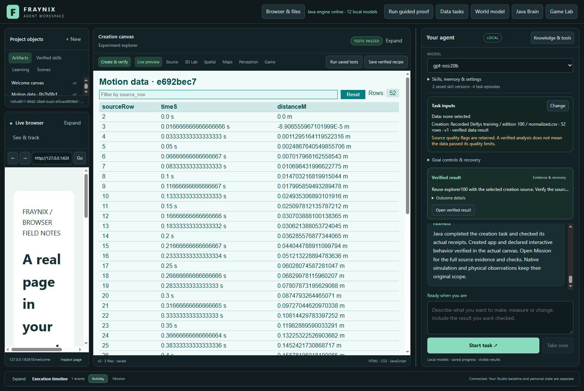

# Fraynix Agent Workspace

Edition100 connects verified data analysis to real, model-created content in the same application. Select a checked result, review its behavior checks, build a working explorer and reuse the saved procedure with fresh data.

[Edition100: verified data becomes working content](README-100.md) · [Offline guide](docs/readmes/100/index.html) · [Previous edition](README-099.md) · [Contributor direction](README-CONTRIBUTORS.md)

Java owns durable goals, physics, tools, verification and retained procedures. Chat, browser, creation canvas, original Game Lab and spatial views share those capabilities.

Publication receipt follows the actual push and fetched-content audit.
