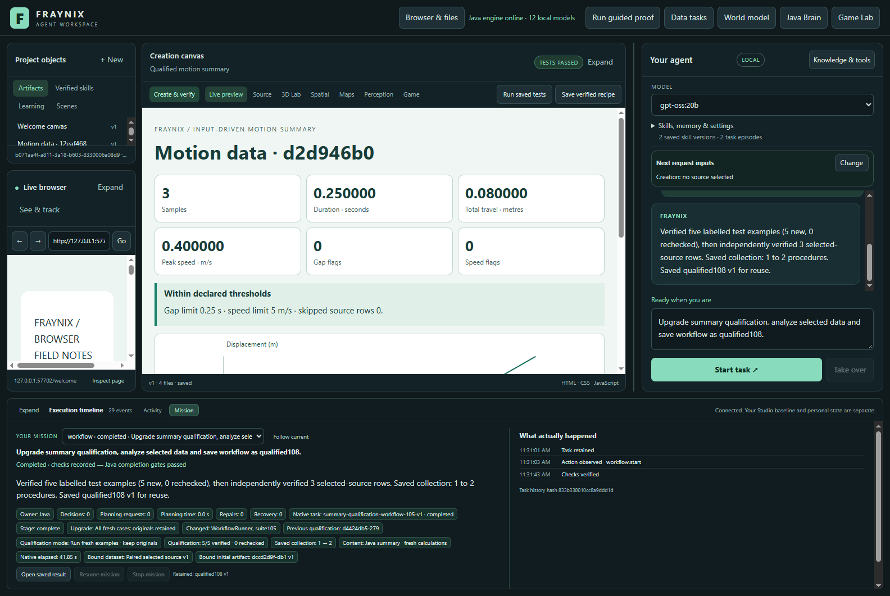

# Fraynix Agent Workspace

Edition108 adds explicit, verified qualification upgrades across Java coordination changes. It retains old evidence, runs every fresh example, survives interruption and verifies before saving.

[Edition108: functions, evidence and next steps](README-108.md) | [Offline guide](docs/readmes/108/index.html) | [Previous edition](README-107.md) | [Contributor direction](README-CONTRIBUTORS.md)

Seven actual requests complete; five refuse correctly. Every source and outcome check remains.

Java owns durable goals, tools, verification, recovery and memory. Chat, browser/canvas, spatial views and Game Lab remain integrated.

Published to main. [Fetched GitHub verification](docs/PUBLICATION_108.json).
