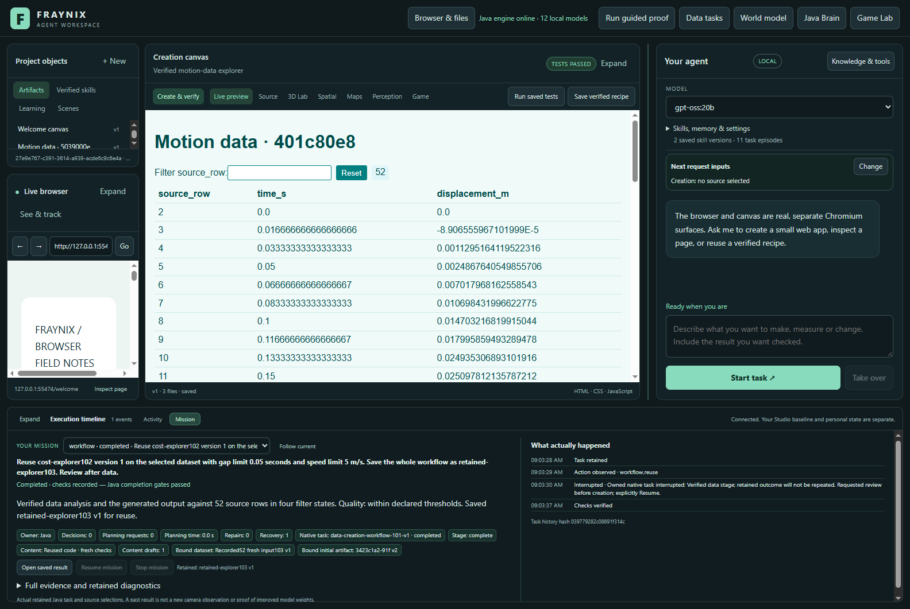

# Fraynix Agent Workspace

Edition103 reuses verified implementations with fresh data and every original source/outcome check. Three requests completed; three incompatible or corrupted candidates were correctly refused. No new content-generation calls were needed in the six measured reuse trials.

[Edition103: functions, measurements and next steps](README-103.md) · [Interactive offline guide](docs/readmes/103/index.html) · [Previous edition](README-102.md) · [Contributor direction](README-CONTRIBUTORS.md)

Java owns durable goals, physics, tools, verification and retained procedures. Chat, browser, creation canvas, Game Lab and spatial views share those capabilities.

Publication receipt is added after the actual main/tag push and fetched verification.
