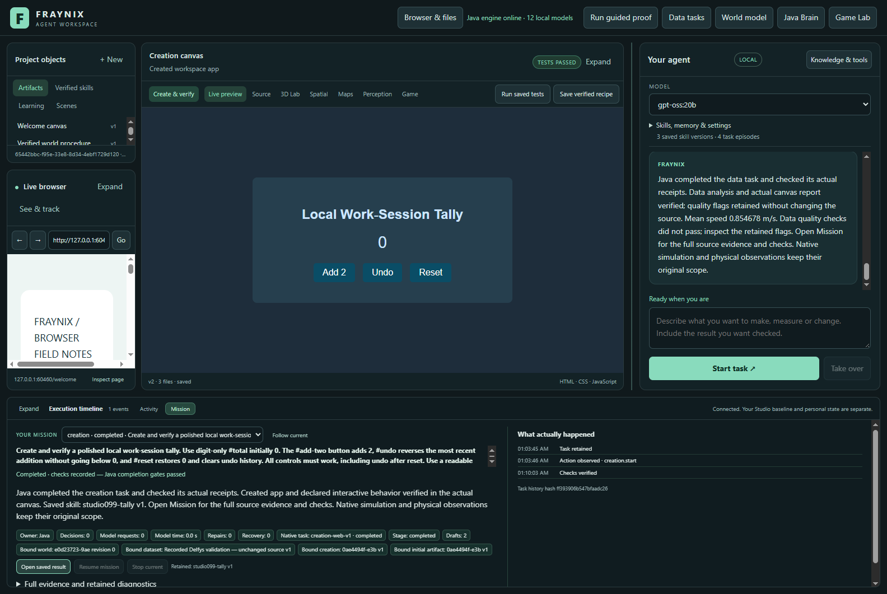

# Fraynix Agent Workspace

Edition099 makes the same integrated workspace easier to use and tests complete world, recorded-data and creation requests through the installed local gpt-oss:20b model. A fourth request reuses a saved data procedure after a cold restart.

[Edition099: layout and real local-model workflows](README-099.md) · [Offline guide](docs/readmes/099/index.html) · [Previous edition](README-098.md) · [Contributor direction](README-CONTRIBUTORS.md)

Java owns durable goals, physics, tools, verification and retained procedures. Chat, browser, creation canvas, original Game Lab and spatial views share those capabilities.

Published to main. [Fetched GitHub verification](docs/PUBLICATION_099.json).
